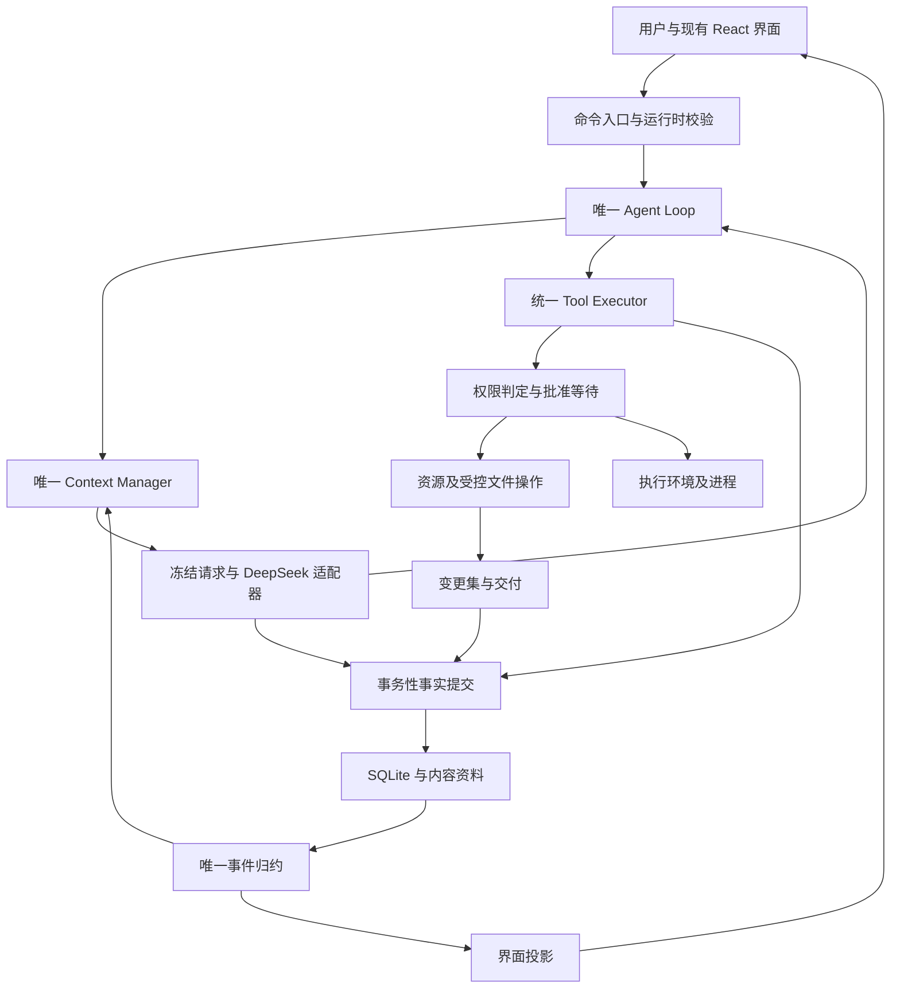

# Umi 架构与职责 v1

日期：2026-10-04（Asia/Shanghai）。阶段 1 为设计基线；阶段 2—4 的核心、资源、命令和上下文已实现。阶段 5 Electron 与 React 对接、预算阻塞恢复已实现。最新实际范围见 [阶段 5 报告](stage-5-report.md)。

## 1. 目标与范围

重构现有 Work 链，统一职责、事实来源、协议、权限及恢复。保留已有可用行为和用户调整的前端风格。

第一版只实现 DeepSeek。模型调用位于适配接口之后，未来提供方通过同一接口接入。项目只拥有一个任务循环。

用户只需要：选择初始工作区、描述目标、补充或纠正要求、决定权限请求。内部计划、候选资源查找、实现步骤、路径防护和执行核验由系统与 Agent 完成。

本文与 [核心契约](contracts-v1.md)、[迁移验收](migration-and-acceptance.md)共同构成设计基线。遇到冲突时，以明确的契约编号为准，修订必须同步更新三个文件。

## 2. 技术与进程方向

| 项目 | 第一版决定 | 理由及边界 |
|---|---|---|
| 核心语言 | TypeScript，严格类型检查 | 前端与核心共享协议；外部数据仍需运行时校验 |
| 无界面运行环境 | Node.js 24 LTS | 本机已检测到 v24.11.0；阶段 2 固定可复现版本和依赖锁 |
| 数据库 | SQLite，单逻辑写入者 | 事务、唯一约束、外键、恢复检查明确；数据库端口隔离驱动 |
| SQLite 驱动 | 阶段 2 使用 Node 24.11.0 的 `node:sqlite` | SQLite 3.50.4；已验事务与重启，API 仍有实验性警告；Electron 内嵌版本后续验证 |
| 模型协议 | 主循环先采用 DeepSeek Chat Completions | 对应旧模型调用语义；思考回传及工具配对必须经过真实协议验证 |
| 搜索传输 | 保留旧代码可用的 DeepSeek Anthropic 兼容搜索语义 | 搜索作为工具能力；其内部请求不建立第二条 Agent 循环 |
| 界面 | 复用现有 React 界面 | 通过共享事件投影对接，不以此次迁移重新设计样式 |
| 桌面进程 | Electron 主进程＋Agent utility process | 通道、就绪、退出及重连由应用明确管理 |
| 可选执行环境 | Docker、WSL 分别接入 | 核心不负责安装、启动或维护二者的组合子系统 |
| Python | 专业工具子进程 | 文档、表格等需求出现后再接入；不承担 Agent 调度 |

阶段 2 已固定 TypeScript 7.0.2、Zod 4.6.5、Node 类型 24.10.0，主模型客户端采用 Node 原生 fetch。阶段 3A/3B 使用同一循环、仓储与协议接入资源、交付、回收站和受批准命令；未创建未来桌面模块空壳。

### 当前阶段 3A 的实际分工

`ResourceFiles` 负责候选元数据、物化与副本读取；`ResourceRepository` 在同一 SQLite 连接保存授权、挂载、计划和回执。`DeliveryFiles` 根据基线生成固定变更集、核验来源并逐项写回。`ToolExecutor` 仍是唯一权限与派发入口，`AgentEngine` 仍是唯一工作循环；上述适配器不自行调用模型。

初始选择的是来源目录，不是直接写入目录。托管环境沿用逻辑 environmentId；副本位于数据根下的 working/mountId，scratch 旧位置不变。基线是 manifest 与按内容 hash 存储的资料。现阶段物化不保留 Git 内部和依赖，也不支持来源自动同步；源文件写回采用具体变更批准。开发者数据根由 `--data` 配置，未来桌面端默认根及 UI 接入在阶段 5 决定。

核心、协议、持久化、文件/进程调度和桌面入口全面采用 TS；旧 `.py` 文件只作为迁移依据。Python 不是默认启动依赖，未来仅在专业工具需求出现时作为可选工具执行环境。

## 3. 结构与依赖

阶段 3B 实际新增 `host-process` 适配器：`CommandPreparation` 固定执行请求和目录指纹，`WindowsProcessRunner` 驱动固定 PowerShell/C# 原生桥接，`CommandTools` 执行及核验原命令。`ProcessRepository` 复用同一 SQLite 连接；共享协议新增进程事件和 `commandExecutions` 投影，没有第二套任务循环或事件游标。进程树管理不是磁盘/网络隔离；完整限制见阶段 3B 报告。

以下是整体目标结构，不能据此判断每个目录都已经实现。阶段 2 实际文件以 README 导航及实施报告为准：

```text
Umi/                        产品名称；当前开发目录名不影响产品名称
  docs/                     架构、契约、迁移与验收
  packages/
    protocol/src/           数据校验、事件、纯归约、界面 DTO
    agent/src/
      loop/                 唯一循环、模型轮次与任务完成边界
      context/              要求、记忆、预算、模型输入视图
      tools/                工具注册、调度及效果分类
      policy/               权限判定和批准范围
      resources/            发现、来源、能力及工作集
      environments/         基线、工作副本及持久环境
      delivery/             变更集、冲突、写回及回执
      ports/                模型、数据库、文件、进程接口
    adapters/src/
      deepseek/             主模型协议与流解析
      deepseek-search/      搜索传输及证据解析
      sqlite/               仓储、事务与数据迁移
      host-files/           Windows 文件系统实现
      host-process/         受控进程启动与停止
      native-actions/       系统回收站等桌面能力
  apps/
    headless/src/           最小验证入口及进程组装
    desktop/
      main/                 桌面生命周期及受限系统操作
      preload/              渲染器的有限接口
    renderer/               后续迁入的现有前端
  plugins/                  按实际需求增加的执行环境插件
  tests/                    契约、故障注入和完整任务验收
```

`protocol` 不依赖 Electron、Node 文件系统、数据库驱动或模型 SDK，可被浏览器安全导入。

`agent` 依赖协议和端口；`adapters` 实现端口；`apps` 组装它们。Agent 不导入具体 SQLite、Electron 或 SDK。插件通过组装层注册能力，不拥有绕过执行入口的正式接口。



图中的循环由 `loop` 协调。`Context Manager` 构建输入；`Tool Executor` 调度效果；两者不再另行建立任务循环。

## 4. 每个组件的职责

| 组件 | 输入与输出 | 拥有的职责 | 边界 |
|---|---|---|---|
| 命令入口 | 用户操作→有身份的命令 | 校验、归属、幂等接收、排队 | 不直接执行 Shell |
| Agent Loop | 当前任务→下一模型轮次或工具阶段 | 顺序、停止、阻塞、完成门槛 | 文件和数据库通过端口调用 |
| DeepSeek Adapter | 冻结协议请求→标准响应块 | 原始字段、回传、结束原因、用量 | 不判断本地目录授权 |
| Context Manager | 会话事实＋状态＋预算→本轮输入 | 唯一视图、来源、压缩、检索、冻结 | 不修改原始历史或授予权限 |
| Tool Registry | 工具注册→稳定规格 | 参数校验、效果声明、可用性 | 不直接决定是否批准 |
| Tool Executor | 完整调用→结果或批准等待 | 判定、持久化边界、调用、核验 | 不信任模型自行申报的安全级别 |
| Policy | 具体请求＋有效能力→允许、询问或拒绝 | 范围、有效期、拒绝、重新校验 | 不让工作笔记充当授权 |
| Resource Discovery | 名称、路径线索→候选元数据 | 有界发现、排序、实际身份检查 | 候选不等于内容读取权限 |
| Materialization | 已批准来源→工作副本挂载 | 按资源复制、基线、来源清单 | 不直接写回原文件 |
| Environment | 会话环境→文件/临时资料位置 | 稳定身份、隔离目录、修订及持有关系 | 工作目录不被称作 OS 沙箱 |
| ChangeSet | 基线＋工作副本→固定变更版本 | 变化检测、来源路径和内容哈希 | 检测不等于批准 |
| Delivery | 已批准变更集→逐文件回执 | 冲突检查、写回、核验、部分结果 | 不承诺跨文件事务式磁盘写入 |
| Persistence | 事实批次→提交编号 | 校验、事务、顺序、幂等、快照 | 不把网络发送当成数据库提交 |
| Recovery | 日志＋真实环境→恢复决定 | 租约、未知结果核验、能力重验 | 不把重复调用等同于恢复 |
| Projection | 事实→状态与界面视图 | 纯函数、历史与实时一致 | 折叠和语言显示不改变事实 |

## 5. 身份和环境延续

### 5.1 第一版的确定规则

- `workspaceId`：用户选定的主要项目/资料目录及会话分组。
- `conversationId`：完整多轮交流；与一个活跃 `environmentId` 绑定。
- `userTurnId`：一次用户输入，不由临时语言提醒或系统快照生成。
- `runId`：一次持续执行；运行中新增用户输入先作为该运行的 steering（纠正或补充）保存。
- `modelTurnId`：一次逻辑模型请求；网络重试由 `modelAttemptId` 区分。
- `callId`：内部工具身份，与厂商原始调用 ID 分开。

已有运行完成或明确停止后，新用户输入创建新 `runId`，继续同一会话环境。批准卡片的决定、恢复和界面重连均不创建新运行。

新建会话创建新环境。旧会话的未交付文件、挂载和资料不被新会话隐式继承。一个环境同一时刻只有一个执行写入者。

### 5.2 用户目录的用途

用户最初选定的目录作为主要资源来源与默认项目目标。选择动作给予系统初始读取/物化依据，不自动批准直接覆盖源文件。

默认把环境放在应用管理的数据目录，结构为 `environments/<environmentId>/baseline`、`working`、`task/artifacts`、`task/scratch`、`task/research` 和 `task/logs`。用户项目不会因每轮请求产生新的副本和临时文件堆积。

阶段 2 的最小批准工具使用该环境的 task/scratch 区，其文件是临时用途，环境身份和必要核验资料仍持久保存。阶段 3A 接入 working 区与资源挂载；不把旧 scratch 根直接改指向项目副本。测试使用独立环境，正式会话新建独立环境，二者共享契约格式而非强制共享同一个 ID。执行记录引用逻辑环境身份及当时定位快照，见 C11。

这是 v1 明确的存储决定：工作区标识与物理执行环境分离，物理路径由系统管理。目标文件在其他目录时，Agent 发现资源、提出具体批准请求、纳入工作集，再交付到该资源。后续若调整环境存储位置，使用环境创建策略版本，不改变各路径权限的语义。

工作区目录不代表硬安全边界；结构化工具受路径与能力校验，宿主代码执行受独立批准与实际执行环境限制。

## 6. 完整任务流程

### 6.1 接收与准备

1. 校验命令版本、会话归属、客户端请求 ID。
2. 在事务中保存用户原文、附件引用及输入事件，再向调用方确认接收。
3. 若当前运行仍活跃，将消息加入持久输入队列；仅在安全边界消耗。
4. 若无活跃运行，创建运行并绑定会话原有环境。
5. 读取有效要求、真实权限、最近执行事实与上下文版本。
6. Context Manager 准备本轮输入，适配器编码并冻结实际协议请求。
7. 提交请求快照及模型轮次开始，再发送网络请求。

寒暄也走同一接收、上下文、模型响应和持久化链；不在代码中维护意图正则来阻止工具能力。权限由实际提出的操作触发。

### 6.2 模型、思考和正文流

1. 解析独立的思考、正文及工具参数块，保留原始顺序与归属。
2. 增量分批落库，提交后向前端发布；尚未提交的内容不宣称可恢复。
3. 前端收到正文增量即可展示阶段文字，无需等整个模型响应结束。
4. 工具参数只能在完整响应/调用完成且校验成功后进入执行队列。
5. 模型结束不代表任务结束。最终答复发布受任务完成门槛约束。
6. 中途取消保留已提交的响应前缀，标明 interrupted（中断）；不把它当作完整工具指令执行。

公开阶段说明、原始思考和最终结果是不同内容身份。执行时按 block 的真实顺序交错呈现；任务完成后执行过程可以折叠，最终正文独立显示。提示词引导关键阶段进展，不强制每次调用发言，也不把内部计划变成用户批准步骤。详见 C05.3。

### 6.3 工具与批准

1. 将完整调用保存为 prepared（已准备）。
2. 系统按真实操作效果、路径、环境和能力进行判定。
3. 需要批准时保存批准请求和运行阻塞状态，再发布聊天内卡片。
4. 决定提交后唤醒执行器；内存 Promise 只用于唤醒，不作为决定事实。
5. 执行前重新校验范围、资源身份、参数和脚本版本。
6. 提交 dispatch intent（派发意图），随后启动操作。
7. 执行完成后提交结果、原始工具消息、状态和界面事件。

用户不审核内部计划，不被要求决定复制到哪里或使用何种实现。批准必须有具体路径或操作、用途及范围。

### 6.4 文件发现与交付

`discover → request capability → materialize → working copy → changeset → approval → delivery receipt`。

发现阶段可查看范围内路径、名称、类型及有限元数据。正文读取与复制必须取得能力。复制资源保持原始来源关系，并拒绝把符号链接、junction（目录连接）或硬链接当成隔离副本。

Agent 默认修改工作副本。用户指定的外部交付目录由系统验证并请求对应权限。没有指定目标时，Agent 依据主要项目选择合理目标并给出具体交付请求；无法合理推断任务含义时可请用户澄清目标，不把内部实现选择转交给用户。

交付批准绑定固定版本、目标及哈希。实际写回前重新检查源文件；发生冲突时阻塞该交付，保留工作副本。逐文件记录 applied、conflict、failed 或 unknown，完成后让模型基于真实回执生成最终说明。

源文件删除使用经过验证的原生回收站能力；能力未实现或不可用时返回不支持，不创建 `.trash` 假装系统回收站。

### 6.5 长任务与上下文

每轮选择最新事实和必要证据。系统状态、模型笔记、用户要求分别记录来源。动态计划是 Agent 的判断，由模型根据新观察调整；权限、交付结果和进程结果由系统维护。

活跃窗口变大时，Context Manager 可对已结束消息组生成摘要；历史可按 ID、范围及文本检索。切换上下文版本不改变任务、环境、批准或执行身份。第一版保留系统预算兜底，是否开放模型主动请求新窗口在阶段 4 通过案例决定。

### 6.6 停止、断线和恢复

- 断线：结束订阅，后台运行保持原状态。
- 停止：先持久化 stop request，阻止新派发，再取消模型与清理任务子进程。
- 进程崩溃：失去租约的运行进入恢复检查；持久批准仍可读取。
- 模型额度/限流：记录原因，有限重试或保持可恢复状态，禁止无限自动循环。
- 未知副作用：核验文件哈希、原生回执、进程身份或外部结果；不能证明结果时保持 unknown，不自动重复。

恢复同一 `runId` 和 `environmentId`，增加执行 attempt，并重验能力。PID 存在本身不能证明仍是本任务的原进程。

## 7. 数据与投影的权威性

| 数据 | 权威来源 | 可重算部分 |
|---|---|---|
| 用户消息、完整模型响应、工具结果 | 不可变消息＋提交事件 | 浏览器消息排版 |
| 正在生成的响应前缀 | 已提交的增量事件 | 思考/正文块的合并展示 |
| 权限决定与范围 | 系统批准事件及一致的能力记录 | 卡片状态 |
| 派发、结果、交付 | 系统执行事件与回执 | 时间线摘要 |
| 运行和工具状态 | 唯一归约函数 | 状态缓存、加载动画 |
| 本轮模型看见的内容 | 冻结请求快照 | Token 估算可由当前规则重新核算，但不回写旧估算 |
| Agent 笔记 | 有来源的模型笔记事件 | 任务记忆视图 |
| 摘要 | 有版本、覆盖范围的派生资料 | 可以重新生成，不覆盖原始历史 |
| 折叠、悬停、标签页宽度 | 前端个人展示设置 | 不进入模型或授权判定 |

消息和事件在同一事务内形成一致关联，不能分别各保存一份可任意变更的正文作为两个权威源。具体引用规则见 C03、C04。

## 8. 插件边界

第一版定义小型注册接口，按实际能力加载内置适配器。插件声明 ID、版本、工具规格、执行环境和效果范围。所有工具统一经过权限及持久化入口。

可替换的是模型传输、搜索、文件/进程后端与专业工具。会话身份、事件校验、批准事实、恢复语义和纯归约契约属于核心。

同进程 Node 插件是受信代码；类型和注册接口不构成 OS 权限隔离。第一版优先随应用发布的可信实现，不建立任意市场安装机制。

执行环境报告 `filesystemIsolation`、`networkIsolation`、`processContainment` 和 `enforcement`。宿主环境明确报告无 OS 文件/网络隔离。进程树管理不被展示为文件沙箱。

## 9. 桌面通信

Electron 主进程管理窗口、文件选择、打开本地位置、原生回收站与 Agent 子进程生命周期。Agent 进程拥有唯一数据库写入责任。

preload 暴露有限操作：发送消息、批准或拒绝、停止、恢复、读取快照、订阅事件、预览已授权文件、选择初始工作区。渲染器不获得通用命令执行、任意路径读写或原始 IPC 通道。

`contextIsolation: true`、`nodeIntegration: false` 是渲染器基线。Agent utility process 自身有 Node 能力，不因这一配置自动受宿主沙箱限制。

主进程启动子进程后等待带协议版本的 ready 握手。收到命令不等于命令完成；超时后查询已持久化的 command ID，不生成新 ID 重试副作用。退出后按恢复契约重建状态，不能仅重启进程就宣称任务恢复。

## 10. 设计决定记录

| 编号 | 决定 |
|---|---|
| ADR01 | 一个循环；默认 DeepSeek，其他模型作为未来适配器 |
| ADR02 | Context Manager 从阶段 2 起成为唯一请求准备入口 |
| ADR03 | 会话环境跨运行复用，工作区主要目录与托管执行目录分离 |
| ADR04 | 事实追加；共享纯归约；实时、重放、历史使用同一逻辑 |
| ADR05 | 批准绑定具体操作；内部计划不需要批准 |
| ADR06 | 先受控文件，后宿主代码执行；如实报告隔离能力 |
| ADR07 | 主模型先采用 Chat Completions；保留可用搜索的独立传输语义 |
| ADR08 | 原始历史可取回，摘要和笔记有来源；硬窗口切换作为有版本的上下文维护 |
| ADR09 | 对未知副作用采用核验与阻塞；不承诺任意操作 exactly-once（恰好一次） |
| ADR10 | 新数据库独立建立；旧数据导入是明确的离线迁移能力 |

## 11. 依据与限制

旧实现依据：[当前整体审计](E:/SOME_SEVEN_PROJECT-57/Umi/docs/UMI_CURRENT_ARCHITECTURE_AND_COMPARISON_2026_10_03.md)及本阶段实际源码核对。原仓库 HEAD：`1f95ac14d953e5039b8e3b2e2a7610dd4615dc36`；审计包括工作目录修改。

外部对照固定为 Harness `639ed015397290b3745d163aafe02ffee4aa3f84`、Reasonix studio `68a311ad02eb29ccfd4e394db02351c6beb598ac`。前者的会话投影与模型适配、后者的唯一上下文准备入口提供设计参考；本文不复制其完整框架。

- [Harness 模型适配](https://github.com/deepseek-ai/deepseek-harness/blob/639ed015397290b3745d163aafe02ffee4aa3f84/packages/llm/llm-pi-ai/README.zh.md)：专用和通用适配器可以共享核心。
- [Harness 会话投影](https://github.com/deepseek-ai/deepseek-harness/blob/639ed015397290b3745d163aafe02ffee4aa3f84/packages/core/session/src/index.ts)：事件记录与模型消息派生分离。
- [Reasonix ContextManager](https://github.com/esengine/DeepSeek-Reasonix/blob/68a311ad02eb29ccfd4e394db02351c6beb598ac/internal/runtime/agent/context_manager.go)：准备入口和冻结视图。
- [DeepSeek 思考规则](https://api-docs.deepseek.com/guides/thinking_mode/)：带工具请求的原始思考回传约束。
- [DeepSeek 缓存](https://api-docs.deepseek.com/zh-cn/guides/kv_cache/)：自动、尽力而为；稳定前缀有助于复用，不能保证永远命中。
- [DeepSeek Responses](https://api-docs.deepseek.com/zh-cn/guides/responses_api/)：兼容接口不等于服务端会话与压缩能力。
- [Node 发行策略](https://nodejs.org/en/about/previous-releases)：优先使用 LTS；阶段 2 固定具体版本。
- [Node 24 SQLite](https://nodejs.org/docs/latest-v24.x/api/sqlite.html)：驱动能力以目标版本验证为准。
- [Electron utilityProcess](https://www.electronjs.org/docs/latest/api/utility-process)：提供进程和消息通道，任务恢复由应用实现。

真实模型、结构化搜索、Windows 回收站及获准 Windows 命令停止/恢复已有各阶段证据。长期模型成本、大型工程、任意恶意宿主代码、其他平台和 Electron 内嵌运行环境尚未验证。目标设计不作为未实施能力已可用的证明。

## 阶段 4 的实际分工

ContextManager.prepareTurn 在已有循环中协调维护，projection.ts 提供完整消息组和来源投影。MemoryRepository 在唯一 SQLite 连接中保存模型来源记录及窗口维护；纯 reducer 从原事件日志恢复状态。维护通过原 ModelPort 执行有界无工具请求，不建立第二套 Agent。主请求从稳定前缀、来源摘要、原文历史、真实状态及有限记忆构建；完整用户要求不能被笔记替代。

schema 4、实际方法、恢复和统计界面契约见 [阶段 4 报告](stage-4-report.md)。阶段 5 负责旧 UI/桌面对接；此处不预建 Electron 或插件子系统。


## 阶段 5 实施对齐（2026-10-04）

C03/C05/C13：Electron utility process 组装唯一 UmiApplication，页面使用同一事件 schema、会话游标和 reduceConversation。运行时校验、就绪确认、实例身份、超时、待处理上限和失败退避已实现。传输为有界 IPC pull，未增加 HTTP/SSE 服务。

C07/C12：新增 context.budget_blocked/cleared，预算原因与指纹持久化。相同超限条件下恢复不推进世代或调用模型；条件改善后恢复仍重检，下一请求通过才清除阻塞。完整用户原文超过模型上限时仍保持阻塞，没有静默折叠。

C11：schema 5 仅新增会话显示与附件绑定数据，不新增平行事件、工具或 Agent 状态。旧事实、迁移指纹和执行定位保持。

C08/C09/C13：既有资源、交付和宿主命令授权保持；渲染器隔离不冒充命令 OS 沙箱。Docker 与 WSL 分别配置和检查，模型使用原具体批准命令入口；未建立容器 Runtime 或管理子系统。

A38—A41/A44：已验实时/历史、持久设置、IPC 与实例边界、窗口隐藏/退出/停止区别、实际打包 Node/SQLite、分轮展示与完成折叠。界面使用 input.accepted 顺序，模型上下文使用 input.applied 顺序。

具体函数、证据和未实现范围见 [阶段 5 报告](stage-5-report.md)。
