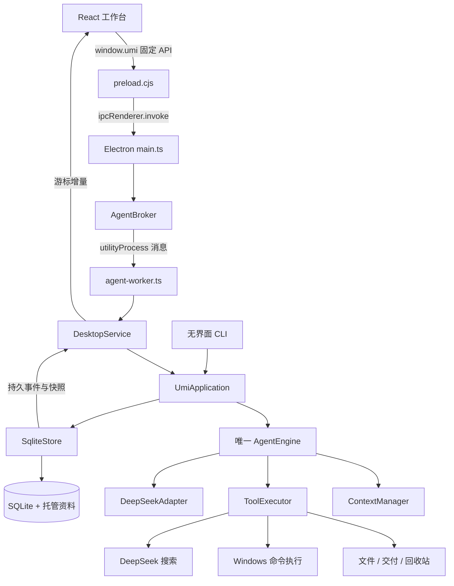

# Umi 当前项目详解与开发路线

> 核对日期：2026-10-09。本文描述当前仓库源码，不把早期设计、历史验收和未来计划混为一谈。产品名为 **Umi**；本地文件夹名不构成产品版本。配套阅读：[代码学习指南](code-reading-guide.zh-CN.md)。

## 1. 现在的 Umi 是什么

Umi 是面向 Windows 的桌面 Agent：用户在 React 页面提出目标，唯一的 TypeScript Agent 核心调用 DeepSeek，根据需要检索历史、联网搜索、处理附件、编辑托管文件副本、申请源文件交付或运行宿主命令。执行事实保存在 SQLite，页面通过持久事件重建展示。

目前已经具备可以继续打磨的完整桌面链路，但不能据此认为长任务、权限体验和生产发布已经全部成熟。尤其是单文件资源物化、恢复反馈与大上下文可用性，仍有明确缺口。

### 1.1 当前能力状态

| 范围 | 已有实现 | 实际边界 |
| --- | --- | --- |
| 桌面 | Electron 主进程、独立 Agent 进程、React 工作台 | 当前打包目标为 Windows x64；未实现安装器、自动更新和签名发布流程 |
| Agent | 唯一执行循环、流式事件、重试、批准等待、停止和恢复 | 默认每次运行最多 24 个模型轮次；恢复不是从头再跑 |
| 模型 | DeepSeek 专用适配器，文字/思考/工具调用流解析 | 只实现一个厂商；界面版本名称不是每次 API 返回的实际版本证明 |
| 文件 | 目录发现、获准资源物化、副本读写、变更集交付 | 文件路径目前提升为父目录资源，可能因无关文件超过物化限额 |
| 命令 | 程序与脚本快照、批准复核、Windows Job、输出归档 | 宿主命令没有 OS 文件/网络沙箱；Job 只管理其覆盖的进程树 |
| 上下文 | 保留用户原文、完整工具组压缩、来源笔记、窗口维护 | 使用保守估算；用户原文自身过大仍会预算阻塞 |
| 附件 | 文本和常见图片、粘贴/拖放、预览、长文本转附件 | 文本和图片存在大小上限；PDF/Office 二进制解析未实现 |
| 权限 UI | 输入区批准卡片、冻结变更预览、批准/拒绝 | 恢复检查与结果说明仍不充分；本轮未修后端问题 |
| 插件 | Docker/WSL 配置、可用性检查、模型查询配置工具 | 没有通用插件加载平台，也不是专用容器/WSL Runtime |
| 语言 | 回复/思考语言配置 | 多处 UI 文案仍固定中文，尚非完整国际化 |

### 1.2 与旧仓库的关系

旧主分支包含 `AI_front_end/` 和 `Back_end/`，使用 React 前端和 Python 后端。本次将主分支更新为当前 `apps/ + packages/` 实现，保留已有 Git 提交历史。需要研究旧实现时，可查看迁移前提交；当前应用启动不需要 Python 服务。

当前不是 pnpm/npm workspace 工程：只有根 `package.json`、一个依赖锁文件和一个 TypeScript 编译配置。`packages/` 表示职责划分，并不表示这些目录已经分别发布成 npm 包。

## 2. 技术栈及其职责

以下版本来自本次读取的 `package.json`，是项目固定配置，不是“网上最新版本”推荐。

| 技术 | 当前配置 | 在 Umi 中做什么 |
| --- | --- | --- |
| TypeScript | 7.0.2 | 核心、桌面入口与页面代码的静态检查 |
| Node.js | `>=24.11.0 <25` | 无界面运行、构建脚本、SQLite 内置驱动 |
| Electron | 44.5.1 | 窗口、受限系统桥接、独立 Agent 进程 |
| React / React DOM | 19.2.8 | 组件与页面状态 |
| Zod | 4.6.5 | IPC、模型消息、工具参数和持久数据的运行时校验 |
| SQLite | `node:sqlite` | 消息、事件、命令回执、批准与恢复依据 |
| esbuild | 0.27.4 | 页面和 preload 打包 |
| react-markdown / remark-gfm | 10.1.0 / 4.0.1 | 正文、表格、代码与链接展示 |
| lucide-react | 1.45.0 | 界面图标 |
| Windows 原生桥 | 代码中的固定桥接实现 | 创建/管理进程、Job、回收站等平台能力 |

TypeScript 类型在运行时不会替你验证来自模型或 IPC 的 JSON，因此 Zod 不是重复劳动。TypeScript 负责开发时约束，Zod 负责运行时入口，数据库事务和实际文件核验负责持久事实与副作用。

### 2.1 编译配置值得学习的地方

`tsconfig.json` 开启 `strict`、`noUncheckedIndexedAccess`、`exactOptionalPropertyTypes` 和 `noEmitOnError`。例如，`approvals[id]` 可能不存在，必须检查；“字段不存在”和“字段值为 undefined”也不能随意混用。

采用 `NodeNext` 和 ESM。源码中 `import './xxx.js'` 可以对应 `xxx.ts`，是为了让编译后的 Node ESM 路径正确，不应批量改成 `.ts`。

## 3. 总体架构：两条边界

第一条边界是页面和宿主：页面不能直接操作磁盘或启动程序。第二条边界是模型建议和执行事实：模型输出调用建议，核心决定是否批准、派发、核验和结算。



图中省略了返回通道上的主进程与 preload，实际响应仍经同一消息链路返回。当前页面不是直接持有 Agent 的 MessagePort；它通过受限 IPC 调用主进程，再由 broker 转发。

### 3.1 各层应该负责什么

| 层 | 核心职责 | 不应承担的职责 |
| --- | --- | --- |
| `protocol` | 身份、消息、事件、执行定位、纯归约、运行时 schema | 直接读写用户文件、发模型请求 |
| `agent` | 循环、上下文、工具规则和持久化端口 | 依赖 React、Electron 或直接操作 SQLite 驱动 |
| `adapters` | DeepSeek、SQLite、宿主文件和进程的具体实现 | 在适配器内部另起一套 Agent 循环 |
| `headless` | 组装依赖，提供 send/approve/stop/resume 等应用入口 | 用控制台状态代替数据库事实 |
| `desktop` | 进程通道、系统选择器、页面与应用命令适配 | 在前端重写权限或执行成功判定 |
| `renderer` | 草稿、选择、预览、时间线及交互反馈 | 从模型文字推断“已批准”“已交付” |

### 3.2 最容易混淆的几个对象

| 名称 | 含义 | 为什么需要分开 |
| --- | --- | --- |
| workspace | 用户选择的来源目录 | 是用户资料的来源，不等于可随意写回 |
| conversation | 一条会话 | 保持消息、附件与权限归属 |
| environment | 会话对应的托管执行环境 | 具有独立修订、根身份和活动执行者 |
| run | 一次可持续执行的任务运行 | 同一运行可能接收多条后续用户输入 |
| model turn | 一次循环中的模型轮次 | 与重试次数、工具次数不同 |
| model attempt | 某轮的实际请求尝试 | 失败重试必须有新尝试身份 |
| commandId | 用户输入命令的幂等标识 | 网络重发同一输入应返回原回执 |
| callId / executionId | 工具调用与实际执行身份 | 将批准、结果和恢复核验绑定到正确操作 |
| mountId | 获准资源的工作副本挂载 | 工具使用它和相对路径定位文件 |
| artifact | 有标识和指纹的不可变资料 | 保存快照、结果、原文片段与来源 |

**普通“继续”消息不能代替批准；模型回复“完成”不能代替交付回执。**

## 4. 一条消息如何执行

### 4.1 从点击发送到持久接收

1. `Composer.tsx` 管理输入交互，触发提交。附件完成上传前不能发送。
2. `App.tsx` 用 `CommandGate` 限制同会话并发提交，生成并冻结 `commandId + text + attachmentIds`。
3. 请求前查询 `receipt`；回执不明时重试应继续使用原 `commandId`。
4. preload 只发固定频道。主进程检查 sender、主 frame、URL、大小和命令 schema。
5. `AgentBroker` 分配 `correlationId`，校验执行进程 `instanceId`。它的通信回执不是任务完成回执。
6. worker 的命令队列把请求交给 `DesktopService.handle()`。
7. `UmiApplication.send()` 调用 `SqliteStore.acceptInput()`，保存输入、命令回执和 run 归属，然后启动唯一循环。

`commandId` 解决“是否接收过这条输入”；`correlationId` 解决“这份 IPC 响应属于哪个请求”；两者不能互相替代。

### 4.2 AgentEngine 的一次迭代

```text
检查租约和停止信号
→ 应用待处理输入
→ 构建事实和上下文
→ 必要时维护上下文
→ 适配器编码实际请求
→ 再检查编码后的预算
→ 保存冻结请求
→ 发模型流并逐块保存
→ 保存完整响应和工具调用
→ 校验 / 批准 / 执行 / 结算工具
→ 有工具则继续下一轮
→ 无新输入且没有未知工具，则完成本次答复
```

当前普通完整答复不再强制多发一次总结请求。`run.completed` 指向完整消息，归约器将其正文作为最终答复展示。这解释了为何纯聊天可以一轮完成；不要根据早期报告继续假设所有任务都需要额外 finalize 模型请求。

默认限制为 24 轮、每轮最多 2 次重试、模型尝试超时 180 秒、重试等待 1 秒。重试只处理满足条件的失败，不会重新派发已经执行或结果未知的写入。

### 4.3 流式 UI 为什么能恢复

正文、reasoning、工具参数通过 `model.block_started`、`model.delta`、`model.block_completed` 等事件保存。页面以 `streamId + logEpoch + sequence` 游标拉取增量，使用同一个 `reduceConversation()` 归约。

因此页面重载可以从快照和事件恢复；历史展示和实时展示不用各写一套状态机。但原始事件和最终 UI 不是一一对应：`activity.ts` 会把工具与思考组织成可展开的活动组。

## 5. 事实存在哪里：SQLite 与事件

### 5.1 当前数据库版本

当前迁移版本为 **5**。根版本定义在 `store.ts`，资源、进程、记忆、桌面扩展定义在各自 schema 文件中。迁移指纹会被校验，不能为了方便直接修改已经发布的旧迁移字符串；后续变更应新增版本并测试升级。

| 数据组 | 主要表 | 用途 |
| --- | --- | --- |
| 根对象 | `workspaces`、`environments`、`conversations`、`runs` | 来源、执行环境、会话与运行 |
| 持久事实 | `events`、`messages`、`commands`、`artifacts` | 有序事实、原消息、幂等回执、不可变资料 |
| 模型请求 | `context_snapshots`、`model_requests` | 重现该轮模型真正看到了什么 |
| 工具与批准 | `tool_executions`、`approval_requests` | 派发前记录、批准绑定、结果结算 |
| 资源 | `resource_candidates`、`resources`、`capabilities`、`resource_denials` | 候选、授权和拒绝事实 |
| 工作副本 | `mounts`、`materializations` | 基线、挂载、复制计划和中断核验 |
| 交付 | `changesets`、`delivery_items` | 冻结差异、每项意图和回执 |
| 进程 | `process_executions`、`process_outputs`、`process_fingerprints` | 命令快照、生命周期和输出 |
| 记忆 | `memory_entries`、`context_maintenance` | 来源笔记和上下文维护提交 |
| 桌面 | `conversation_views`、`attachments`、`message_attachments` | 标题/归档、附件及消息归属 |

这是“持久事件 + 事务内维护的关系表 + 可重建投影”的架构。不要误以为任何状态表都能随便丢弃再完全从事件重建；恢复依赖执行上下文、artifact、回执和持久记录共同提供证据。

### 5.2 几个持久化规则

- WAL、`synchronous=FULL`、事务和唯一约束保障提交边界。
- `writer.lock` 和启动守卫用于唯一写入者；run generation 用于拒绝过期执行者。
- 原消息、事件和 artifact 有不可变保护；更正追加新事实，不改写旧事实。
- 先保存派发意图，再产生副作用；发生崩溃后可知道哪些调用结果尚不明确。
- SQLite 事务不能自动回滚文件系统、外部命令或远端 API。跨这些边界必须核验，不能宣称绝对 exactly-once。

### 5.3 数据目录

无界面入口使用 `--data` 指定目录；桌面默认在 Electron userData 之下增加 `Umi/agent`。主进程支持 `--data` 覆盖。默认 Windows 安装的实际位置应按源码和启动参数核对，不应在逻辑中固定某个用户名。

```text
<agent data root>/
  umi.sqlite
  writer.lock                       # 运行时存在
  environments/<environmentId>/
    working/<mountId>/              # 用户资源的托管副本
    task/scratch/                   # 受控临时写入区
    task/artifacts/content/         # 内容资料
    ...                             # 其他托管区域
```

localStorage 保存头像、主题、面板宽度、当前会话和部分待发送标识。它不是批准或工具执行事实的权威来源。API Key 不在 Git 中：桌面通过 `safeStorage` 加密保存，页面读取配置只得到 `hasKey`。

## 6. 文件、批准与交付

### 6.1 为什么先编辑副本


“副本已修改”和“源目录已交付”是两个事实。副本中的普通结构化编辑在已有能力范围内连续执行，避免每写一行都弹批准；交付批准绑定不可变 ChangeSet，而不是未来的任意变更。

### 6.2 工具链

| 阶段 | 代码/工具 | 返回的关键依据 |
| --- | --- | --- |
| 发现 | `discover_resource` / `ResourceFiles.discover()` | candidateId、覆盖范围；目前候选是目录 |
| 授权和复制 | `request_resource` / `materializeAsync()` | capability、挂载计划、mountId |
| 读取 | `list_files` / `read_file` | 相对路径、内容指纹、字节范围与截断信息 |
| 编辑 | `write_file` / `delete_file` | 前置状态、目标内容指纹、回读结果 |
| 冻结 | `build_changeset` / `DeliveryFiles.build()` | 基线与选定副本差异、内容资料 |
| 交付 | `deliver_changeset` | 具体批准、源文件核验、每项回执 |
| 回收 | `recycle_file` | 独立的 Windows 系统回收站操作与核验 |

工具准确参数以对应 Zod schema 为准。模型不能凭自然语言生成一个任意绝对路径的读写调用。

### 6.3 执行定位为什么不只是路径字符串

`ExecutionContext` 包含 environmentId、environmentRevision、根绑定和身份。每个 location 包含：

```text
schemaVersion
environmentId
rootRef = task(area) | mount(mountId, area) | source(resourceId)
relativePath
beforeHash / desiredHash
physicalRoot / physicalRootIdentity / beforeIdentity（按场景提供）
```

`relativePath` 相对于 rootRef 指定的区域。working 的定位通过 mountId 绑定资源，不需要再复制一个可能失配的 resourceId 字段。逻辑身份用于解释旧记录，物理绑定与内容指纹用于核验“现在是否仍是当时那个对象”。

### 6.4 当前边界

结构化扫描单文件上限 4 MiB、目录总内容上限 32 MiB、目录项上限 5000，并有深度和时间限制。`.git`、`node_modules` 等目录被排除。因此副本不保证是可以直接运行构建的完整开发环境。

交付通常通过暂存文件和原子替换逐项完成，但整个 ChangeSet 不是跨所有文件的原子磁盘事务。变更集中的 delete 是永久删除；需要回收站时走独立工具。

## 7. 命令执行：强能力与明确边界

入口为 `run_command`、`run_shell` 和 `read_process_output`。`CommandPreparation` 固定实际程序、参数、工作目录、环境、脚本版本、程序身份/哈希和目录指纹。批准后、派发时、释放挂起进程前都存在相应核验。

```text
准备请求
→ 具体批准
→ 保存执行快照与派发记录
→ 建立桥接 / 挂起目标 / 绑定身份
→ 再次核验
→ 保存释放意图
→ 释放目标运行
→ 保存输出和退出回执
```

需要区分四件事：

1. **批准**：允许这一次已知操作。
2. **Job Object**：管理普通进程组、资源上限与终止清理。
3. **文件核验**：判断某个预期效果是否发生。
4. **OS 沙箱**：从操作系统限制文件和网络访问；当前没有这一层宿主隔离。

所以 `cwd` 不能阻止 Shell 访问其他目录，批准也不能让模型提供的程序自动安全。WMI、服务、计划任务、容器或 WSL 的间接进程不在普通 Job 清理保证内。

非零退出仍可能修改文件。当前命令结果携带 `mutated: gateReleased`，不能用 exitCode 非零作为“不推进环境修订”的理由。后续做命令复用授权时，必须重新考虑这些批准与环境变化的绑定，不能简单增加“永久允许”。

## 8. 上下文管理：模型每轮实际看什么

### 8.1 唯一构建入口

`ContextManager.project()/prepareTurn()` 负责构建；其他模块不要拼装自己的平行历史。当前大致顺序是：

```text
稳定 persona + 语言指令
→ 旧记录有损摘要（如果存在）
→ 当前活跃的完整历史消息组
→ 真实运行状态 + 来源与记忆投影
```

另有稳定排序的工具定义。动态运行状态放后面有助于保留较长的相同前缀，但不能据此保证 DeepSeek 的服务端缓存命中比例。

`memoryProjection()` 同时列出用户要求来源、保留消息来源、最近笔记和旧记忆读取入口。摘要和笔记始终标明不是授权、成功或交付事实。

### 8.2 预算怎么计算

默认窗口配置 1,000,000，安全余量 16,384。输出预算：Off 8,192；Normal 32,768；High 65,536。输入天花板为：

```text
inputCeiling = 有效窗口 - 输出预留 - 安全余量
维护阈值 ≈ inputCeiling × 75%
维护目标 ≈ inputCeiling × 50%
```

文本按 UTF-8 字节构建保守估算，并计入消息/工具开销；图像在估算中使用代码定义的每张 1024 预算，不把 base64 字符串当普通文本计数。这是实现中的估算策略，不是实测 tokenizer。

模型适配器编码完实际请求后再检查预算；保存的 `estimatedInputTokens` 和服务端返回 `prompt_tokens`/缓存 usage 分开处理。

### 8.3 维护与主动切换

- 系统在压力阈值触发维护；模型也可以调用 `request_context_reset` 提出切换。
- 实际维护在完整工具组结算后进行，不拆开 assistant tool_calls 和对应工具结果。
- 普通维护保留近期完整组；主动 reset 有自己的保留来源和近期组策略。
- 保存计划、原始来源哈希和基础窗口版本，再请求有界摘要；成功后提交新窗口。
- 摘要校验失败、来源改变或费用请求中断时，保存失败事实；必要时用有界原文片段降级。
- 原始消息没有被摘要覆盖，历史工具仍能读取。

### 8.4 当前的长期限制

用户消息原文目前全部保护。累计原文和必需状态自身超过输入预算时，继续压缩旧助手消息也无济于事。恢复检查会阻止条件未变化的反复失败，但这不是无限会话方案。

长输入转附件主要解决编辑和消息载体：超过约 6000 字符或 120 行可转成文本附件，原文不摘要。它不等于语义压缩，也不自动解决累计用户要求预算。后续若将要求放入附件，必须建立可追溯的要求索引和检索规则，不能只保留“请看附件”而丢掉约束。

`searchMessages()` 已用 SQLite 在当前会话中筛选角色、时间和内容，并只解析命中结果；内容匹配仍是 `instr(json_extract(...))`，不是 FTS/语义索引。大历史的性能需要单独测量。

### 8.5 缓存与模型适配的开发原则

请求前缀、工具 schema 排序、提示词版本、reasoning 回传和维护会影响请求稳定性。当前 `ToolRegistry.specs()` 按名称排序，适配器在启用思考且存在工具时补齐需要的 reasoning 字段；关闭思考时删除回传 reasoning。

当前正常完成路径已减少不必要的额外总结请求。维护摘要仍是独立无工具请求。不能只看“tools 是否还在 JSON 里”推断缓存键；应该用相同任务的实际 usage、费用、完成率和要求保留情况验证。本文没有新增缓存基准或真实模型费用测试。

## 9. 前端结构与改 UI 的正确入口

| 位置 | 职责 |
| --- | --- |
| `App.tsx` | 会话选择、快照/事件轮询、发送回执、设置、面板和批准卡片接入 |
| `Timeline.tsx` | 用户消息、运行片段、活动展开、最终正文、复制反馈、恢复区 |
| `activity.ts` | 由事件顺序组织思考、工具和进展，不生成假的执行事实 |
| `ApprovalCard.tsx` | 读取批准详情、冻结交付预览、提交批准/拒绝、防重复点击 |
| `features/work/components/Composer.tsx` | 输入、附件、模型/思考菜单、上下文环、发送/停止和批准停靠区 |
| `features/sidebar/Sidebar.tsx` | 工作区、会话、新对话、头像和侧栏交互 |
| `features/settings/SettingsPage.tsx` | 个人资料、模型、会话、插件和归档分类 |
| `components/ui/ConversationMap.tsx` | 对话位置刻度及悬停内容预览 |
| `transport.ts` | 增量事件校验、共享归约和消息合并 |

样式加载顺序为 `global.css → desktop.css → surface.css`。后加载和更高 specificity 会覆盖前面的值，因此修改某个早期 width 不一定生效。当前有较多覆盖层和 `!important`，这是已积累的维护成本；建议后续按控件整理 token 和局部样式，而不是不断在最后追加补丁。

本次纳入仓库的最新界面包括透明横版品牌、紧凑圆形发送/停止、英文 Off/Normal/High、消息复制反馈、输入区批准卡片。它们沿用已有批准与事件逻辑；没有新增一套前端权限状态机。

### 为什么 Harness/Codex 的活动文字和 Umi 不同

具体命令文字取决于工具协议是否有 `description/title`、模型填写了什么参数、运行事件携带哪些字段，以及前端怎样摘要它们。Umi 当前的 `Tool` 从已保存的工具详情选择 path/query/program/messageId 等提示，`activity.ts` 再组成活动组；它不会自动得到其他产品的命令标题。

因此这同时涉及协议与展示，不能靠给前端换一句“运行了命令”就解决。若后续增加工具调用的短标题，真实 argv/script 和结果必须继续保留，标题不能成为执行依据。

## 10. 已知问题及优先级

以下问题不是本次新增猜测，其中资源与恢复问题来自此前指定会话的只读事件排查；本次没有修改其运行逻辑。

| 优先级 | 问题 | 证据/原因 | 建议验收 |
| --- | --- | --- | --- |
| P0 | 指定单文件却物化整个父目录 | discover 文件路径调用 dirname，materialize 扫描目录 | 一个小 HTML 在含大文件的桌面仍能独立获准、复制、编辑、交付 |
| P0 | 空资源候选被解释成文件不存在 | query 匹配目录字符串，不搜索扩展名 | 返回明确对象/覆盖范围；模型不把空目录候选当文件搜索结论 |
| P0 | 资源失败原因不充分 | 通用 mutating catch 只保留 RESOURCE_LIMIT 代码，进入 unknown | 保留阶段、具体限额和已发生效果；区分复制前失败/部分复制/结果未知 |
| P1 | 恢复检查反馈不明确 | UI 主要展示 budget.reason，隐藏物化核验信息 | 用户可看到为何阻塞、核验了什么、恢复后做什么、有没有重试 |
| P1 | 相同输入在同 run 出现两次 | 记录是两条不同 commandId 的真实输入，不只是重绘 | 追踪客户端操作来源，区分重发同命令与用户主动补充；不删除原记录掩盖问题 |
| P1 | 同 run 多输入的耗时重复 | 每个片段使用整个 run 的时间 | 清楚区分运行总耗时和消息片段，避免看起来执行两遍 |
| P1 | 保护原文的预算可用性 | 用户原文自身可能超预算 | 有预算的活跃原文 + 永久可检索原文 + 可追溯要求索引；显式说明折叠范围 |
| P1 | 模型标签与实际版本证据分离 | UI 名称为静态配置，API 使用路由 ID | 同时展示配置路由和实际响应版本（若服务端提供），不要把别名当实测 |
| P2 | 样式覆盖与大组件维护困难 | App 编排集中、CSS 多层覆盖 | 保持行为后逐步提取 hooks、组件和设计 token |
| P2 | 国际化尚未完整 | uiLocale 存在但不少 UI 文案固定中文 | 统一文案入口，模型输出语言和 UI 语言分别配置/测试 |
| P2 | 长任务索引、成本和质量证据不足 | 历史检索未引入 FTS，真实长任务样本有限 | 测检索 p50/p95、要求保留、恢复成功率和每个完成任务费用 |

两次恢复不意味着两个并发 Agent：应用的运行 Map 阻止同 run 并发启动。此前记录显示两次顺序恢复，第一次核验未物化后模型新发起同资源请求，再次失败。日志也没有“截图触发用户停止”的证据。

## 11. 后续开发路线

### A. 先修资源闭环

新增单文件/选定范围资源契约，使发现、授权、物化、执行定位、变更集与恢复都认识同一范围。目录资源继续保留，不能只在 UI 上显示文件名而后端仍扫描父目录。

建议先写验收矩阵：大桌面中的小文件、同名文件、多资源挂载、文件移动/替换、批准后变化、复制中停止、重启恢复、交付冲突。若需要新增 schema，采用新的迁移版本，保留旧目录资源解释。

### B. 完整呈现恢复过程

先明确“只检查”“核验原执行”“重新复制”“继续模型”分别是什么操作。为用户展示具体结果，必要时增加新的显式重试动作；原 unknown 副作用不能因为用户点击恢复就直接重复执行。

### C. 长任务上下文可用性

先为基准任务保存完整请求和要求来源，测量估算误差、用户原话占比与维护收益，再引入有预算保护。小请求能被 API 接受，并不能证明完整上下文请求也能被接受；不要用缩小后的探测请求解除完整请求预算限制。

### D. 前端整理与任务可观测性

整理按钮/菜单/卡片 token，收敛 CSS 覆盖；拆分 App 的会话加载、发送和预览编排。执行详情保留真实命令和输出，活动摘要使用可读标题，最终答复与中间进展分开。优先保证实时、重载与历史三种展示一致。

### E. 发布工程

建立干净克隆构建、Windows 自动检查、独立测试目录和可重现打包。再决定安装器、更新、签名、发布渠道和许可证。真实 API 验收需要显式配置凭据和费用预算，不应作为每次普通构建的默认动作。

### F. 模型与插件扩展

第二个模型适配器应实现 ModelPort，明确能力、思考回传、上下文预算、工具协议和请求重放归属。不要直接放开 Settings 枚举就声称已适配。通用插件需要版本协议、注册/卸载、权限与生命周期，当前 Docker/WSL 配置不是这些能力的替代品。

## 12. 验证、发布与本次报告边界

当前仓库保留自动案例、故障注入 worker 和真实 API 验证脚本。历史阶段 5 报告记载 132 个案例，后续 UI 报告又有新增案例；这些是各阶段当时的证据，不能作为本次重新跑过的结果。

本次实际执行了 TypeScript 类型检查，并进行提交文件检查；没有重跑整个测试套件、启动真实模型、执行用户宿主命令、重新打包或全面视觉验收。此前最新 UI 修改的桌面构建已通过。个人会话数据库、密钥、node_modules、dist、release 和本地原始 evidence 输出不进入本次源码提交。

历史文档 `stage-*.md` 保留其时点描述，所以会看到“尚未支持图片”等旧表述。判断当前状态以本文与对应源码为准；历史证据目录仅在原开发机保留，不随本次源码发布。

### 本次仓库维护内容

- 将当前 TypeScript/Electron 项目作为主分支实现，保留迁移前历史。
- 更新 README，增加本报告与按调用链学习的指南。
- 增加跨平台文本换行约定及运行资料/密钥忽略规则。
- 本次没有修改 Agent、资源、恢复或前端业务逻辑。

下一步最值得投入的是 **单文件资源闭环和恢复反馈**。先让日常小任务可靠完成，再用真实长任务衡量上下文与费用，能得到更明确的改进依据。
