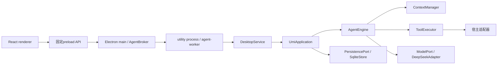

# Umi 当前技术状态

核对日期：2026-10-22。适用对象：本提交源码；package版本0.2.0、DATABASE_VERSION=7、PROMPT_VERSION=`umi-persona-22`。本地构建和远程已发布资产是不同交付物，版本号相同也不能替代源码指纹核对。

## 技术与依赖

- Windows x64桌面产品，Electron44.5.1；Node要求`>=24.11.0 <25`，本地验证使用24.21.0。
- TypeScript7.0.2、React/React DOM19.2.8、Zod4.6.5；单一根npm工程和锁文件。
- SQLite使用Node内置`node:sqlite`。Markdown、着色、图标使用react-markdown/remark-gfm、highlight.js、lucide-react。
- DOCX/XLSX使用yauzl和saxes做本地有界容器/XML提取；Skill元数据用yaml。
- 项目当前UNLICENSED，第三方材料依各自许可证；没有因此取得统一开源再分发许可。

## 进程与依赖方向

桌面与headless/CLI复用唯一`UmiApplication → AgentEngine`循环。protocol只做运行时校验和纯归约；agent处理循环、上下文、工具与领域端口；adapters实现模型、SQLite、文件、命令、资料和技能。renderer不获得任意IPC、SQL、文件系统或Shell入口。

Electron renderer启用contextIsolation/sandbox/webSecurity，关闭nodeIntegration；这不构成被批准宿主命令的OS文件或网络沙箱。

## 模型与运行

| 设置 | 实际请求 | 单次输出容量 |
| --- | --- | --- |
| Off | thinking disabled | 65536 |
| Normal | thinking enabled，reasoning_effort=low | 65536 |
| High | thinking enabled，reasoning_effort=high | 65536 |

上表为通常窗口下单次预留，输入较长时按剩余容量下调；思考开关不再决定回复长度。新会话默认deepseek-flash、Off、ask、简体中文；另支持deepseek-v4-pro。显示型号标签与API别名分离，不宣称服务端未报告的实际部署版本。图片请求仅走支持图片的Flash，不自动切模型。

Chat Completions流式适配保留完整已完成思考和工具配对，发送usage请求。模型工具参数根必须为object。180秒是无活动超时，非整次生成总时长；已收到部分实际输出的中断不会无条件原样付费重试。有限重试默认maxRetries=2。接收不再按累计SSE协议外壳16MB截断；原始分片无损压缩，正文与原始delta不裁剪。重复思考只记诊断，工具次数只用于已知相同失败的提醒与后续受阻处理，不截停成功复查。具体容量与验证见[本轮技术记录](records/20261022-streaming-and-failure-guards.zh-CN.md)。

默认没有隐藏24轮硬停，普通设置不再提供任务预算输入；旧版显式限制显示现值并可取消。兼容字段`runOutputTokenLimit`缺省/null不限，按同一run服务端completion_tokens累计，包含思考及付费维护；恢复不清零。缺usage保持未知，启用预算时暂停新模型请求。它不是总费用或跨run任务预算。

没有有效最终答复的失败、停止与恢复路径保存本地“Umi执行说明”，说明原因、已知回执和下一步；正常最终正文不额外请求模型总结，也不因检查点未完成强制重答。完整stop却只有思考时，沿同一循环尝试一次带具体事实的续作；同一最新输入再次出现则明确解释受阻，重启不重置。任务/要求/笔记与Skill按需，无检查点不注入空任务验收域。旧TASK_STALLED等特定路径仍沿既有机制。非空正文的语义完成和错误任务取消并未得到通用保证，见[自主执行记录](records/20261022-model-autonomy.zh-CN.md)。

## 历史、上下文与存储

SQLite数据库为umi.sqlite，使用外键/WAL与同步持久化，WriterLock协调单写者。默认桌面数据根由Electron userData下的Umi确定，`--data`可指定隔离目录；核心在其agent子目录。API Key由main通过safeStorage加密保存或由环境提供，数据库与托管文件并非整体静态加密。

当前31张表覆盖会话/环境/运行、events/messages/artifacts/commands、请求快照、工具/批准、资源/能力/物化/挂载、changesets/delivery_items、进程、附件、记忆/维护、迁移与永久删除。任务、问答、成果还复用事件和artifact，不要求各自存在独立同名表。

`reduceConversation`从事实产生纯投影。原始历史、思考、请求和资料保留，模型视图可以折叠。默认上下文窗口最多1,000,000，安全余量16,384；Off/Normal/High通常预留65,536输出，输入较长时按实际余量协调。保守估算与编码后复查不冒充服务端分词。压力阈值默认0.75，维护目标0.5。

完整assistant工具调用/结果消息组成组维护，最新原话和来源受保护。旧原话可用有界来源索引定位，再从历史追回；摘要/笔记是派生资料，不授予权限或撤销原话。模型维护失败、达到既有限额等情况下走本地索引/摘录路径，不能假称已读全文。

请求carry与按域宿主事实增量用于稳定前缀；只读缓存诊断区分字段值、编码与新增尾部，不改写旧请求，不以命中比例代替任务成功。大历史冷投影已做真实只读定点测量，常见状态事件改为局部复制；进程内缓存以外仍需逐事件重放，没有持久化派生检查点或自动留存清理。测量与边界见[性能技术记录](records/20261022-history-and-preview-performance.zh-CN.md)。

## 文件、命令与交付

- 来源经发现与具体授权物化到托管副本。初始能力和外部run能力不同，查询仍受原environment/run作用域约束。unavailableMounts最多提示同环境最近16个保留但本轮未获准的历史副本，说明需重新申请，不扩大权限。真实Flash Normal制作HTML、观察反馈续改和后续文字修改已完成隔离测试；显示证据与剩余缺口见[本轮记录](records/20261022-live-html-and-resource-facts.zh-CN.md)。
- read_file支持字节或1-based行选择，lineCount单独从第1行；行定位与startByte互斥。模型默认字节8192、行模式200行，单页最多64000字节，按nextStartByte/hash续页；桌面工作副本、附件及冻结交付预览首段使用64000字节，版本和权限核对不变。
- write_file默认create，存在拒绝；replace要求完整已见范围。edit_file支持唯一精确片段或最多32项批量原子修改，保留BOM/换行/无关字节；文件4MiB，单替换片段64000 UTF-8字节。
- 回执/哈希是可选兼容参数，由宿主自动绑定当前已见版本；显式提供仍严格核对。成功自写正文可直接作为后续编辑依据，局部编辑的内部knownRanges只传播已见原文和新替换字节。未读、隐藏、过期、身份替换与歧义继续拒绝。
- run_command与run_shell绑定具体程序、参数/脚本、cwd、环境与根身份，沿批准、派发、Job管理和回执链执行。默认30秒、最大300秒；输出有有界首尾预览及最多64MiB脱敏归档。read_process_output保留范围分页，并支持可选find字面定位与原字节位置、续查；未命中不排除未归档内容。未知副作用先核验，不重跑。
- build_changeset冻结具体变化，deliver_changeset批准后写回来源并逐项记录；来源冲突不覆盖。独立create/capture_output冻结成果，export_outputs按具体目标独占创建、不覆盖，inspect_export只检查原目标。
- open_delivered_file的系统接收回执不等于网页可用。内置HTML是静态预览，不执行脚本。

Docker/WSL仅是用户配置的可选外部命令入口，不托管daemon/发行版或证明隔离。executionPolicy的auto仍未实现，不能作为免批准模式使用。

## 附件、图片、技能与界面

文本/图片附件保留消息来源、原字节与版本。list/search/read附件只查询已发送且已应用资料，草稿不自动进入模型历史。同名版本独立，相同内容可复用artifact。

DOCX/XLSX原件最大8MiB，派生文本有2MiB等有界提取限制。DOCX提供正文段落，XLSX提供工作表/A1、原始值、公式与缓存值，不重算公式、不渲染Office。PDF/OCR未实现。read_image只观察获准副本或本会话冻结成果，PNG/JPEG/GIF/WebP单张1,000,000字节、单边8192、16Mi像素，活跃窗口8张不同图片。

Skill采用SKILL.md/YAML与小目录、按需搜索及分页。read_skill默认8192、最多64000字节，按任务需要续读；设置可在导入/启用前查看完整SKILL.md。开关读写统一64KiB以覆盖128项本地技能。umi-code/research/artifacts为可选基础方法。公开GitHub包先固定commit/tree/blob清单，后台草稿→预览→确认发布，默认停用；来源、导入实例与本地版本分开。读取不执行脚本，不强制改写，不赋予新权限。

桌面支持工作区/会话、流式时间线、批准和选项问答、附件、设置、预览、归档和确认永久删除。设置有通用/资料/模型/会话/执行环境/技能/归档七类，通用主题与发送快捷键按设备保存，诊断默认折叠。欢迎语Thus begins the story.、232px侧栏及原配色/边缘保持。关闭窗口仅隐藏，菜单退出才结束；源码变化需要重建，已有便携包不会自动更新。

## 工具范围

完整桌面组装的48项工具按用途如下；可选模块未注入时headless集合会更小。分类不是授权结论，具体effect与校验仍由注册定义决定。

| 用途 | 工具 |
| --- | --- |
| 来源与文件 | discover_resource、request_resource、list_resources、list_files、stat_file、read_file、search_text、write_file、edit_file、delete_file、recycle_file |
| 交付与成果 | build_changeset、deliver_changeset、open_delivered_file、create_output、capture_output、list_outputs、read_output、export_outputs、inspect_export |
| 执行 | inspect_execution、run_command、run_shell、read_process_output、get_execution_plugins、inspect_tool_execution、write_scratch |
| 资料 | search_web、fetch_webpage、read_webpage、list_attachments、search_attachment、read_attachment、read_image、read_artifact |
| 历史/任务/记忆 | search_history、read_history、list_user_requirements、record_requirement、record_work_note、read_work_memory、request_context_reset、record_task_checkpoint、read_task_checkpoints、set_task_state、ask_user_question |
| Skill | list_skills、read_skill |

## 当前验证与分发边界

2026-10-22本轮技能与设置修改后重新构建，完整离线核心683/683、独立真实Electron离线桌面103/103通过；本轮未调用真实模型API、未操作默认库。具体见[技能与设置记录](records/20261022-skills-and-settings.zh-CN.md)。此前授权的真实Flash Normal隔离HTML制作、视觉反馈续改和标题修改共39次请求已经完成，首两次交付在独立观察窗口可见场景；这不是原历史任务重做成功或全场景可用证明。Normal/High同题比较仍未验收，边界见[真实任务记录](records/20261022-live-html-and-resource-facts.zh-CN.md)。测试数量不等于复杂任务成功率。

GitHub托管CI仅覆盖工作流列出的子集，不包含全部真实Windows进程桥和桌面交互。本地打包校验源码指纹、运行文件和安装器载荷；不等于实际安装/升级/卸载验收。当前源码已生成本地0.2.0开发包，236项运行文件与安装器载荷一致，新便携exe离线桌面103/103通过，见[打包记录](records/20261022-development-package.zh-CN.md)。没有代码签名、自动更新或本轮远程Release发布。仍未修复的具体边界见[已知问题](known-issues.zh-CN.md)。
