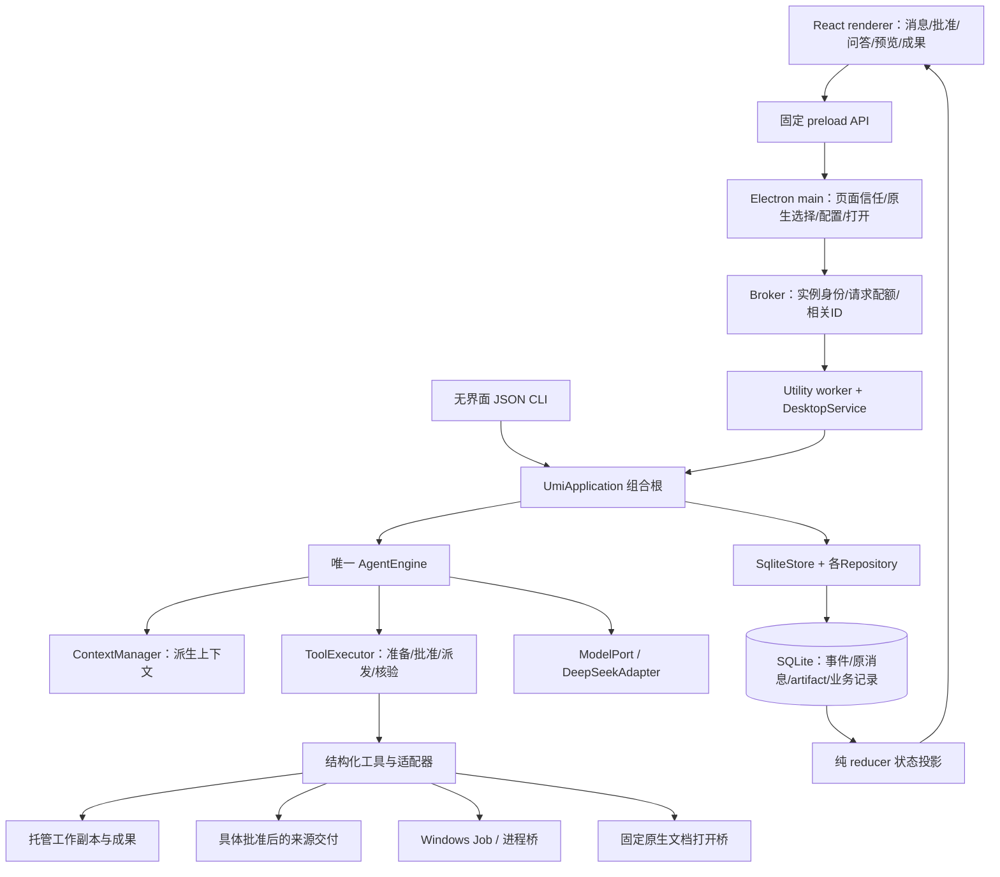

# Umi 全面源码审计与学习报告

审计日期：2026-10-15。对象：`E:\SOME_SEVEN_PROJECT-57\Umi_v2.0` 的当前源码、全部多阶段未提交改动与非忽略未跟踪文件。产品名称是 **Umi**。本报告同时提供实现地图、实际问题、验证证据和继续开发的契约；建议不构成下一轮自动实施授权。

## 1. 先看结论

Umi 已具备一条贯通桌面与无界面入口的 Agent 主链：持久输入 → 上下文投影 → 模型请求 → 结构化工具与具体批准 → 效果/回执 → 验收与正文。它已经超出聊天界面原型，具有工作副本、冻结交付、未知结果核验、自然新输入、连续预览、任务证据和进程生命周期管理。后续应优先补齐异常路径与信息表达，再逐步扩大能力。

这轮完成的产品改动只有品牌显示：侧栏与欢迎区均使用用户提供的独立图形，移除 Umi 字形图片及深色字形遮罩。侧栏图像盒为48×48 CSS px，欢迎区为128×128 CSS px，并随窄窗口缩小；同一512×512透明PNG在浅、深主题等比显示。图标中的白色角色保留。原横版资源保留为历史材料，不再由桌面构建复制或页面加载。

本轮常规编译、桌面构建、**439项核心测试全部通过**，**48项隔离真实 Electron 桌面检查全部通过**。另外启用未使用声明检查得到25条诊断：产品1条、测试24条；该额外规则未启用在常规 tsconfig 中，不能把它写成常规编译失败，也不能用439项通过来掩盖它。

新增隔离探针确认三处问题：

| 编号 | 优先级 | 问题及影响 | 本轮处理 |
| --- | --- | --- | --- |
| A-01 | P2，建议最先修 | 启动期间遗留 `writer.starting`，后续启动持续返回 WRITER_LOCKED，没有内置核验恢复路径 | 已用两种遗留状态及正常旧锁对照复现；未改生产逻辑 |
| A-02 | P2 | 达到模型轮次上限 TASK_LIMIT 时，只有失败状态/原因，未保存独立正文收尾 | 已经真实唯一循环复现；不影响已修复的 TASK_STALLED 分支 |
| A-03 | P2，低成本 | 实际迁移到6，CLI、worker及ready规格仍报告/要求数据库版本5 | 新数据库与真实CLI ready对照确认；未修改协议 |

P2表示应安排在正常开发周期内修复，不表示每天都会触发。A-01在异常启动窗口内触发后影响很大，但本轮没有证据表明它已发生在你的真实数据目录，也没有证据表明它破坏了数据库。没有发现足以断言“当前存在数据损坏”的复现。

## 2. 审计范围、方法与可信程度

### 2.1 这轮具体做了什么

1. 按根目录AGENTS要求读取交接、当前报告、学习指南，核对Git状态与已有diff。
2. 保存修改前261个Git可见文件记录（含3个已删除路径），保留未跟踪源码、文档与学习注释；没有reset、clean、提交或覆盖其他阶段改动。
3. 修改单图标接入、相关样式、资源构建复制和真实桌面验收断言。
4. 逐段审查应用组装、唯一循环、工具注册/执行、SQLite与事件投影、上下文维护、资源发现/授权/副本/交付、进程与日志、桌面隔离/IPC、预览、问答、设置和构建入口。结合现有测试检查异常与恢复边界。
5. 重跑439项核心测试及48项真实桌面检查，查看浅色与深色截图；另做启动锁、版本上报及TASK_LIMIT的独立探针。
6. 统计源码体量与集中模块，形成下面的学习地图和小范围修复契约。

### 2.2 证据等级

| 标记 | 含义 | 例子 |
| --- | --- | --- |
| 本轮复现 | 新隔离样本实际执行得到结果 | startup guard连续两次阻塞；TASK_LIMIT无final正文 |
| 本轮测试 | 本轮常规或桌面验收执行通过 | 文件/恢复/上下文回归；单图标尺寸与主题 |
| 源码确认 | 从当前调用链和条件分支确认的机制/限制 | 主机命令没有OS沙箱；多文件交付逐项提交 |
| 用户实测 | 用户在此前交互中明确反馈的体验 | 跨轮打开与重复受阻收尾表现正常 |
| 待专项验证 | 缺少生产规模或外部环境证据 | 真实复杂任务完成率、长期磁盘增长、付费token成本 |

没有调用真实/付费模型接口，没有读取或改写生产会话数据库，没有安装依赖、改Windows设置、发布或同步便携包。本轮未联网运行依赖漏洞公告扫描，也未做外部渗透、断电/磁盘损坏测试、完整并发对抗或长时间生产压力测试。源码审查加本地测试不能替代这些专项证据。

### 2.3 当前代码体量

统计的是Git跟踪及非忽略未跟踪的 `.ts/.tsx/.css/.mjs` 文件，物理行含注释/空行，不把行数当质量评分。

| 分类 | 文件数 | 物理行 |
| --- | ---: | ---: |
| apps/packages的TypeScript，不含桌面验收脚本 | 135 | 20,658 |
| 桌面验收脚本 | 1 | 952 |
| tests，含fixtures与崩溃子进程 | 45 | 10,764 |
| CSS | 4 | 6,458 |
| scripts中统计到的源码脚本 | 10 | 312 |

集中模块：`store.ts`1618行、`resources.ts`766行、`outputs.ts`659行、循环597行、ContextManager553行、主进程531行、reducer811行。CSS中global4162、desktop864、surface1157行。适合围绕行为逐步拆分，暂不值得为目录整齐重建平台。

## 3. 本轮单图标改动与视觉验收

入口是[BrandMark.tsx](../apps/desktop/renderer/src/components/ui/BrandMark.tsx#L1)，由[Sidebar](../apps/desktop/renderer/src/features/sidebar/Sidebar.tsx)和[EmptyConversation](../apps/desktop/renderer/src/features/work/components/EmptyConversation.tsx)共用。现在组件直接返回带 `alt="Umi"` 的img，保持可访问名称，无需主题字形变体。

尺寸由[surface.css](../apps/desktop/renderer/src/styles/surface.css)控制，资源由[build-desktop.mjs](../scripts/build-desktop.mjs)复制。移除了wordmark的clip/mask及相应规则，页面与构建不再使用 `umi-lockup.png`。原资源文件保留，避免抹掉前一阶段材料。

桌面检查从上一阶段49项变为48项，是因为删除了已不适用的横版字标文件检查，并把原布局/深色检查改成单图标契约；没有把历史49项当成今天结果。图形外围透明、白色角色、原始512尺寸、侧栏48/欢迎128尺寸、无文字遮罩及无滤镜均有断言。两张实际欢迎区截图已人工查看，左右栏与输入框未被图标挤压。

- [浅色截图](E:/Codex/Workspace/output/umi-full-audit-20261015/desktop/welcome-preview.png)
- [深色截图](E:/Codex/Workspace/output/umi-full-audit-20261015/desktop/welcome-dark-preview.png)
- [真实桌面48项记录](E:/Codex/Workspace/output/umi-full-audit-20261015/desktop/desktop-verification.json)

源码dist已重建。使用源码版时从菜单完整退出再启动；关闭窗口仅隐藏。便携包仍含自己的dist，本轮没有更新它。

## 4. 全局架构：一个循环，多层边界

图中DB到UI表示“经服务、broker和固定传输送达”，渲染器没有直连SQL或文件系统。Electron渲染进程的sandbox与宿主命令的OS沙箱是不同对象：前者已启用，后者没有。

| 层 | 核心职责 | 不应迁入的职责 |
| --- | --- | --- |
| [protocol](../packages/protocol/src) | Zod运行时规格、事件、纯reducer、工具/资源/桌面契约 | 文件、网络、进程、数据库操作 |
| [agent](../packages/agent/src) | 唯一循环、上下文、工具执行与能力端口 | 具体Windows API、Electron组件 |
| [adapters](../packages/adapters/src) | SQLite、文件、模型、宿主进程的实际效果与核验 | 第二套Agent循环、页面状态 |
| [application.ts](../apps/headless/src/application.ts#L63) | 组合根、注入端口、对外业务入口、运行生命周期 | 向renderer暴露整个store或任意宿主执行 |
| [desktop](../apps/desktop) | 桌面传输、原生交互、可视投影 | 自建另一套权限/任务执行系统 |

目前边界总体成立。未来skill、插件、网页读取和卡片改进，应接入这一条链，不把工具效果塞到页面点击处理器里。

## 5. 五条必须理解的调用链

### 5.1 一条普通消息如何得到回复

`Composer → CommandGate → window.umi.request → main → broker → worker/服务 → UmiApplication.send → 持久输入回执 → AgentEngine.run → ContextManager → DeepSeekAdapter → persistResponse → reducer → 页面`。

关键源码：[输入应用入口](../apps/headless/src/application.ts)、[循环入口](../packages/agent/src/loop/engine.ts#L140)、[请求持久化](../packages/adapters/src/sqlite/store.ts#L1198)、[响应持久化](../packages/adapters/src/sqlite/store.ts#L1260)。

commandId解决重复点击/断线重发的输入身份。模型请求有自己的request/turn/attempt身份，工具还有execution身份，不能用一个ID代替所有层。无工具且已有完整可用正文时，当前答复直接作为最终正文，不强制再花一次请求生成同义总结。

### 5.2 读取、修改、交付一个外部文件

`discover_resource → 候选元数据 → request_resource具体批准 → materialize工作副本 → read_file/search_text取得版本与可见范围 → edit_file修改副本 → build_changeset冻结 → deliver_changeset具体批准 → 每项来源核验/意图/写回/回执`。

资源发现不等于读取正文；工作副本编辑不等于源文件写回。单文件资源范围不会因为共用父目录就自动扩大成整个目录。文本批量编辑是“同一个原版本、同一个文件的一组操作整体成功或不写”；多文件源交付则是逐项提交，详见第9节。

### 5.3 交付后跨轮打开

`原changeSetId + 相对路径 → 查冻结after及成功交付回执 → prepare只观察对象元数据 → 此次具体打开批准 → 核hash和identity → 固定桥 → 主进程再次核验 → shell.openPath → systemAccepted回执`。

源码：[delivered-open.ts](../packages/adapters/src/host-files/delivered-open.ts#L22)、[主进程打开](../apps/desktop/main.ts#L511)、[任务打开证据](../packages/adapters/src/host-files/task-evidence.ts#L33)。

当前实现不再要求恢复旧run的读取授权；打开批准也没有产生通用read/edit权限。支持受限文档扩展名，程序/脚本不从此入口执行。文件变化时拒绝打开旧版本，未知回执只核验、不自动再次打开。系统接受请求只能证明请求被接受，不能证明浏览器排版、内容正确或用户看到窗口。你对实际体验的肯定是用户实测证据，不扩大成所有默认应用均已专项验收。

### 5.4 新消息、停止与未知操作

自然新消息先作为原话交给模型判断继续、切换或新任务；旧的未派发准备/批准可以取消。结果未知的旧操作仍须核验，不能因新消息而重跑。taskId可以跨run，运行状态、任务生命周期和用户新目标是三层概念。

停止走控制通路并传播AbortSignal；关闭窗口、页面重载和取消订阅不冒充用户停止。进程终止能证明生命周期结束，不能证明它没改过文件或没发送网络请求。代码中的generation/lease用于拒绝旧执行者迟到提交；它不是操作系统访问令牌。

### 5.5 重复无进展如何形成正文

`ToolExecutor检测当前原话/版本下的重复 → TASK_STALLED工具结算 → currentStall → finalizeStalled → 至多一次无工具收尾请求 → 失败/空答/越预算时保存本地正文 → failed + blocked验收`。

源码：[executor.ts](../packages/agent/src/tools/executor.ts#L120)、[stalled-finalization.ts](../packages/agent/src/loop/stalled-finalization.ts#L14)。请求已持久化后崩溃，恢复不能再消费一次收费收尾机会；新原话/停止仍优先，收尾不派发新工具。该链已实现并回归通过。TASK_LIMIT属于另一个catch路径，当前尚未复用这类正文能力。

## 6. 已确认问题：证据、原因、修复契约

### A-01：启动防并发目录没有残留恢复分支

**证据：本轮隔离复现。** [store.ts:67](../packages/adapters/src/sqlite/store.ts#L67)先创建 `writer.starting`，写owner，然后处理 `writer.lock`，finally再删除guard。guard创建或owner写入后、finally前退出，会留下目录；下次mkdir失败直接报WRITER_LOCKED，没有读取guard owner或继续恢复。

探针只操作新建样本目录：①空guard；②guard中owner PID已经退出；各连续启动两次均WRITER_LOCKED，目录仍在。对照③只有已退出PID的writer.lock，连续两次均正常打开并关闭数据库。说明问题集中在启动guard，而非所有写入锁都无法恢复。证据见[audit-probes.json](E:/Codex/Workspace/output/umi-full-audit-20261015/audit-probes.json)。这是对崩溃遗留状态的构造复现，没有用真实会话或强杀生产进程。

**影响：** 该数据根上的应用无法正常重新启动，需要受控修复；保守拒绝并发是合理的，但应该有可用的核验与恢复入口。

**建议契约：** 活跃owner继续拒绝；已确认退出的owner可以按固定锁协议恢复；空guard、损坏owner、PID复用/权限不足等不能靠“目录年龄大”直接删除，提供明确诊断与受控恢复。完整评估创建guard、写owner、创建lock及清理的每个崩溃窗口，避免并发恢复者互相删除新锁。不要通过用户聊天让模型执行任意删锁命令解决。

**验收：** 两实例并发只一个写者；上述两个遗留状态可恢复或进入明确修复入口；owner活跃/不可核验时不夺锁；在guard与lock边界注入崩溃后重复启动，数据库、事件与唯一写者保持正确。

### A-02：TASK_LIMIT仍以状态原因结束，没有正文总结

**证据：本轮真实应用+固定模型复现。** 探针设置maxTurns=1，让模型调用一次成功的search_history；下一轮在[engine.ts:223](../packages/agent/src/loop/engine.ts#L223)抛TASK_LIMIT，最终进入[通用失败分支](../packages/agent/src/loop/engine.ts#L591)。run为failed、code为TASK_LIMIT；只有“先执行这项操作。”的commentary，既无finalMessageId，也无failureSummary。

**影响：** 到默认24轮上限等场景时，用户仍可能看到状态式结尾，缺少已完成/未完成/如何继续的正文。这个探针用1轮缩短触发路径，没有证明真实复杂任务经常耗尽24轮。

**建议契约：** 为已知可解释的受阻终态保存本地正文，说明本轮停止的真实原因、已结算结果、未完成部分与下一步条件；失败保持失败，不追加工具或绕开轮次限制。先覆盖TASK_LIMIT；对网络/预算等其他中断分支逐一决定是否需要正文。持久化失败时不能声称正文已保存，未知副作用仍保留未知。

**验收：** 有工具/无工具进展、恰好最后一轮得到完整最终答复、上限前后新输入、停止、重启恢复、数据库写失败分别验证；正文只有一份，不重复请求收费模型，不误标任务完成。

### A-03：数据库迁移版本与ready字段不一致

**证据：本轮新建数据库+真实CLI。** `schema_migrations`实际记录1到6，最新迁移入口在[store.ts:210](../packages/adapters/src/sqlite/store.ts#L210)。[CLI:113](../apps/headless/src/cli.ts#L113)、[worker:67](../apps/desktop/agent-worker.ts#L67)仍填写5，[readySchema:144](../packages/protocol/src/desktop.ts#L144)也固定5。现有CLI测试还断言5，所以测试通过并不能证明这份对外信息正确。

**影响：** 支持诊断、未来兼容判断和学习文档容易受误导；目前迁移器自行校验1–6及各自hash，本轮未发现它导致现有数据库不能打开。

**建议契约：** 明确databaseVersion表示当前实际迁移版本，建立单一常量或读取实际迁移版本；CLI、worker、runtime schema与测试同步。protocolVersion保留表示传输协议，不与数据库迁移版本混用。如果要表达兼容基线，单独命名该字段。

**验收：** 全新库与已有5→6升级库上，ready值等于迁移最大值；桌面和CLI一致；遇到未来未知/校验不兼容迁移仍拒绝，不能因报告值修正而放宽校验。

### A-04：低影响清理项与静态疑点

额外 `--noUnusedLocals --noUnusedParameters --noEmit` 检查有25条诊断，其中产品唯一一条为[Timeline.tsx:24](../apps/desktop/renderer/src/Timeline.tsx#L24)的未使用 `...props`，其他24条在测试/fixture。建议单独清理并决定是否逐步将规则纳入常规检查，不需要为图标修改顺手重写测试。

同文件[Markdown链接点击](../apps/desktop/renderer/src/Timeline.tsx#L23)使用 `void window.umi.openUrl(href)`，未把失败接到现有onError。主进程只允许无凭据HTTP(S)，因此拒绝或系统打开失败时，这条UI路径缺少正常反馈。此项为源码确认的错误处理缺口，没有做本轮浏览器交互复现，优先级P3；不意味着URL限制失效。可在后续小修中统一catch与用户错误显示。

## 7. 循环、任务与正确性审查

### 7.1 已经成立的机制

- 请求/响应/工具都有持久身份，工具参数经Registry运行时校验；JSON Schema导出输入规格，object根与名称在适配器发送前检查。之前问候HTTP400问题已修复，当前默认38工具规格均为object根；可选工具随配置增加。
- 工具准备和批准比较具体参数、上下文、位置与环境版本。派发前再次检查lease；批准不再作为一个模糊的永久“同意执行”。
- 新输入优先、旧未知操作只观察；主循环会在模型、等待、派发边界重新检查输入与停止。
- 同一批工具按持久记录结算；不完整assistant/tool组不能直接送给模型。工具失败结果可以交给模型决定下一步，工具自身成功不自动代表用户目标成功。
- 复杂任务checkpoint绑定原话和版本，文件/命令/交付/导出/打开分别验证；目标和验收项不可随意删除降级，review仍保持待审。

### 7.2 仍需保持清晰的语义

`run.completed`表示本次循环完成且有最终正文，不能单凭这个事件证明用户所有目标已客观完成。任务验收只检查模型已经记录、且有对应证据的标准；宿主没有通用语义理解器自动补齐用户隐含验收项。普通寒暄也不需要创建复杂任务清单。

`taskId`是目标/验收单的身份，`runId`是一次运行的身份；任务可挂起、取消、恢复并跨run。当前资源授权生命周期不全部等于任务生命周期，卡片文案不要只写“本次任务”让用户误以为跨轮都有效。

现有重复保护有阈值与版本/观察键，并不等于理解“这次尝试是否有研究价值”。不同工具/不同参数但语义相同的循环、模型长篇推理和过度验证仍需任务级统计与实测样本，不能只加一个更小硬阈值解决。已实现收尾与A-02需分别对待。

## 8. 权限、宿主命令与网络：真实保护在哪里

### 8.1 权限是多类具体能力

| 动作 | 当前授权/约束 | 不代表什么 |
| --- | --- | --- |
| 用户选择工作区 | 原生选择证据，一次消费/限时，来源身份复核 | 页面可提交任意目录字符串 |
| 外部资源发现 | 受预算约束的元数据观察，范围/覆盖明确 | 已准许读取内容 |
| request_resource | 具体范围、read/edit、版本；初始工作区与外部资源生命周期不同 | 写回来源或跨所有run的永久权限 |
| 工作副本改动 | 已授权副本、版本/读取可见范围约束 | 原文件已变化 |
| 源交付 | 冻结ChangeSet、独立批准、当前来源核验 | 后续任意改动自动批准 |
| run_command/run_shell | 冻结程序/目录/参数等，宿主执行批准与原生门控 | 操作系统沙箱 |
| 已交付文档打开 | 具体交付版本、此次打开批准或用户手动操作、固定桥 | 脚本执行或通用read/edit |
| 询问用户 | 独立问答与答案记录 | 对任何副作用的批准 |

这些能力沿同一个ToolExecutor执行。当前批准默认覆盖scratch-write、resource、source-write、host-code；各工具还可用approvalRequired做具体策略。网络工具的存在也需要单独解释：已配置的模型请求/结构化搜索不会因为写了network effect就自动进入同一种宿主命令批准卡。

### 8.2 Windows命令很强，目前靠具体批准和生命周期控制

结构化执行入口区分direct与shell，冻结程序、参数、cwd及相关输入；准备输入检查能阻止使用过期工具链观察回执。Windows桥有ready/go边界，父进程退出/停止会清理Job中进程，启动和结果有可核对记录。

**没有OS文件或网络沙箱。** 宿主程序获得当前用户可用的能力，恶意/有缺陷脚本仍可能越过cwd读写其他目录或访问网络。限制程序名、Node参数和Git配置是收窄入口，不足以隔离程序内部的行为。Git禁用若干hooks/helper等减少隐式执行面，也不能让git/npm/PowerShell变成无副作用操作。

这不是必须立刻上Docker/WSL2的理由。日常低风险固定动作适合继续做窄工具，例如文档打开；需要编译、测试、git与包安装时应保留通用执行能力，但将具体意图、输入、目标范围、联网需求和结果讲清楚。若以后推出“免逐项批准的任务内宿主信任”，必须明确它是信任范围和撤销策略，不能命名成沙箱。真正OS边界另做独立可验证契约。

### 8.3 网络分三条路径理解

| 路径 | 当前机制 | 剩余限制 |
| --- | --- | --- |
| 模型/DeepSeek搜索适配器 | 配置端点、协议/URL约束、AbortSignal、响应规格/大小限制；搜索有结构化来源才算证据 | 没有完整自选URL抓取/清洗/引用主工具；服务可用性需真实验证 |
| 宿主git/npm/脚本联网 | 跟随获批宿主程序运行，退出/日志有回执 | 无强制域名/出站网络边界；命令批准后程序内部可能联网 |
| 用户点击普通网页 | main只接收无凭据HTTP(S)，交系统默认浏览器 | 浏览器后续行为由系统应用处理；UI打开错误反馈有A-04缺口 |

不要把三者混成一个“允许网络”开关。未来结构化URL读取可以先支持明确URL、正文上限、跳转/来源记录、取消、错误可解释与网页内容的不可信身份，和宿主下载依赖分开设计。任务内信任、代理/域名控制和依赖完整性是后续讨论项，本轮未实现。

### 8.4 日志脱敏与秘密

进程输出先经脱敏并限额归档；脱敏主要覆盖已知宿主环境变量中符合API_KEY/TOKEN/PASSWORD/SECRET等名称、具有足够长度的值，跨片段也有处理。它不是通用秘密识别器，项目文件中新秘密、编码/分片变形后的值及所有工具返回正文不能据此保证自动保密。

主进程配置用Electron safeStorage保存API Key，renderer拿配置状态而不是原始Key。会话正文、路径、附件与工具资料本身仍是敏感本地数据，SQLite并未因此自动整库加密。完整历史有学习/恢复价值，未来留存/备份与导出应明确范围，避免默认为调试长期复制所有生产数据。

## 9. 文件、成果和交付审查

### 9.1 当前值得保留的设计

[paths.ts](../packages/adapters/src/host-files/paths.ts#L32)负责规范位置、根身份、路径范围和符号链接/联接等检查；常规结构化资源不接受UNC/设备路径。读取/写入检查hash与对象身份，限制硬链接等不稳定边界，避免把字符串路径当可靠对象身份。

资源物化先保存计划与来源清单，建立托管副本后记录事实；崩溃恢复检查既有工作与计划，不能盲目重新复制覆盖。常规资源清单具有单文件4MiB、合计32MiB、5000项、深度/时间等限制；资源发现另有独立遍历预算与覆盖结果。超限或搜索空结果不等于文件不存在，也不等于完整目录已阅读。

读取支持行窗口和UTF-8连续分页；搜索提供命中范围/版本/游标，编辑引用已观察范围与同一原版本。冻结before/after/diff可连续分页，预览版本变化才刷新；工作副本、附件、冻结交付按身份区分，不靠显示文件名合并。

输出链与源修改分开：[outputs.ts](../packages/adapters/src/host-files/outputs.ts)创建/捕获成果时冻结内容与descriptor，导出有独立计划、批准、回执和恢复，不以可变副本路径冒充已交付文件。成果列表只展示冻结元数据，正文按需读取。

### 9.2 三种“原子”不能混用

| 层 | 实际保证 | 实际不能保证 |
| --- | --- | --- |
| 同文件多项edit_file | 同一原版本校验整组操作，成功一次写入，失败不写该批 | 跨多个文件的项目事务 |
| 单文件atomicWrite | 临时文件写入/刷新后rename，减少半写正文；路径/身份反复复核 | 对所有外部进程的文件系统CAS、绝对防TOCTOU、断电损坏免疫 |
| 多文件deliver_changeset | 批准冻结计划，逐项意图→效果→核验→回执，冲突停止，保留已交付部分 | 全部文件一起提交或自动回滚 |

[DeliveryFiles.apply](../packages/adapters/src/host-files/delivery.ts#L222)明确逐项for循环。如果第二个文件冲突，第一个可能已经成功提交；工具返回已有receipts，不继续写入。恢复再核验每个原意图，而非重放整批。这是当前契约，不把它当本轮新发现的批量编辑失败。UI、文档和未来“整项目修改”流程都必须讲清部分提交。

### 9.3 剩余体验与工程空间

- 托管工作根仍在应用配置/数据根下，普通任务区域是scratch/artifacts/research/logs；preparation按需创建task/cache。用户自选工作资源根尚待设计，不能写成已经支持。
- 源目录、工作副本、冻结成果、交付目标路径在技术层分开了，但用户还可能不清楚“我现在看到的是哪份”。应优先增强明确位置与状态，避免加入大量调试按钮。
- 文件检查与真正效果之间仍存在外部进程竞争窗口；防护是多次核验与诚实未知，不是全机事务。
- 当前资源限额适合小中型任务。大仓库/大报告若频繁超限，需要先测真实使用分布，再选按需文件物化或更窄索引，不直接全目录指纹化。

## 10. 持久化、事件与恢复审查

### 10.1 一份事实日志与多个派生视图

[SqliteStore](../packages/adapters/src/sqlite/store.ts#L53)统一管理连接、唯一写者、事务、事件、原消息和artifact；各Repository沿同一store操作。SQLite使用foreign_keys、WAL、synchronous=FULL与busy_timeout。迁移有版本及校验指纹；未知版本拒绝。

这里的artifact主要是SQLite中的结构化资料与hash引用，不能误读为“所有artifact均是外部文件且先后写不同事务”。工作副本、进程桥文件和导出文件则确实在文件系统，需要意图/回执处理跨数据库与外部效果的边界。

reducer只从已提交事件构建状态，内存投影是缓存，不是另一份业务真相。`snapshot()`返回克隆后的投影；冷启动需要从事件恢复，长会话的投影/复制/全量初始化成本仍值得测量。原始记录和派生摘要有不同身份，摘要不会替换或删除原历史。

### 10.2 流式输出与落盘

[StreamBuffer](../packages/agent/src/loop/stream-buffer.ts)短批次提交流式delta，保留块/索引。renderer消费已提交事件，通常不会先显示尚未落盘的片段。进程在flush之前被杀仍可能损失刚从服务端收到、但尚未提交的短暂片段；这与“屏幕已显示文字会随意丢失”不是同一事实。完整响应、usage和工具调用又有独立提交边界。

### 10.3 恢复保证及空白

已经覆盖运行中断、未知工具、进程结果、资源物化、交付、成果导出、上下文维护等恢复路径，并有崩溃子进程测试。核心原则是先观察原执行结果，不能因回执丢失就重做副作用。

仍缺完整的用户级备份/校验恢复演练与清晰的留存策略；归档会话不是物理删除/加密备份。writer.starting恢复缺口见A-01。WAL+FULL与单文件fsync也不等于设备掉电、坏盘、整库损坏和任意文件系统均已验收。后续“无损存储”应拆成事件完整、外部效果核验、备份可恢复、归档上限和保留策略等可测契约。

## 11. 上下文、缓存、速度与成本

[ContextManager](../packages/agent/src/context/manager.ts#L38)投影完整消息组、当前必要事实和工作记忆，保留原始历史，设置输入/输出/安全余量。事实按域变化追加，稳定前缀及当前工具结果不随意改写；旧历史真正需要维护时才派生摘要与归档窗口。

已经实现：工具结果的当前可见窗口、旧资料可追回的引用、源指纹/预算阻塞、维护计划与恢复、实际usage和缓存hit/miss信息、请求体分项字节与阶段耗时。已知超预算就阻塞或维护，不假装服务端一定能接受。默认窗口配置与thinking输出预算是本地策略，并不自动证明任意模型端点都支持同样容量。

当前统计能解释“本地发出了什么”和“服务端回了什么usage”，但还不是完整任务级成本仪表：用户原话→多个run/task→维护请求→搜索→命令准备→人工等待之间需要真实聚合。UTF-8估算不是账单token；服务端缓存命中也不能只由“前缀看起来稳定”推断。

Windows桥冷启动与动态编译、预检、重复批准等待、长上下文和模型思考都可能影响体感。此前研究记录不是这轮生产基准。下一步测量应固定一个简单打开任务和一个真实小项目任务，分别记录模型/工具/人工等待、桥冷暖、输出规模、token与最终验收，不把整个耗时笼统归因给模型或权限。

进程输出默认预览与归档分开；归档预算为64MiB连续脱敏前缀，已归档内容支持UTF-8分页。超过预算的后缀无法追回，archiveComplete会标记不完整。因此“保留原历史”不等于“任意无限进程输出完全保存”。

## 12. 桌面、UI与交互审查

### 12.1 隔离与传输

[main.ts](../apps/desktop/main.ts#L421)启用contextIsolation、关闭nodeIntegration、启用renderer sandbox，并禁止新窗口与非预期导航。页面通过[preload](../apps/desktop/preload.ts)的固定API访问主进程，消息sender与参数在边界校验，主进程不接受页面任意IPC/SQL/Shell入口。CSP约束脚本、连接、对象与框架来源。Markdown没有开启原始HTML执行。

[Broker](../apps/desktop/broker.ts)按instanceId/correlationId区分进程代次与请求，普通/控制名额分开，普通命令串行而停止能优先到达。worker中的DesktopService调用同一UmiApplication。renderer轮询有积压时立即追赶、正常间隔40ms；事件批次有128条与约512000字节上限，但单个首事件可以超过字节目标，不是绝对传输硬上限。

### 12.2 当前交互已实现的部分

- 权限卡允许/拒绝、无自定义回答、等待时无停止控件；这是当前用户选择，不能重新列成待实现。
- 独立ask_user_question支持选项和自定义答案、持久等待、新输入/停止中止与迟到答案失效；答案不等于批准。
- 过程正文、思考、工具活动与最终正文按身份/事实展示；完成后收纳过程，失败/拒绝/取消/未知有区分。
- 工作/冻结/附件预览身份不同；分页绑定hash，迟到异步响应不串对象，无关修订不刷新目标。
- 用户实测跨轮打开与重复受阻收尾正常；本轮桌面回归未将这些列为尚未实现。

### 12.3 你提过的“每次请求卡看起来一样”仍值得做

这是当前有效的体验欠账。资源卡已经能带purpose，但宿主命令多为通用说明和技术参数；用户难以快速回答“为什么现在要做、会动哪里、是否联网、成功后能判断什么”。详细技术资料没有错，主要缺少更靠前的具体目的与清晰层次。

建议下一次仅做卡片信息契约：首行一句具体意图；接着展示动作、对象/路径、改动和网络范围；完整命令及冻结依据可展开。模型提供的目的只作说明，不作为权限依据，批准仍绑定宿主冻结的参数/上下文。目的缺失时用真实动作生成有限后备文案，禁止虚构“只读/无网络/完全安全”。引用[既有Harness/Reasonix与官方资料研究](desktop-verification-and-capabilities-20261014.zh-CN.md)，本轮没有重新联网调查其最新变化。

“批准仅限本次任务”与外部run级读取权限也应一起校正文案，明确到底到何时失效。这属于用户理解边界，不能通过无限延长原授权来掩盖它。

### 12.4 窄DTO与CSS是下一阶段结构重点

[transport.ts:10](../apps/desktop/renderer/src/transport.ts#L10)的Snapshot/Batch对context/resources使用any，Timeline等又沿用宽对象。事件本身运行时校验较强，但这些非事件DTO缺少同等明确的窄规格。大型快照让renderer依赖内部投影形状，也影响初始化性能。

建议按“批准卡DTO”“资源摘要DTO”“上下文统计DTO”逐个定义，只公开UI确实需要的字段；与服务端组装一起改，每个DTO有边界验收。不要新造一个全局状态框架。

CSS三层加载顺序仍是global→desktop→surface，后两层覆盖很多历史选择。规则有效但定位成本上升；应围绕当前组件移除已被覆盖或失效规则，保留视觉基准。不要一次洗掉所有旧样式和学习注释。本轮单图标已经删除不再需要的字形遮罩，是合适的局部清理。

## 13. 工具目录、skill与插件接入点

本轮在“无可选搜索、原生打开、执行provider”的默认无界面配置下实测注册 **12个模块、38个工具**，全部导出object根。桌面/其他配置可添加 `open_delivered_file`、搜索及provider工具，所以不能把38写成所有运行环境固定数量。完整列表和description见[tool-catalog.json](E:/Codex/Workspace/output/umi-full-audit-20261015/tool-catalog.json)。

| 能力组 | 当前工具/入口 |
| --- | --- |
| 用户沟通 | ask_user_question |
| 文件 | discover/request/list资源，list/read/stat/search/write/delete文件，edit_file，build/deliver_changeset，recycle_file |
| 成果 | create/capture/list/read_output，inspect_export，export_outputs |
| 任务 | record_task_checkpoint、set_task_state、read_task_checkpoints |
| 历史/工作记忆 | search/read_history，工作笔记、要求、上下文重置、read_artifact等 |
| 执行 | inspect_execution、run_command、run_shell、read_process_output |
| 其他 | read_attachment、write_scratch、inspect_tool_execution；可选打开/搜索/provider |

[ToolModule](../packages/agent/src/tools/modules.ts)检查模块身份、依赖、环与工具重名，全部准备成功才发布工具。它是**可信编译期模块装配机制**，不是已经实现的任意第三方插件加载沙箱。当前Docker/WSL设置是可选执行环境，历史内部命名含plugin不改变其产品含义；没有通用插件市场、安装器、连接器权限系统或完整skill运行时。

未来可分三步讨论：

1. **本地skill资料。** 明确目录、名称/说明、按需读取完整SKILL、来源与会话引用；内容视为任务资料/指引，不能覆盖用户原话或自动提升宿主权限。先支持查找/读取，避免每次把全部正文塞提示。
2. **技能包。** 保存来源、版本/hash、安装/禁用状态，支持用户可理解的更新与卸载；不默认运行包里的安装脚本。
3. **窄插件/MCP适配。** 统一工具命名、输入校验、具体授权、超时/取消、结果归档与未知状态；沿现有ToolExecutor和唯一循环。连接器账户权限、宿主命令信任和文档指令是不同边界。

卡片意图先明确，会让skill或插件带来的新能力更容易被理解。它们依赖现有权限/事件/DTO稳定，不适合同时搭一个平台。之前的主流产品/Harness/Reasonix研究可作设计材料，不能充当Umi已实现事实或本轮最新第三方核验。

## 14. 构建、依赖与测试审查

工程使用根npm package和锁文件，Node要求 `>=24.11.0 <25`。这轮运行Node24.21.0，Electron44.5.1。依赖版本以[package.json](../package.json)与锁文件为准；React、Zod、Markdown、图标与构建工具分工清楚。没有为了审计升级依赖或重写锁文件。

`npm run build`是全工程TypeScript编译；`build:desktop`还打包renderer和preload并复制资源；`dev`先重建再启动，`desktop`使用既有dist；`package:desktop`生成独立交付物。本轮没有执行发布/打包/便携同步。CSS、资源或preload变化都应走桌面构建，单做tsc不能证明页面已更新。

### 14.1 本轮验证矩阵

| 检查 | 结果 | 可以证明 | 不能证明 |
| --- | --- | --- | --- |
| 常规TypeScript编译 | 通过 | 当前配置下类型/模块可编译 | any覆盖对象的真实结构完全正确 |
| 核心完整测试 | 439/439，通过；无取消/跳过 | 当前隔离样本中的协议、循环、文件、进程、恢复、上下文等回归 | 所有真实模型均能完成任意任务 |
| renderer/preload构建 | 通过 | 当前资源可产出 | 便携包已同步 |
| 隔离真实Electron | 48/48，通过 | utility SQLite、IPC/UI、批准/成果等验收样本，含本轮图标 | 所有DPI、屏幕、默认应用和生产时延 |
| 额外未使用声明检查 | 25诊断，未通过 | 产品1/测试24处清理项 | 常规build失败或存在25个运行错误 |
| 审计探针 | 三问题均确认，对照通过 | A-01/A-02/A-03在隔离样本中的现状 | 生产数据已发生这些问题 |
| git diff --check | 通过；Git有现存CRLF提示 | 未发现被检查diff的空白错误 | 所有业务逻辑正确 |

439项约277秒，Windows桥与故障恢复样本占用时间不能等同生产用户任务耗时。48项是桌面验收脚本自己的检查条目，不与439相加冒充487个同类型单元测试。

### 14.2 测试结构值得学习的部分

测试不是只给函数喂常量：有ScriptModel替换模型端口后走真实应用/仓储/循环，有独立子进程在意图/效果/回执边界退出，有真实Windows进程与真实Electron隔离数据根。fixtures统一创建临时目录，删除路径有专门约束。这是Umi恢复逻辑可信度的重要来源。

新增测试应优先覆盖行为和跨边界失败。图标改动沿真实桌面断言调整即可，无需再写大量重复组件实现的单测。A-03也提醒：测试若只固化一个错误常量，仍然会全绿；需要跨层不变量，如“ready版本等于实际迁移版本”。

### 14.3 待补的验证

- A-01启动guard与并发接管的崩溃窗口；A-02轮次上限正文；A-03真实迁移/ready一致性。
- 生产规模长会话的冷启动、snapshot大小、事件追赶与预览峰值内存。
- 可选择的备份/恢复演练，损坏/只读/磁盘满时的真实提示与保留情况。
- 包安装/git联网与进程已终止但外部效果已发生的解释，按具体场景验证。
- 经用户单独安排的真实模型小项目、费用/完成率样本，以及更多默认应用打开体验。
- 依赖公告与供应链专项：本轮未联网检查，不能报告“依赖无漏洞”。

## 15. 继续开发的建议顺序与验收

建议是候选顺序；下一轮先选一项，重大增删重构先讨论。本轮没有代你实施下表的行为变化。

| 批次 | 小范围目标 | 为什么先做 | 完成标准 |
| --- | --- | --- | --- |
| 1 | A-01启动锁恢复；A-03版本报告可独立小修 | 一个影响异常后能否启动，一个便于诊断且契约窄 | 唯一写者不变，崩溃/并发/迁移对照通过 |
| 2 | A-02 TASK_LIMIT本地正文，顺带评审其他受阻终态 | 延续你已认可的正文收尾体验 | 不再只有状态结尾；不额外收费，不误报完成 |
| 3 | 批准卡具体意图+生命周期文案 | 你已反馈难以辨识意图 | 几个不同动作能快速读懂真实目的和范围；冻结依据不变 |
| 4 | 单任务真实统计与桥冷暖测量 | 给速度/精度决策提供证据 | 固定样本分清模型/工具/人等耗时及usage，避免提示里堆统计 |
| 5 | 本地skill最小读取，再讨论插件 | 复用已有工具/权限，逐步扩能力 | 不可信内容不提权，按需加载、来源可追、单循环 |
| 按真实需求穿插 | 自选工作根、结构化URL、备份/留存、窄DTO和CSS整理 | 各有具体用户收益与结构收益 | 每次独立契约、视觉/恢复验证，不打包成大平台 |

如果你更看重当下使用感，可在A-01之后优先卡片；如果暂时很少触发复杂任务上限，A-02不必抢在所有体验改进前。优先级应结合实际任务频率，而非仅按报告章节顺序。

## 16. 学习路线：按问题读源码

### 第一步：分清“规格、状态、效果”

读[model.ts](../packages/protocol/src/model.ts)、[events.ts](../packages/protocol/src/events.ts)、[reducer.ts:208](../packages/protocol/src/reducer.ts#L208)。挑run.failed、tool.completed和input.applied三个事件，找规格、生成位置、归约分支和UI消费位置。

练习：解释为什么“函数返回Promise成功”“tool.succeeded”“run.completed”“任务验收verified”不是同一句话。不要先通读800行reducer背所有字段。

### 第二步：跟一条消息走完循环

读[application.ts:184](../apps/headless/src/application.ts#L184)附近的会话/发送入口，再读[engine.ts:140](../packages/agent/src/loop/engine.ts#L140)，最后看[fixtures.ts](../tests/fixtures.ts)的ScriptModel和[ui-flow.test.ts](../tests/ui-flow.test.ts)。画出command、input、run、turn、attempt、message、execution的ID关系。

练习：用固定模型回一句普通文字，确认只请求一次，找出finalMessageId如何选择该正文；不需要付费API。

### 第三步：读权限与工具状态机

按[registry.ts](../packages/agent/src/tools/registry.ts) → [executor.ts](../packages/agent/src/tools/executor.ts) → [store.requestApproval/dispatch/settle](../packages/adapters/src/sqlite/store.ts#L1355)阅读。找prepare、批准hash、dispatch、execute、reconcile/inspect。

练习：描述批准后文件变化、拒绝后新要求、执行完但回执丢失这三种情况，分别是否允许重做，依据是什么。用现有恢复测试核对答案。

### 第四步：跟一个文件改动

读[tools.ts](../packages/adapters/src/host-files/tools.ts)、[resources.ts](../packages/adapters/src/host-files/resources.ts)、[text-edit.ts](../packages/adapters/src/host-files/text-edit.ts)、[delivery.ts](../packages/adapters/src/host-files/delivery.ts)、[file-workflow.test.ts](../tests/file-workflow.test.ts)。只跟一个单文件案例，先分清来源、副本、blob、冻结before/after与receipt。

练习：模拟交付两个文件，第二个冲突，说明第一个是什么状态；为什么不能把单文件edit的原子性推到整个项目。

### 第五步：理解上下文为何不是聊天数组

读[context/manager.ts](../packages/agent/src/context/manager.ts)、[facts.ts](../packages/agent/src/context/facts.ts)、[projection.ts](../packages/agent/src/context/projection.ts)、[bounded-context.test.ts](../tests/bounded-context.test.ts)。找原消息、工具组、派生事实、窗口摘要、维护计划与冻结请求的区别。

练习：解释“原历史没有删除”和“每次请求只带可用窗口”为什么可以同时成立；描述哪些内容是估算、哪些来自实际usage。

### 第六步：最后看桌面与扩展

读[preload](../apps/desktop/preload.ts) → [main](../apps/desktop/main.ts) → [broker](../apps/desktop/broker.ts) → [service](../apps/desktop/service.ts) → [transport](../apps/desktop/renderer/src/transport.ts) → [App](../apps/desktop/renderer/src/App.tsx)。再看ToolModule。此时再设计skill或MCP接入，不容易把renderer、宿主效果和模型指令混为一谈。

练习：选择“批准卡目的”作为小功能，写下renderer需要的窄DTO、哪些字段由模型给、哪些由宿主冻结，确保点击按钮仍只提交具体批准决定。

阅读过程中保留学习注释；注释与实现不一致时在原位置纠正，不以清空注释代替理解代码。

## 17. 证据索引与本轮交接

本轮证据根：[umi-full-audit-20261015](E:/Codex/Workspace/output/umi-full-audit-20261015)。

| 文件/目录 | 用途 |
| --- | --- |
| before/、before-manifest.json、git-status-before.txt | 本轮改动前的Git可见源码/文档、hash和删除记录；不含依赖/dist/生产数据 |
| full-tests.log | 本轮439项核心结果 |
| desktop/desktop-verification.json及PNG | 本轮真实Electron48项与视觉证据 |
| unused-diagnostics.log | 额外未使用声明检查25条原始诊断 |
| audit-probes.mjs、audit-probes.json、probe-data/ | 三问题隔离复现脚本、输出与专用样本 |
| source-inventory.json、tool-catalog.json | 代码体量/入口清单、默认配置工具规格 |
| git-diff-after-symbol.patch | 相对仓库HEAD的多阶段合并diff，含此前改动，不是本轮独立补丁 |
| turn-changes.json | 本轮相对before快照的逐文件变动与hash，由收尾脚本生成 |
| final-checks.json | 本轮验证结果及范围说明 |

探针数据不是用户工作资料，保留是为了可复查；其中guard残留是有意留下的隔离样本，不要当成你的实际应用故障目录。完整源码仍在真实仓库开发，没有转去发布或备份目录。

本轮完成单图标与审计，没有修复A-01到A-04、没有改任务信任/网络/skill/插件策略。后续可从一个小修复开始，继续沿现有唯一循环、窄适配器和具体证据推进。
