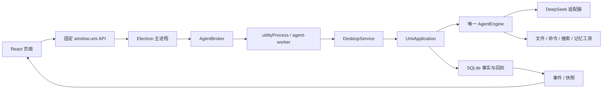

# Umi 新会话交接

## 2026-10-18：0.2.0-alpha.3 Windows 发行

按用户新授权提交并推送累计顶栏修复，以新版本v0.2.0-alpha.3同步本地安装器/便携包和GitHub Releases，旧版本资产保留。包含开发/发行菜单区分、原生窗口控制、侧栏按钮常驻灰底与标题按钮固定色块修复；README、CHANGELOG、已知问题及版本说明同步版本。

本轮类型检查/构建、核心全量486/486、源码完整桌面83/83和实际便携桌面83/83通过；新版本exe的ProductVersion/FileVersion均为0.2.0-alpha.3。安装器从同一已验收便携目录封装，公开前由脚本强制核验195个运行文件、exe和ZIP，并比对远端资产摘要。托管CI仅覆盖明确列出的离线子集，不替代原生桌面回归。

本轮无新增数据库迁移、依赖升级、付费API或默认会话库改动；未执行实际安装/卸载，未配置签名/自动更新。见[alpha.3版本说明](releases/0.2.0-alpha.3.zh-CN.md)。发行证据在E:/Codex/Workspace/output/umi-github-release-alpha3-20261018；下方“不提交/不更新发布”等为此前修复阶段范围，本轮由用户明确变更。

## 2026-10-18：顶栏灰色底板修正（未发布）

侧栏按钮已展开时不再常驻灰底；应用/编辑与左侧按钮统一用主题文字色6%的悬停叠色、10%的按下叠色，无投影。原生标题按钮改为透明底，解决固定灰色块与Mica材质不连贯。开发/发行区分、原生窗口按钮、现有布局及所有未提交修改保留。类型/构建、源码完整桌面83/83通过，实际便携完整桌面83/83也通过；195个运行文件hash与最终源码/构建指纹一致，本地便携已同步；本轮不重复核心全量。不提交Git或更新GitHub/Setup，不调用真实API或改默认会话库。见[顶栏说明后续修正](desktop-titlebar-20261018.zh-CN.md)，证据与旧便携备份位于E:/Codex/Workspace/output/umi-titlebar-surfaces-20261018。

## 2026-10-18：开发与发行顶栏区分（未发布）

原生“Umi / 开发”菜单此前无条件注册，已改为40px紧凑顶栏：侧栏按钮、应用、编辑，开发版额外提供开发菜单；移除左上角产品图标，保留Windows原生窗口控制。应用只含关于/退出，编辑使用原生角色，设置页保留顶栏。发行判定来自app.isPackaged，主进程拒绝伪造开发菜单，发行版禁用DevTools。调用链与学习入口见[本轮说明](desktop-titlebar-20261018.zh-CN.md)。

本轮类型/构建及13项相关逻辑测试、源码完整桌面82/82通过；实际便携完整桌面82/82也通过；195个运行文件逐项hash与最终源码/构建指纹一致。完整退出旧进程再启动release/Umi-win32-x64/Umi.exe可查看本轮结果。独立测试数据，无真实API/默认会话库改动。未提交Git或更新GitHub/Setup；已发布alpha.2资产保留，不把本轮未发布修复混入旧版本发布说明。证据与旧便携运行文件备份在E:/Codex/Workspace/output/umi-titlebar-release-20261018。

## 2026-10-18：Windows 0.2.0-alpha.2 预发布

按用户要求同步Windows安装器、完整便携ZIP、SHA-256清单与构建清单，使用新版本v0.2.0-alpha.2保留旧版。包含本日具体模型编号、直连Search/Fetch及快照补读、归档永久删除、数据库版本7与HTML预览修复；README、CHANGELOG、当前问题清单与发布说明同步版本。

本轮重跑类型检查/构建、全量484/484、源码桌面78/78、实际便携桌面78/78及实际便携预览34/34通过。发行公开前必须校验安装器实际内嵌192个运行文件和exe、ZIP完整性及远端四项资产SHA-256。仅生成并分发安装文件，未实际安装/卸载、未改默认会话库或调用付费模型；没有代码签名和自动更新。详见[版本说明](releases/0.2.0-alpha.2.zh-CN.md)，证据与备份位于E:/Codex/Workspace/output/umi-github-release-alpha2-20261018。下方“不更新Release”等为此前各阶段范围，本轮由用户明确授权更新。


## 2026-10-18：源码同步与社区首页整理

本轮按用户新授权整理并提交累计的模型显示、网页研究、归档永久删除及HTML预览修复。README以Umi整体工作流程为主线，介绍文件/项目、联网资料、命令、上下文、多轮任务、交付和桌面能力；说明单一循环、事件与模块边界，区分main未发布源码与Release安装包。贡献指南改为可复跑的检查说明，托管CI增加网页搜索/抓取与会话删除的离线回归。

本轮类型检查、构建、全量484/484以及CI同配置子集220/220通过；公共文档31处本地链接有效，待提交源码扫描未发现疑似凭据或禁止提交的本机资料。前轮源码/便携各78项桌面与各34项预览专项是此前验证，未在本轮重复运行。不更新安装器或远端Release、不调用真实API、不修改默认会话数据。证据位于E:/Codex/Workspace/output/umi-git-readme-20261018。下方“不提交Git”是各历史阶段的授权范围，本轮由用户明确变更。


## 2026-10-18：HTML首帧与长文档预览修复

定位到读取开始前创建空iframe、随后多次替换srcdoc的触发路径。FileContent改为同版本完整HTML到达后再清理和挂载一次，空文件正常留白；保留原有缩放/拖动、CSP与sandbox、资源/交付权限。其他格式仍滚动续读。原实现24次复现空白，修复后24次连续打开通过；源码/实际便携扩展预览各34项、相关逻辑66项、源码/便携完整桌面各78项通过。本地便携已同步，192个运行文件hash一致。本轮未重跑484项核心。详见[修复与学习说明](html-preview-repair-20261018.zh-CN.md)。下方HTML仍未修复的表述属于之前的历史时点。保留全部未提交修改，不提交Git、远端发布或调用真实API，不改默认会话库。


## 2026-10-18：唯一搜索与归档后的永久删除

旧模型包装实现已无独立价值；唯一工具统一为search_web，模块为umi.web-search，不注册旧工具名/回退接口。此前Fetch、完整快照和有界补读保留。归档页新增取消/明确确认后的永久删除，侧栏原“删除会话”准确改为“归档会话”。仅用户管理命令可删除，不是模型工具。

删除事务覆盖会话、运行、请求、消息、事件、附件、上下文及不被其他会话引用的资料；只清理固定托管环境，源文件/交付和导出保留。目录清理失败保存待清理项，重启核验后重试；活跃任务/未知副作用阻止删除。迁移7不改写旧SQL/指纹，ready/CLI/worker共用DATABASE_VERSION=7，A-03已修正。10项新测试覆盖共享资料对象键引用、计算ID导出回执、全回滚、联接、来源引用、补清理与客户端草稿/反馈。最终核心484/484、实际便携桌面78/78通过，191个运行文件hash一致，源码/构建/便携指纹150d151778235afc73005eaebbb49e6bb2d5d48a8ecb93b4b9a8a1e12e3a4d44。本地便携已同步。前两次桌面检查分别在69/77与70/78被已知HTML首帧断言阻断，失败记录保留；不能据最终通过声称旧问题已修复。

用户明确允许舍弃测试历史，默认7条会话已同盘改名备份后重置为0会话/0资料的7版新库；全局配置、头像/主题及用户源目录保留。备份为原agent同级agent-test-backup-20261018。不是普通永久删除功能自动备份。实现契约、风险审查、学习入口和准确验收见[本轮报告](search-clean-and-deletion-20261018.zh-CN.md)。

本轮不提交或推送Git、不更新远端发布/Setup安装器，不新增真实API调用；既有未提交源码与学习注释全部保留。旧报告中旧搜索名、未提供永久删除、数据库ready错报等均是历史状态。证据在E:/Codex/Workspace/output/umi-search-clean-delete-20261018。


## 2026-10-18：直连搜索与有限真实 API 验收

deepseek_server_web_search 已迁移至官方 POST /v1/tools/search，保留工具名和 query；不再另经 Flash 模型包装。搜索词1～128个Unicode字符，默认5/最多10条，空结果和失败分开；摘要视图有界，完整结构化回执独立存入 web-search artifact，read_artifact 可补读。成功回执建立会话归属，保留现有 Fetch/read_webpage、唯一循环、批准与窗口维护，无新数据库表。

本轮用户授权有限真实API，硬上限3搜索/3抓取/6模型，实际2/2/3，均HTTP 200；真实模型完成搜索、抓取、补读及有来源的正文答复。9352字节Markdown首8KiB确实截断，完整回读hash相同；三次模型输入15382/20039/20805 token。仅证明本次指定任务，不保证所有资料自动读全或提供商提取完整。请求与费用边界、16项新增测试和学习入口见[本轮报告](web-search-live-20261018.zh-CN.md)。

类型检查、构建、全量474/474及实际便携桌面74/74通过；187个运行文件hash一致，源码/构建/便携指纹adeab2cd917bc3fffd96edd20f271d44098b41bd02e61a629dc5b24c5676cea9。本地便携已同步，菜单完整退出后重启。独立测试数据与旧包备份在E:/Codex/Workspace/output/umi-web-search-live-20261018。未提交/推送Git、未更新GitHub Release或Setup安装器，未操作生产会话，全部既有修改与学习注释保留。下方“保留旧搜索、真实API未测”仅为前轮历史记录。


## 2026-10-18：独立网页抓取与完整快照按需读取

已接入 fetch_webpage / read_webpage，保留当前搜索。完整保存上限内提供商返回的 Markdown 为独立 artifact；首次只给 8KiB 摘录和有界目录，本地全文字面查找/UTF-8 续读可追回中部与末尾，工具 data 不藏全文。响应超过4MiB或正文超过2MiB明确失败，不伪装完整；网站提取完整性未知。成功快照按会话归属，窗口维护与重启后仍可查；同轮默认复用、明确刷新新建快照。无新数据库结构、调度器或插件平台，源码/学习注释与上轮未提交改动保留。全量458/458、最终相关71/71及本地便携桌面74/74通过，185运行文件hash与最终源码指纹一致，本地便携已同步。实现、验收和能力边界见[本轮说明](web-fetch-20261018.zh-CN.md)。本轮不提交 Git/远端发布，不调用付费API或操作生产会话。

## 2026-10-18：DeepSeek 1017 具体型号与本地切换更新

已核对官方 2026-10-17 公告：Flash 显示 DeepSeek-V4.1-Flash-1017，Pro 显示 DeepSeek-V4-Pro-0813；真实 API ID 仍为 deepseek-flash / deepseek-v4-pro，旧会话设置保留。输入区、菜单和设置页共用模型表；窄区隐藏品牌前缀以保留完整型号日期，提示包含完整名称和 API ID。沿原设置/IPC/唯一循环切换，不增加模型路由或新调度。类型/构建、15 项针对性测试及实际便携版 74/74 桌面检查通过，182 个运行文件 hash 和源码/构建/便携指纹一致，详见[本轮说明](deepseek-models-20261018.zh-CN.md)。

本轮只同步源码与本地便携程序，不提交 Git 或更新远端发布/安装器，未调用付费 API 或修改生产会话。旧 A-01/A-02/A-03 及 HTML 已知问题不因本轮而视为修复。

## 2026-10-17：GitHub与Windows预发布 0.2.0-alpha.1

本轮同步安装器、完整便携包和校验清单，图标改为平面圆角白底。GitHub托管CI只运行明确列出的协议、文件IO和界面逻辑测试，不覆盖真实Windows进程桥。初次在托管环境运行全量时，宿主进程就绪/崩溃核验出现超时和失败，运行随后被停止；这项托管环境兼容性仍待处理，不能把后续CI绿色当成439项全量通过。本轮完整439项结果来自本机Windows 11，所有原测试及断言保留。版本入口：[v0.2.0-alpha.1](https://github.com/QI-seven33/Umi/releases/tag/v0.2.0-alpha.1)；本地输出release/installers/。公共README、贡献/安全/授权/第三方声明、Issue/PR模板和Windows CI已整理。项目未选择新的开源许可证，状态为UNLICENSED。

本轮类型检查和构建通过，439/439核心测试通过（测试文件并发度2）；源码桌面72/72通过；实际便携exe 64/72检查已通过，随后因已知HTML可见排版断言失败而结束，余下8项未执行。安装器实际嵌入载荷解包后182个运行文件逐项hash通过，载荷exe与便携exe相同。安装/卸载交互和注册表/快捷方式行为没有在本机额外执行验收；安装文件未代码签名。

详情见[本版发布说明](releases/0.2.0-alpha.1.zh-CN.md)和[Windows流程](windows-release.zh-CN.md)。已有历史改动、学习注释和3个旧删除保留并纳入本次提交范围；证据/旧exe备份保存在E:\Codex\Workspace\output\umi-github-release-20261017。HTML首帧偶发空白及A-01/A-02/A-03仍待单独处理。此条不授权下一轮自动实施旧计划。


## 2026-10-16 最新：输入区蓝色呼吸与请求卡等宽

运行输入框改为3.2秒蓝色呼吸边缘，只改变透明度；停止/结束后移除，减少动态偏好下为静态蓝边。旧canvas电流组件已移除。权限卡和选项卡不再单独限制620px，宽度、左右留白和18px外圆角共用输入框规则；正文12px、标题13px/500字重，沿用主题UI字体，无额外卡片阴影。宽聊天区820px、右预览展开后的窄区约446px，均与普通输入框实测等宽对齐。

本轮 TypeScript、桌面构建与29项相关UI/分页/问答/交付回归通过；宽窄批准卡/问答卡、真实提交、蓝色呼吸、减少动态及停止状态的桌面检查均通过。完整桌面检查：源码版72/72通过；实际便携版Umi.exe 72/72通过。182个运行文件逐项hash匹配，源码、dist、便携版指纹一致。没有重跑历史439项全量或13项服务契约。

便携版已同步；通过菜单完整退出后重启。说明和学习入口见[输入区调整](composer-breathing-20261016.zh-CN.md)。证据与旧便携备份：E:/Codex/Workspace/output/umi-composer-breathing-20261016。修改前311条记录、3个旧删除保持；本轮仅删除已替代的ElectricBorder.tsx。唯一Agent循环、宿主桥、权限语义及此前布局修正保留，A-01/A-02/A-03仍未处理。旧“电流特效、请求卡最大620px/14px外圆角”属于历史设计。


## 2026-10-15 最新：布局、预览与拖动性能修正

右侧收起按钮位于工作卡片右上角并给标签留位，左按钮保留顶部。聊天与预览顶栏同为48px；完整路径和查看/刷新/打开共用单行。查看和打开方式共用9px菜单，原文代码同样着色，补JSONL/NDJSON。普通HTML保留自然字号，仅固定像素宽度布局适应缩放；静态隔离和既有打开桥不变。右侧空时留白。

窄聊天区保留420px，模型控件可收缩，textarea原生随文字/宽度自适应（最高140px）。拖动通过RAF更新CSS，松手才提交React与存储，关闭拖动宽度过渡并覆盖释放/取消/失焦。修复高权重全局hover与强制圆角冲突；设置/失败操作无灰色浮起，文件入口主题蓝色，移除思考摘要尾部挤成竖排的中断徽标，状态事实仍保留。

本轮 TypeScript 与桌面构建通过，29 项相关 UI/分页/交付回归、13 项桌面服务契约通过；源码真实 Electron 72/72、实际便携版 Umi.exe 72/72 检查通过。183 个运行文件 hash 与构建清单一致，源码、dist、便携版指纹相符。未重跑历史 439 项全量测试。构建时间 2026-10-15T12:30:28.684Z，打包时间 2026-10-15T12:32:13.611Z。

真实拖动观察：36 次指针移动期间 localStorage 写入 0 次、iframe srcdoc 重载 0 次、宽度过渡 0s；松手保存 1 次。聊天区 420px、输入框 388px，按钮无越界，短草稿重排完整。

详见[本轮说明](layout-polish-20261015.zh-CN.md)。证据、307条修改前记录（3条旧删除）与旧便携备份：E:\Codex\Workspace\output\umi-layout-polish-20261015。打包使用Electron npm包自带校验表验证本地缓存，解除重复联网获取清单的阻塞。所有旧改动/学习注释保留；A-01/A-02/A-03仍未修复。此前“左右控制同一顶栏”“路径独立一行”“所有HTML至少1024宽”等描述不再是当前契约。


## 2026-10-15 前轮：双侧栏对齐与纯文件预览

左右收起按钮共用同一顶栏，修复此前独立定位造成的错位；头像与主体位置保留。右侧没有打开文件时完全留白，移除成果首页、计数、说明和首页按钮。文件标签采用随包内置的彩色 vscode-icons 原版图标；上方只保留路径、原文/预览、重新加载、打开方式。默认预览：代码语法着色、Markdown 排版、HTML 静态隔离页、图片按比例显示。内层卡片、版本/hash/大小信息和手动分页条移除，长文件随滚动续读；长行折行、细纵向滚动条。

文件身份、同版本连续分页、目标 hash 刷新和原有打开桥保留。冻结页展示 after（删除项展示 before）；原文/预览是同一内容的呈现方式。HTML 不执行脚本或访问宿主桥/外部资源；PDF/Office 等二进制解析能力没有扩展。系统默认打开仅针对已有交付回执，工作副本仍可在文件夹中显示，没有新增 Shell 打开入口。

本轮 TypeScript 编译与桌面构建通过，29 项相关 UI/分页/交付回归通过；源码真实 Electron 63/63、实际便携版 Umi.exe 63/63 检查通过。181 个运行文件的 hash 与构建清单匹配，源码指纹与源码、dist、便携版一致。本轮没有重跑上一轮 439 项全量测试。构建时间 2026-10-15T11:05:50.464Z，便携版打包时间 2026-10-15T11:07:05.264Z。

说明与学习入口见[文件预览调整](file-preview-20261015.zh-CN.md)。证据、修改前272记录和上个便携版备份在 E:\Codex\Workspace\output\umi-file-preview-20261015。此前十二项界面说明和439/56项记录为历史证据；其中“右按钮保持旧坐标、右侧成果首页、三态差异/版本折叠”已被本次用户要求覆盖。审计 A-01/A-02/A-03 仍待单独选择处理。


> 最新交接日期：2026-10-15（历史阶段按原日期保留）。用于恢复开发上下文，不代表重新完成全部验收。产品名称始终是 **Umi**。


## 2026-10-15 前一轮：界面十二项打磨与便携版同步

按用户新要求移除左上/欢迎区产品图形与文字品牌，左侧收起按钮独立置顶，新对话/工作区上移；头像底部位置和右侧控制坐标保持。欢迎区hello采用离线可变字体的压力效果；运行输入框为契合原圆角和#2e7feb的低强度电流，隐藏/离屏停止，减少动态偏好下静止。

批准卡与问答卡收窄至最大620px、14px圆角，字体/间距收紧；长命令保留可展开完整描述。问答逐问显示、返回/下一问/自定义回答/最后统一提交，卡片正文无内部滚动。变化列表去掉悬停阴影和侧边操作标签，真实失败命令标红；右侧去掉重复新建工作区，标签紧凑，差异红删绿增、冻结版本折叠，连续分页/成功交付后打开保留。消息操作区提供复制、赞踩、重新组织和更多；赞踩仅本机，重新组织先填草稿，不自动重跑工具。设置页统一无阴影并收紧卡片。

本轮最终439核心全量、29项相关UI回归、源码56项和实际release/Umi-win32-x64/Umi.exe的56项真实Electron检查均通过。首次并发438通过/1项等待超时、独立31项通过及后续全量439通过的日志均保留；没有修改该核心超时测试。原便携版确认为10月5日旧产物，已保存旧exe/dist后重新打包，148运行文件逐项hash及源码指纹一致。新增dist/umi-build.json与release/umi-release.json，打包前拒绝过期源码/产物，打包后核验；以后更新便携版运行npm run package:desktop，npm run dev只更新源码版。

实现/学习入口、12项对照、参考来源、验收和限制见[本轮说明](ui-refinement-20261015.zh-CN.md)。证据/本轮前262记录（含3个旧删除项）与旧便携备份：E:\Codex\Workspace\output\umi-ui-refinement-20261015。未修改唯一Agent循环、工具/权限策略、生产会话、Windows设置或调用付费API，全部旧改动与学习注释保留。此前审计A-01/A-02/A-03仍未修复，后续按小范围另选。

本轮已按用户第11项同步指定便携版。使用前菜单完整退出旧Umi再启动新exe，关窗只隐藏。以下同日早先与历史记录不代表当前界面或发布状态。

## 2026-10-15 较早：24/96图标与普通Umi文字（历史，页内品牌现已移除）

用户自行将侧栏/欢迎图标调为24/96 CSS px，本轮原样保留。欢迎区移除“一万年太久太久 太久太久 只争朝夕”，仅保留用户当前标题“今天打算做些什么呢？”，改用Segoe UI Variable Text / Microsoft YaHei UI，24px、400字重；无工作区时原有必要连接/选择提示仍保留。左上角图标旁新增普通文本Umi，Segoe UI、18px、400字重、8px间距，随主题变色，不恢复图片字标。

统一图标入口：页面侧栏/欢迎区共用现有512透明PNG；Windows窗口改用同来源七尺寸ICO，构建复制ICO并作为网页favicon；Windows打包配置继续读取同一public/umi.ico。ICO重新由当前PNG导出，内容与既有同源ICO一致；未更改图形/透明白色角色。未重新发布或同步便携包，也未改Windows图标缓存/快捷方式。

本轮常规编译、桌面构建、50项隔离真实Electron检查和diff检查通过；核对24/96尺寸、单句/字重/字体、普通品牌文本无按钮遮挡、浅深主题及ICO七尺寸与PNG逐项匹配，并查看两张截图。未重跑此前439项核心全量。未改Agent/工具/权限/生产数据或调用付费API，全部旧修改和学习注释保留。

证据与本轮前备份：E:\Codex\Workspace\output\umi-brand-finish-20261015。源码dist已更新，需从菜单完整退出再启动源码版；关窗只隐藏。此前全面审计及A-01/A-02/A-03仍按原记录保留，未在本轮修复。

## 2026-10-15 当前：单图标与全面源码审计

按用户新要求，侧栏与欢迎区改用同一512×512透明单图标，显示盒48/128 CSS px，移除Umi字形与深色文字遮罩；原横版资源保留为历史材料但不再构建复制/加载。已查看浅深主题截图。

本轮常规编译/桌面构建、439项核心全量、48项隔离真实Electron检查及diff检查通过。额外未使用声明检查25条（产品1、测试24），与常规编译结果分开记录。隔离探针确认三个未修复问题：writer.starting遗留会持续阻止启动；TASK_LIMIT仍只有状态原因而无独立正文；数据库实际迁移6但CLI/worker/ready仍报告5。重复无进展TASK_STALLED正文和跨轮打开已实现、用户实测正常，不重新列为未实现。

完整架构/调用链、问题证据与修复契约、权限/宿主网络边界、持久化/上下文/UI/构建审查及六步学习路线见[全面审计与学习报告](full-project-audit-20261015.zh-CN.md)。证据与改动前备份：E:\Codex\Workspace\output\umi-full-audit-20261015。候选修复、卡片具体意图、统计、skill/插件、工作根/URL/备份/DTO/CSS等未在本轮实施，下一轮按小范围另选。

保留全部旧改动、未跟踪源码与学习注释，无reset/clean/提交、付费API、生产数据库、Windows设置或发布/便携同步。源码dist已重建，需菜单完整退出再启动；关闭窗口只隐藏。以下同日及早期节为历史记录，当前以本节及审计报告为准。

## 2026-10-15 早些：横版与独立图标适配（历史，现已采用单图标）

用户提供横版标志与独立图标。已处理外围背景/阴影和多余留白，保留角色白色区域，导出1200×376透明字标、512×512透明应用图标与7种尺寸ICO。侧栏100px、欢迎区200px等比显示；深色主题沿同一透明图形的文字范围呈现浅色字标，角色与蓝色符号保留原图。浅色字标生成试稿有杂点，未用于产品。

核心编译/桌面构建及49项隔离真实Electron验收通过，浅深主题截图已查看，ICO逐尺寸解码检查通过；未重跑核心439项全量。保留旧源码/资源与学习注释，未修改工具/权限、生产会话、Windows设置或发布/便携包。源码dist已更新，菜单完整退出后重启源码版使用。说明与资源入口见[图标适配记录](brand-assets-20261015.zh-CN.md)，证据 E:\Codex\Workspace\output\umi-brand-assets-20261015。

## 2026-10-14：桌面验收已整理，批准卡片/技能/插件仅研究

用户反馈跨轮打开和受阻正文收尾的实际体验正常，记录为用户实测反馈。按本轮授权只整理apps/desktop/verification.ts：对齐当前批准标题、10px圆角、欢迎语、蓝色发送按钮、思考菜单和执行环境分类；深色侧栏改为实际背景合成对比度检查；批准等待无输入/停止，停止样式在真实运行中检查；明确点允许本次并核对成功工具回执及来源完整写回，避免把拒绝后的结束误认成交付成功。

本轮核心编译/桌面资源构建及整套隔离真实Electron桌面验收46项通过；失败报告保留，未重跑上一轮439项全量。未改产品UI、工具或权限行为，未用付费API/生产数据库/依赖安装/Windows设置/发布或便携同步。全部旧改动及学习注释保留。

查阅Harness本地639ed015…、Reasonix完整固定4041b48…源码及主流官方资料，确认命令卡缺少具体用途/信息分层；建议后续先卡片意图，再本地skill，随后技能包和窄MCP接入。仅提出契约，未实现或自动授权。执行环境仍为Docker/WSL配置，不是通用插件系统。完整对照、关键源码与验收见[本轮报告](desktop-verification-and-capabilities-20261014.zh-CN.md)；证据 E:\Codex\Workspace\output\umi-desktop-audit-20261014。

## 2026-10-13：跨轮打开、停滞正文收尾与状态文案（已实现）

按用户本轮授权，已交付文档打开改为此次具体打开批准：沿原ChangeSet/成功回执定位，批准前仅观察元数据，批准后核对hash/identity；不依赖旧run读取权限、不新建副本或做无关修改重新交付。手动打开仍走固定原生桥，未知打开回执不自动重放；系统接收不证明页面排版。

重复阈值阻断后沿唯一循环进入受阻收尾：最多一次无工具模型请求，错误/空正文/违规工具/超预算时保存本地真实正文；请求已持久化的恢复不再次收费请求。新原话/停止/未知门控保持，运行为failed且验收blocked，不冒充用户目标完成。过程标题改为“执行受阻”，失败/拒绝/取消/未知分别显示。PROMPT_VERSION为umi-persona-16。

本轮最终439项全量、15项新增专项、核心/桌面构建和diff检查通过；前期失败日志保留。既有UI拒绝断言对齐新语义，专用测试临时目录清理增加有限重试，路径校验不变。额外整套Electron验收因历史UI断言不一致未通过，相关临时调整已撤回，现有界面设计与欢迎语保留；实际默认应用启动仍未专项验收。未调用付费API、生产数据库、重新发布/便携同步或修改Windows设置。源码dist已重建，需菜单完整退出再启动。

学习调用链、恢复契约、完整验证与限制见[本轮说明](cross-run-open-and-stall-20261013.zh-CN.md)。受影响文件原始备份、逐文件变更和日志在 E:\Codex\Workspace\output\umi-cross-run-open-20261013；全部旧改动与学习注释保留。任务信任、网络工具及其他旧B/C候选仍未自动实施。

## 2026-10-13 收尾交接：用户确认修复，下一轮待办重新商议

用户已反馈 HTTP 400 修复后测试通过并确认完成。本轮只整理交接/源码快照，不新增产品逻辑，不重跑上一轮424项测试。最新[新窗口交接](session-handoff-20261013.zh-CN.md)归纳已实现功能、工作资源实际分配、验收限制和第5节待商榷清单；[开场提示](next-session-prompt.zh-CN.md)已更新。备份 E:\Codex\Workspace\output\umi-new-chat-handoff-20261013，source/ 与 manifest.json 保存全部 Git 非忽略源码/文档、hash、删除项和状态/diff。

自然消息优先、分页日志、批量编辑与阶段A已经实现；权限自定义输入暂缓，独立问答支持选项/自定义回答；工作副本路线保持。Windows桥缓存、任务测量/进展策略、宿主任务信任、URL读取、自选工作根和B/C降耦合等为未实施候选，由用户按最新情况调整，不构成全部自动实施授权。默认应用启动、生产延迟/真实复杂任务仍未专项验收；未发布/同步便携包。历史节中的“未实现”按该阶段日期理解。

## 2026-10-13：问候 HTTP 400 的请求规格修复

发现 edit_file 批量参数顶层 union 被 Registry 默认导出为 anyOf，无 object 根；整份工具表随问候发送，能导致接口在执行工具前拒绝请求。现在复用原字段派生 object 输入，执行仍严格校验单项/批量；Registry 导出 input JSON Schema，适配器在本地检查工具根和名称。避免当前 Zod pipe(union) 丢弃入口未知字段错误，使用独立 transform 解析，保持编辑证据与原子批量约束。

本轮实际424项全量、请求/适配器9项及核心/桌面构建通过。真实循环+适配器的本地模拟 transport 验证完整39工具表、问候和读后批量编辑；本阶段未自动调用真实API或读取生产数据库；随后用户已反馈测试通过，确认该修复完成，不扩展为其他任务的验收。备份/证据 E:\Codex\Workspace\output\umi-deepseek-400-20261013。见[原因、关键代码与验收](deepseek-request-fix-20261013.zh-CN.md)。保留全部旧修改与学习注释，未发布/同步便携包；完整退出后重启源码 dist。

## 2026-10-13 当前：阶段 A 问答、冻结审阅和打开（已实现）

按用户更正，权限等待暂不加自定义输入，保留允许/拒绝、无停止控件及独立扩展插槽。新增 ask_user_question：1–3问、每问2–6选项与自定义回答；持久问题/用户回答、等待不请求模型、无60秒超时但响应停止/新输入，迟到回答失效，回答不代表批准。桌面底部独立问答卡与JSON CLI回答入口沿唯一循环。

冻结文件 before/after/diff 完整连续分页、严格 UTF-8 范围；工作预览仅目标 hash 变化重置，附件/冻结身份保留。桌面打开已交付文档/HTML工具与按钮核对当前许可、回执、来源/hash/身份，通过固定主进程 shell.openPath 打开；Agent仍具体批准，document_open 已接入原任务签收，仅证明系统接收指定当前交付版本的打开请求，来源版本变化使旧证据失效；不证明页面呈现，未知不重放。可选配置改称执行环境。

本轮最终421项全量、收尾28项和阶段补充8项、核心/桌面构建通过；隔离真实renderer验证自定义填写/提交、权限无输入/停止、冻结分页与无关修订不重置，视觉遮挡已修复。打开前核验失败/系统明确拒绝是失败，不阻塞后续任务；回执未知不重放。长HTML真实工具链与模拟系统打开端口通过，尚未实际启动默认应用验收；没有真实API、生产数据库、发布/便携同步、Windows/依赖修改，所有旧修改与学习注释保留。备份/证据 E:\Codex\Workspace\output\umi-stage-a-20261013（238个审查前文件）。见[契约、代码与验收限制](stage-a-user-questions-and-review-20261013.zh-CN.md)。完整退出源码版后重启新dist。

## 2026-10-13 本次：项目审查与小范围整改（已实现）

暂停后续原生打开/桥缓存阶段，对当前入口、Git 改动、循环、适配器和真实 renderer 审查。修复同文件修改后复读仍被 TASK_STALLED 误判、交付详情只读重试、未实现 auto 的误导展示与默认工具名称；附件准备端口注入组合层，移除 agent 反向依赖；删除确认无引用的 JellyRadio/样式/time 三文件及对应生成文件，清理产品未使用声明。全部旧修改与学习注释保存于审查前备份。

本轮实际413项全量、核心/桌面构建通过；产品 unused-locals 诊断0，测试仍24。隔离浏览器验证批准范围失败后同ID重试与执行选项说明；不代表生产性能或真实模型完成率。当前主要缺口：审批替换输入器、冻结大文件全文/差异不足、全环境修订过度刷新预览、任务收尾打开缺失；store/资源接口、前端 DTO/长 JSX 与三层 CSS 需增量降耦合。工作副本与唯一循环保留，任务内宿主信任尚未实现。

见[完整审查、关键代码与整改顺序](project-audit-20261013.zh-CN.md)。证据/239文件审查前备份：E:\Codex\Workspace\output\umi-project-audit-20261013。没有真实API/生产数据库/发布/便携同步/Windows或依赖修改，没有Git提交或reset/clean。重建源码dist后需完整退出再启动。

## 2026-10-13 当前：文件工具与必要事实优化（已实现）

按用户授权完成计划一、二项：search_text 返回所有字面出现、行/字节定位、文件范围和版本游标；read_file 支持真实行窗口与 UTF-8 连续分页；edit_file 新增同原版本的原子批量修改，失败整批不写，旧参数/快照/恢复保持。读取版本、模型实际可见范围、工作副本和源交付批准仍保留。

必要事实按域变化才追加，冻结编码前缀及完整当前工具组保持；停止/撤销/未决事实和新原话仍及时更新，不删原历史。精简重复工具说明，要求针对实际目标验证和收尾，保留高难任务探索及 needs_work。请求分项字节/模型/思考档和耗时诊断不进入提示；审批决定等待与轮询时间分开。

本次最终409项全量、核心/桌面构建通过；92428B HTML 两页→一次六项修改→一次批准交付，6次固定模型请求。真实 Node 小项目测试、日常文件、失败/崩溃恢复与自然消息/停止再次验收。20轮实际编码体 44241→45638B，派生快照1条，旧编码前缀完整；是本地固定样本，不是计费/生产性能/真实模型完成率。备份和证据 E:\Codex\Workspace\output\umi-file-tools-context-20261013；[契约、关键代码与限制](file-workflow-and-context-20261013.zh-CN.md)。

只落实一、二项；原生打开和桥编译缓存仍未实现。未调用真实API/生产数据库，未重新发布、便携同步、改Windows或依赖。仓库原多阶段未提交修改与学习注释保留，没有将它们混入Git提交。完整退出后启动源码版本使用新dist。

## 2026-10-13 研究与下一阶段计划（实施前记录）

本轮核对实际源码及 Git，保留全部多阶段修改，只有研究文档更新，没有产品逻辑变化。用固定模型/临时副本复现：同文件 6 次命中 search_text 只返 1 次；单项编辑成功后旧读取回执不能继续改第二处；20 轮消息正文合计 395B，实际 API 编码体从 45785B 长到 99384B，但旧消息前缀完整。Windows 桥每次 Add-Type，执行桥就绪约 0.7–1.7 秒；Job 正常结束也清理分离子进程，不适合作为打开浏览器的可靠通路。以上不能精确归因原 21 分钟或日总 token。

推荐三小提交：①搜索/行读取/同版本原子多处编辑；②必要事实按变化追加、单任务真实统计与按用户要求收尾；③独立已交付 HTML 打开动作，具体交付批准可一并描述。编译桥按固定源码 hash 缓存另做。仍保留工作副本、版本/模型可见范围、旧未知操作只核验；不引入新调度器、全目录指纹、沙箱/安装前提或硬限步骤。具体契约与验收见[根因与计划](workflow-root-causes-and-plan-20261013.zh-CN.md)。

Reasonix studio 固定 4041b48…，Git 克隆失败后以官方 API 取关键源码，位于 E:\Codex\Workspace\reference\DeepSeek-Reasonix（34 文件快照，非完整 checkout）；Harness 本地 639ed015… 与官方 master d743267… 分别核对，未修改本地 Harness 仓库。只借鉴窄机制，不照搬模糊编辑、派生尾部重排或大平台。研究证据 E:\Codex\Workspace\output\umi-workflow-research-20261013。未用真实模型 API、生产数据库、发布或 Windows 配置；上阶段的 388 项验收不是今天重跑。

## 2026-10-12 当前：本地反馈和界面对象修复（已实现）

按用户授权修复本地阻塞：流式片段短批次原子落盘，保留原片段/索引/块边界；循环定期让出宿主，高频 delta 不再深复制全会话；历史 input.applied 局部索引避免每条消息反复扫描所有流式事件。有界事件积压即时追赶，工具正文展开后读取，普通命令串行/停止优先保持。Electron 错误改为普通 DTO 保留 code，内部 commandId 提示不进入用户横幅。

审批等待不显示停止控件，正文单层滚动、决定按钮固定。预览区区分工作副本/冻结变更/附件，首屏 8KiB、连续分页绑定 hash，副本版本变化刷新，迟到请求不串对象；同名附件、冻结交付与拒绝后源文未变已验收。工作副本、源文件批准、未知执行只核验及完整原始历史契约保留。

本次完整 388 项、收尾相关 29 项、核心/桌面构建通过。相同 2048 片段 + 192KiB 历史消费从 4056ms 降到 349ms；20 次隔离实际 Electron UI 的已收文字显示 p95 98ms、点击停止回执 p95 72ms，另做对象专项。固定模型、测试主处理器和独立数据库，不是生产 p95/真实任务费用证据。备份与证据：E:\Codex\Workspace\output\umi-local-feedback-20261012；[契约、关键代码和限制](local-feedback-and-ui-20261012.zh-CN.md)。

未重新发布/同步便携包，未用真实 API、生产数据库或修改 Windows。完整退出后重启源码版本加载新 dist。任务反复读取、过多验证、多处编辑、派生快照控制及文件打开仍是后续阶段，本节不把之前的方向讨论当作实现授权。

## 2026-10-12 当前：自然消息优先与稳定完整反馈（已实现）

用户明确授权“新输入先给模型判断，旧操作只核验不重跑”。send 与旧 resume 分开：停止/异常后发消息可继续、换目标或问状态；旧准备/批准取消，未知执行先作为事实交模型，需要时显式 inspect_tool_execution，只查原执行。停止清理或原工具失败期间的新消息最多补启动一次；宿主 ready/go 释放前再次检查新原话。既有 taskId 新增 active/suspended/cancelled 与替代目标关联，原目标、验收、历史和学习注释保留。没有新增调度平台或免审批宿主权限。

当前窗口的工具结果完整稳定；沿用已冻结请求的完整语义前缀，只追加新消息和派生事实。压力仅来自派生快照时，本地刷新窗口，不折叠原文、不调用摘要模型。真正的旧历史仍整组维护并保留原始资料。设置展示实际服务端 hit/miss 比例和本地前缀变化原因，未调用真实 API 来宣称命中率。Broker 普通名额 32、控制名额 2 分开；长日志预览独立于 64 MiB 脱敏归档，已归档范围可分页，超限仍诚实标记不完整。

本次全量 376 项、收尾关联 40 项复验及核心/桌面构建通过；6,910 字节读取在 10 次 DeepSeek 请求编码（含重启）中保持完整前缀，280,533 字节真实日志五页完整追回。重新验收 11 文件读改测试及 17,120 字节日常文件任务。60 次隔离 Electron 链停止接收暖 p50/p95 为 4.3/6.6ms，终态 10.6/23.2ms，32 普通请求拥堵时 stop 到达；固定模型、隔离数据库和最小主处理器，不是生产会话 p95 或付费完成率。证据及实施前备份：E:\Codex\Workspace\output\umi-natural-turn-20261012。

普通 task 起初有 scratch/artifacts/research/logs；可选 preparation 按需创建 task/cache。用户工作资源根、任意项目交付目标、明确任务内宿主信任和网页读取主入口仍待讨论；保留副本，未实现直接源编辑，也未新增 OS 文件/网络沙箱。未改生产数据库、真实 API、Windows 配置或发布/便携包。本节优先于同日早先记录中的“自然消息/拥堵停止/长日志尚未修复”。详细契约、旧显式恢复兼容规则和关键代码见[本阶段说明](natural-turn-and-cache-20261012.zh-CN.md)。

## 2026-10-12 路线讨论与新隔离样本（未改运行逻辑）

用户已确定保留工作副本，直接源编辑不再是候选路线；用户选定 Umi 工作目录和任意交付目标仍需独立于当前来源工作区。当前副本实际在应用数据根，task 目录没有 cache；独立成果可另处导出，项目 ChangeSet 主要写回来源。本次 4 类任务、2 类续作分支和 60 次隔离桌面停止测量，发现立即停止前未应用原话会使后续 TASK_STALE、异常消息不自动启动、Broker 32 pending 会拒绝 stop、64KiB 默认归档遗漏长日志末尾。缺口尚未修复；固定模型不代表付费任务完成率。优先修自然消息续作/拥堵停止/日志追回，再讨论明确任务宿主信任与网页读取，随后对齐工作目录和交付位置。具体契约、最新官方纠正及证据见[本次路线审视](roadmap-discussion-and-probes-20261012.zh-CN.md)。未改产品行为、生产数据、真实 API、发布或 Windows 配置。

## 2026-10-12 当前：工具完整反馈与停止链修复

已按用户授权修复最新工具组完整反馈、读范围/历史/资料/进程输出的真实分页、content/data 去重、实际冻结请求与完整模型响应的可见证据，以及 worker 优先 stop / 即时接收 / probe 信号 / 同步工具批次让出事件循环。停止收尾与 unknown 核验仍分开；命令批准和目录根/程序/指定文件版本核验保留。PowerShell 改用原生 Unicode Command 参数、UTF-8 文本输出与本次子进程进度静默，中文错误不再以 CLIXML 展示。

本轮 200 项相关测试、4 项真实 Windows 专项及核心/桌面构建通过；11 文件小项目读改后真实 Node 测试通过，17,120 字节中文文件分页改动与追回通过。实际子进程树停止接收约 3.8ms、清理约 55ms；最终 Electron worker IPC 接收约 3.8ms，模拟模型任务约 10.2ms 完成停止。均为隔离单次证据，不是生产 p95 或付费模型完成率。未调用真实 API、操作生产会话、重新发布、同步便携包或改 Windows 配置。备份与证据：E:\Codex\Workspace\output\umi-feedback-stop-20261012。

具体契约、关键代码、最新官方对照和下一阶段见[工具反馈与停止修复](tool-feedback-and-stop-20261012.zh-CN.md)。命令未归档的超限日志仍不可追回；自然消息续作、直接工作区和宿主信任范围均未实现，需先讨论。下面各日期为历史阶段，旧“待修复/当前”判断以本节为准。

## 新对话入口（2026-10-11）

先读 [本次接续记录](session-handoff-20261011.zh-CN.md) 和 [可复制开场提示](next-session-prompt.zh-CN.md)。最新用户方向是减负、提升日常/编码任务能力和反馈；不恢复全目录命令指纹，不把OS沙箱/安装器/留存流程当能力前置。直接工作区及显式宿主信任范围尚未实现，需列具体契约讨论。上一轮107项通过是历史证据，本次仅做交接、备份和Git/文档核对，不是重新测试。最新完整交接源码/状态备份：E:\Codex\Workspace\output\umi-new-chat-handoff-20261011。

## 2026-10-11 当前补充：UI修复与工具反馈审视

按用户现场反馈修复工具行重复运行状态/图标、批准卡片停止按钮、思考区滚动链、顶部内部超时指令；经用户选择将恢复区合为一个“继续任务”。沿既有resume保留预算与原工具核验，未改变后台授权。

隔离样本精确复现2163字节结果在11条工具历史下被投影成首尾744字节，确认即时工具结果与追回结果被反复裁剪；并复现异常中断后新输入保存却不触发模型。核心30秒PowerShell样本停止约49ms，已有进程树停止测试通过，但未复现桌面等待三次超时；worker串行等待stop收尾及reconcile/probe未贯通信号需下一阶段定位。后端截取/编码/停止/自然续作、直接工作区和宿主信任均未在此轮改动。

类型检查、核心/桌面构建、4文件32项与既有停止专项1项通过；临时浏览器验证滚轮边界传递与UI。没有真实API、生产数据库、产品启动、发布、便携同步或Windows修改。源码与学习注释保留，备份及证据：E:\Codex\Workspace\output\umi-ui-audit-20261011。调用链、问题证据、下一阶段契约/验收及Windows边界取舍见[本轮审视](ui-feedback-and-agent-review-20261011.zh-CN.md)。

## 2026-10-11 当前：删减命令扫描与会话加载开销

命令不再递归读取/哈希整个 cwd，也不记录新 process_fingerprints；改为绑定目录根、真实程序、参数和原批准。普通内容变化不重新批准，根被替换仍阻止释放；具体文件编辑、来源交付与未知恢复保留原核验。inspect_execution/preparation 是可选观察，常规测试/构建不用先走准备流程。宿主本来没有网络沙箱，已用回环 HTTP 验证批准后可联网；外网/代理/服务可用性未测。command_exit 只证明指定执行退出 0，当前文件状态须由 file_hash 等独立证明，不能宣称整个项目没变。

桌面快照只查询用户原话并复用一次状态投影；正文首屏渲染近期 8 条用户消息，可加载更早消息、历史刻度展开跳转，新消息保留当前窗口与阅读位置。原始历史、完整工具组及模型上下文不裁剪。临时 20 轮样本：热快照中位约 29→1.3ms，首次正文服务端渲染约 517→236ms，冷快照约 75→49ms；不代表生产 Electron 全链路延迟已经修复，IPC/utility 启动及实际长会话仍待实测。

本轮相关 7 文件最终共 107 项通过（新增 2 项；最终命令/会话 2 文件 36 项另复测），核心/桌面构建通过；临时浏览器验证历史展开、滚动锚点、跳转与追加消息。没有真实 API、生产数据库、产品启动、依赖安装、发布或 Windows 修改。备份/日志：E:\Codex\Workspace\output\umi-streamline-20261011。后续优先常规任务能力与完成率/延迟样本，再讨论工作区直接编辑和显式宿主信任范围；不把 OS 沙箱、自动安装器或留存框架当能力前置。学习入口：[删减与加载调用链](streamline-and-session-loading-20261011.zh-CN.md)。

## 2026-10-11 历史阶段：成果/准备 UI 与本地执行研究

本轮补右侧首页成果分页、核验预览、系统选址后生成导出请求、原目标只读核验/文件位置，以及固定字段的准备检查摘要。请求导出仍需发送给唯一 Agent 并确认原批准，选址本身不保存文件；准备报告明确为历史观察，非就绪或隔离证明。正文增量不刷新成果列表，会话切换隔离迟到响应。新增 UI 沿用现有紧凑圆角风格，没有新增依赖。

本轮相关 5 个测试文件 85/85 通过（新增 5 项），类型检查、核心和桌面构建通过；临时浏览器夹具验证交互及视觉，不代表 Electron/生产端到端验收。没有真实 API、生产数据库、产品启动、发布、依赖安装或 Windows 修改。备份/差异/日志在 E:\Codex\Workspace\output\umi-local-workflow-ui-20261011。旧数量只代表各自阶段。

核对本地 Harness 与固定版本 Reasonix 后，OS 沙箱不列入核心当前路线；下一阶段先解开全 cwd 内容指纹与大依赖执行的耦合，再做具体项目准备安装计划和按引用/使用权管理的缓存留存。大依赖限制、自动安装器、总配额/清理仍未实现，不能把研究方案当作已完成能力。学习入口：[本地执行、安装、留存与成果 UI](local-workflow-and-ui-20261011.zh-CN.md)。

## 2026-10-11 历史阶段：执行准备观察与具体命令绑定

增加 inspect_execution 只读观察选定目录的工具入口、清单、指定副本输入和依赖目录，直接返回模型可引用的 inspectionExecutionId；不启动程序、不安装或联网。run_command/run_shell 可用 preparation 绑定真实成功检查回执，批准/派发/挂起释放前重查；漂移或未观察输入拒绝原命令。批准说明准备目的、完整命令、联网/安装脚本声明及会话任务缓存。任务缓存可复用，准备阶段不预先创建；同 run 拒绝不能换检查回执重复申请。新增 artifacts cwd，命令生成文件后沿既有 capture_output/Export 交付。

本阶段新增 31 项专项；最终相关 11 个测试文件 191/191 通过，类型检查、核心与桌面构建通过。固定模型、临时目录/测试 SQLite，部分场景真实运行本地 Node/Windows 进程；没有联网安装、真实模型 API、生产数据库、产品启动、发布或 Windows 修改。学习注释和前端/CSS 保留；备份、差异与日志在 E:\Codex\Workspace\output\umi-preparation-20261011。下面旧阶段数量按历史归属保留。

观察不是可运行证明：外部版本未执行则未知，依赖目录存在不代表完整；Node 锁只做根记录核对，Python/其他包管理器/workspaces 仍需审阅。准备网络/安装脚本字段及缓存变量不构成 OS 强制范围；普通命令继续具体宿主批准。当前完整命令 cwd 指纹仍有 20000 项/128 MiB/单文件 32 MiB 等限制，大依赖树可能阻塞后续构建，本轮明确验出并保留，未用浅观察偷换内容保护。没有自动安装器、专用准备 UI 或缓存总配额。

学习入口：[执行准备调用链与限制](execution-preparation-20261011.zh-CN.md)。后续优先研究依赖树规模与执行复查的实际断点，再贯通长命令输出、取消/恢复和任务成果验收；涉及弱化检查或扩大自动宿主执行先协商。目标保持普通用户和开发者的本地任务助手，Docker/WSL2 为可选后端，MXC 退役，不为生态扩大核心。

## 2026-10-11 历史阶段：独立成果、具体导出与只读续作核验

文件路线第三阶段的后端契约已实施：create_output 独立创建 UTF-8 成果，capture_output 将 task/artifacts 下的普通文件（含二进制）复制冻结；list_outputs 只读元数据分页，read_output 核验完整 hash 后有界预览。export_outputs 绑定具体成果、绝对目标和父目录身份，批准后逐项独占创建、不覆盖，保存不可变 intent/receipt。生成成功与实际交付分开；部分失败/取消保留逐项结果，未知与重启只观察、不补写。inspect_export 提供新一轮任务的当前只读证据，export_receipt 加入任务验收。

本阶段新增 32 项专项场景；最终相关 7 个测试文件 117/117 通过，类型检查、核心和桌面构建通过。固定模型、临时目录与测试 SQLite，无真实 API、生产会话库、产品启动、发布或 Windows 修改。学习注释与前端/CSS 保留；备份、差异及日志在 E:\Codex\Workspace\output\umi-outputs-20261011。下面数量按旧阶段保留，不是本次重新验收。

成果单文件 4 MiB、批次 16 MiB/20 项，文本输入 256000 字符，预览单次 64000 字节。mime 为声明；二进制默认元数据，显式 base64 可读取范围，无 Office/PDF 渲染。导出父目录须已存在，不提供覆盖、目录管理或删除。wx 不保证正文事务原子，路径复查不是 OS 沙箱；成果总留存配额/清理未实现。桌面固定 list/preview/inspect/open_export 接口已加入，open_export 核验后仅在 Explorer 定位；没有新增 renderer 成果卡片或按钮。

学习入口：[独立成果与导出](outputs-export-20261011.zh-CN.md)。下一阶段补依赖准备与执行分离，再贯通命令输出和成果验收；可选 Docker/WSL2 后端不构成当前产品实现。MXC 保持退役，不修改 Windows、不新建庞大插件框架。见 [执行计划](execution-boundary-plan-20261011.zh-CN.md)。

## 2026-10-11 历史阶段：文本创建与读取绑定替换

文件路线第二阶段已实施：write_file 默认 mode=create，仅新建且独占名称、不覆盖；mode=replace 必须绑定当前会话成功的完整 read_file 回执、哈希及对象身份。edit_file 继续处理实际已读范围内的唯一片段，两种修改共用只读证据校验。派发后再次检查；无变化不落盘，崩溃恢复只观察冻结目标，不重复写入。旧参数未指定 mode 的调用现在只能新建，这是有意的契约收紧；旧已派发执行仍可按原冻结目标核验。

本轮新增 24 项专项场景；最终相关 16 个测试文件 207/207 通过，类型检查、核心和桌面构建通过。固定模型、临时目录与测试 SQLite，无真实 API、生产会话库、产品启动、发布或 Windows 修改。前端与学习注释保留；备份、差异及日志在 E:\Codex\Workspace\output\umi-text-write-20261011。下面旧阶段数量保留历史归属。

完整读取单次最多 64000 字节；超过该预算不能整文件替换，应分段 read_file + edit_file。create 的独占名称不意味着整个正文事务原子：中断可留下部分文件，恢复未知时不清除或重放。应用层路径与替换复查仍不是 OS 沙箱或原子 CAS。修改副本和交付来源仍为不同权限。

学习入口：[文本创建与替换](text-write-20261011.zh-CN.md)。下一阶段先补独立 Artifact/Export 成果链，再围绕本地宿主执行的批准、依赖准备、输出核验和效率补缺。Docker/WSL2 是开发者可选后端方向，尚无产品实现；不把 AppContainer/LPAC 探针作为主线前提，也不新增庞大插件框架。具体边界与验收见 [执行计划](execution-boundary-plan-20261011.zh-CN.md)。

## 2026-10-11 历史阶段：有界文件发现与元数据分页

文件边界路线第一阶段已实现：discover_resource 支持指定根下的文件名/扩展名/相对路径字面匹配，结果含覆盖范围、预算、跳过原因与分页游标；单文件候选仍经具体批准后仅物化该文件。list_files 改为不读取正文的元数据分页，游标绑定对象、查询与元数据版本，重启可续页，目录变化明确要求重新列举。

list_files 条目不再返回内容 hash；需要内容版本使用 read_file/stat_file。cursor 只翻页预算内已观察结果，不延续未遍历目录；totalExact=false 时须缩小 root/depth 或 prefix。原完整扫描、内容限额、批准和 ChangeSet 交付规则保持。尚未实现新建/整文件替换的分离契约、独立成果导出或 OS 执行隔离。

本轮新增 16 项专项场景，最终相关 11 个测试文件 132/132 通过；类型检查、核心与桌面构建通过。固定模型、临时目录与临时 SQLite 验证，无真实 API、生产会话库、产品启动或发布；Windows 未修改。备份与日志位于 E:\Codex\Workspace\output\umi-file-discovery-20261011。

学习调用链与限制见 [发现与分页](file-discovery-20261011.zh-CN.md)；后续隔离候选及正反向探针矩阵见 [执行边界计划](execution-boundary-plan-20261011.zh-CN.md)。本机 Home 系列不把 Windows Sandbox 作为默认路线；AppContainer/LPAC 仅列待验证候选，尚无原生可行性结论。下一阶段为创建/替换意图，再补 Artifact/Export。

## 2026-10-11 历史阶段：任务验收与续作第一阶段

新增原话绑定的持久任务检查点、固定验收项、证据核验与跨 run 续作。file_hash / command_exit / delivery 分开验证，结束前只读复核当前产物；run.completed 仍仅表示运行结束，另保存 acceptance 报告。无进展时有界反馈，停止后不自行重启，未知副作用恢复不重放。验收报告和结束事件同事务提交；仅最终提交失败可恢复，派发失败契约不变。

模型提出的验收项不保证覆盖完整用户目标；主观质量、任务范围调整/关闭、真实模型完成率和无人值守调度尚未完成。没有 UI 重设计或操作系统沙箱。文件发现默认只查目录名、列举无分页及新成果交付缺口已确认，形成下一阶段计划，本轮未改这些工具的权限。

本轮实际新增 21 项专项场景；相关 13 个测试文件 165/165 通过，类型检查和核心/桌面构建通过。使用固定模型/进程替身和临时数据，不使用真实 API、生产会话库，不启动产品或发布；Windows 未修改。

学习与源码链见 [任务验收与续作](task-acceptance-20261011.zh-CN.md)；源码排查、Harness/Reasonix/Kimi Work 来源和实施顺序见 [文件与执行边界计划](file-boundaries-plan-20261011.zh-CN.md)。完整备份及日志位于 E:\Codex\Workspace\output\umi-task-acceptance-20261011。下面数量保留对应历史阶段归属。

## 2026-10-11 历史阶段：MXC 清理与基础设施盘点

MXC 专用实现、测试和编译产物已退役，专项学习文档、SDK 与实验集中归档到项目外；不再继续原生桌面探索。通用工具模块、Windows 执行端口、批准/证据/恢复接口保留，默认 Windows V1 行为不变。当前源码没有 MXC 依赖或启动入口。

有界上下文已落地当前 bounded-v1 契约；任务完成与续作、执行边界、日常能力与效率均已有部分实现，但独立目标验收、持久任务续作、OS 沙箱与完成率/效率基准尚未完成。下一步优先任务验收与续作，不将 run.completed 当作用户目标已验证。

本轮实际类型检查、核心/桌面构建和相关 12 文件 154/154 通过；未增加测试或执行 MXC 实验，未重验历史数量。Windows、生产会话、真实 API、发布和 Git 提交未操作。

当前能力、缺口和六条源码阅读链见 [开发状态与阅读入口](development-status.zh-CN.md)。旧阶段数量保留历史归属，不计为本轮检查；退役资料与清理前备份位于 E:\Codex\Workspace\output\umi-mxc-cleanup-20261011。

## 2026-10-10 有界活跃上下文补充

已实现 bounded-v1：最新用户输入完整保留，旧长输入可按完整消息组退出活跃窗口；SQLite 原文不改写，窗口清单保存可核验的原话定位与字节摘录。活跃要求索引最多 12 项，长工具结果投影有界，新增 list_user_requirements 分页追回全部输入。本地折叠用户原话不调用摘要模型；每 run 的四次上限现在只计模型维护请求。批准、环境与执行身份不因折叠改变。

本轮实际类型检查、桌面构建及 11 个相关测试文件 93/93 通过，新增 13 项已包含在 93 项中；未执行全量测试、付费 API、生产会话库操作、产品启动或发布。本轮没有新增迁移或修改历史 SQL；旧清单可读，新清单向旧程序降级兼容不作保证。隔离样本的保守输入估算从 267361 降为 42752，摘要模型请求为 0，这不是真实 token 或模型质量验收。

实现、契约及限制见 [有界上下文记录](bounded-context-20261010.zh-CN.md)，文件操作调用链与固定提交参考源码对比见 [文件增删改查](file-operations-comparison-20261010.zh-CN.md)。本轮已取得 Reasonix 官方 studio 提交 afa05c118365b2744767678c7650bf08c586a0bd 的选定文件源码；下面旧研究的网络状态只描述当时，未替代本轮证据。备份与测量位于 E:\Codex\Workspace\output\umi-bounded-context-20261010。

剩余：最新单条原话或明确保留内容自身超限仍阻塞；旧要求追回的语义质量和长任务完成率未做真实模型验收；历史核验仍可能遍历全量消息。重复来源、耗时、任务完成证据与宿主 OS 沙箱未在本轮实施。下文各阶段的案例数量保留为对应阶段记录。

## 2026-10-10 后端排版与研究补充

按用户要求整理 56 个后端 TypeScript 文件，其中 54 个排版变化；学习注释保留，前端/CSS、测试与验证脚本未调整。56 个文件格式化前后 esbuild minify 输出一致，注释文本一致（忽略排版空白）；本轮类型检查与 diff 空白检查通过，无行为契约变化，没有重新执行上轮行为测试。备份与验证清单在 E:\Codex\Workspace\output\umi-backend-reading-20261010。

已只读研究本地 Harness 的选定源码和 Reasonix 官方 studio 分支页面；Reasonix 网络克隆未完成，未取得一致提交快照，不宣称全量审计。结论、来源、Umi 阅读入口和未来路线见 [后端阅读整理与 Agent 机制研究](agent-harness-comparison-20261010.zh-CN.md)。目标验收、Runtime 沙箱、上下文窗口等是建议，尚未实施；本轮没有真实 API、生产会话数据库操作、应用启动或发布。

## 2026-10-10 开发补充：单文件范围与恢复反馈

本轮已在实际源码目录实现单文件资源范围、迁移 6、物化失败阶段与恢复核验反馈。指定文件不再提升为整个父目录；副本操作、冻结 ChangeSet 与交付保持所选文件范围，旧目录记录仍按目录解释。等待批准后来源变化会使原批准失效；扫描前失败直接结算，已有计划则先核验原副本，不盲目重复制。

本轮最终类型检查与桌面构建通过；9 个相关测试文件 95/95 通过，另有批准/迁移相关筛选回归 7/7 通过。新增单文件用例 17 项包含在 95 项中，不重复相加；这些是今天实际执行的结果，不是历史阶段数量。未调用真实 API、打开生产会话数据库、启动产品窗口、打便携包或发布；尚未进行桌面视觉验收。

本轮开始发现 10 个文件有本地修改（包括 broker、App 与文档，较交接时增加）。学习注释及用户改动保留，原始 diff 与字节指纹保存于 E:\Codex\Workspace\output\umi-resource-20261010。仅向本交接增加当前补充，另有 8 个原有修改文件字节未动。broker.ts 在工作期间另有学习注释和排版更新；本轮没有写过此文件，新的修改也保留。开始时与最后版本经 esbuild minify 比较一致，最终类型检查仍通过。

具体契约、调用链、验收证据、旧 UI 断言复现与剩余限制见 [本轮单文件开发记录](resource-scope-20261010.zh-CN.md)。下文是交接时点的历史背景，P0/P1 最新状态以本补充为准。

剩余：任意多文件选集尚未支持；重复输入来源、多片段总耗时、长上下文预算和模型响应版本证据仍待后续。部分副本保留，无一键重复制/清理入口，新的复制必须作为新执行解释。

## 1. 先确认工作位置和 Git 状态

| 项目 | 交接时状态 |
| --- | --- |
| 当前开发源码 | `E:\SOME_SEVEN_PROJECT-57\Umi_v2.0` |
| GitHub | https://github.com/QI-seven33/Umi |
| 分支 | `main`，跟踪 `origin/main` |
| 本次交接前的发布基线 | `c146ce275b2b23efc081549720e788523a6a1c6d` |
| 迁移前的旧实现 | 上述提交的父提交 `ca51df5ba06ef6fda664e9b4d60d620131bd08af`；在 Git 历史中研究 |
| 发布中转目录 | `E:\Codex\Workspace\umi-github-publication`；这是另一份检出，不是当前开发源码 |
| 本地交接备份 | `E:\Codex\Workspace\output\umi-handoff-20261010` |

新会话第一步应在实际源码目录执行 `git status --short --branch`、`git log -3 --oneline`、`git diff --stat`。不要假定新会话继承了此前 cwd，也不要在发布中转目录修改代码。表中的基线是交接前的代码提交；交接文档的最新提交请以 Git 日志为准。

### 学习注释与 Git 记录

交接检查发现以下五个文件有本地修改：

- `apps/desktop/main.ts`
- `apps/desktop/preload.ts`
- `apps/desktop/service.ts`
- `packages/adapters/src/host-files/paths.ts`
- `packages/protocol/src/desktop.ts`

这些学习注释属于正常源码，可以直接保留并继续开发，不需要先清理或另行审批。“未提交”仅表示改动尚未保存到 Git 提交记录，不表示开发存在障碍。备份是为了在换机器或意外覆盖时能够找回，不是隔离这些注释。

这些改动主要添加中文学习注释、调整排版，`main.ts` 还展开了部分代码块。四个文件去除注释并规范化空白后的 esbuild 输出与基线一致；`main.ts` 经完整 minify 后输出也一致。这是支持性检查，不代替类型检查、运行验证或对学习注释准确性的审核。未发现单文件物化或恢复逻辑已经被修复的证据。

交接时没有把既有学习改动混入文档提交，原文件保持不变；后续可把注释作为正常源码变更提交。交接时的状态是：**本机源码包括这五个改动；重新从 GitHub 克隆只得到已提交版本。**

本地备份包含：

| 文件 | 用途 |
| --- | --- |
| `manifest.json` | 基线、文件名、原始字节 SHA-256、时间和初次规范化检查结果 |
| `uncommitted-source.patch` | 相对于交接前发布基线的完整 Git diff |
| `working-files/` | 五个文件的原始字节副本，保留注释和换行 |
| `main-before.js` / `main-after.js` | 辅助比较输出，不是应加载的应用代码 |

备份不包含 API Key、个人会话数据库、依赖或便携包，也不随仓库上传。应用补丁前先检查是否已经存在相同改动；不要对现有源码重复应用。需要迁移到另一台机器时，可另行携带补丁/文件备份。当前应继续在原目录工作。

## 2. 阅读入口与证据层级

1. [当前项目详解与开发路线](current-project-report.zh-CN.md)：整体架构、数据、权限、上下文和已知问题，核对日期 2026-10-09。
2. [代码学习与开发指南](code-reading-guide.zh-CN.md)：具体文件、调用链、练习和修改入口。
3. [核心契约 C00–C14](contracts-v1.md)、[架构](architecture-v1.md)、[迁移与验收](migration-and-acceptance.md)：设计约束与阶段验收基线。
4. `stage-*.md` 等历史报告：对应阶段当时的状态，不是最新源码的全量验证结果。
5. 对应源码和测试：判定实际行为的依据；文档和注释有冲突时核对实现与证据。

早期报告中的“图片未接入”等内容已经过时；历史案例数量不能写成今天重新测试通过的数量。上一次发布执行过类型检查；本次交接只核对 Git、改动、备份和文档，不启动应用、不调用真实模型、不重新打包或跑测试。

## 3. 已实现的核心结构



渲染进程通过主进程请求已有核心，不直接持有 Agent 的 MessagePort。当前运行不需要旧 Python 后端。根目录只有一个 npm package 和 tsconfig，`packages/` 是职责划分，尚不是独立发布的 npm 包。

关键边界：

- 模型建议操作；应用判定权限并保存派发事实；执行器核验实际效果。
- SQLite 的消息、事件、回执、批准、执行记录与 artifacts 是恢复依据；模型摘要不能宣布交付成功。
- 文件以批准后的工作副本为编辑对象，真实来源写回需要冻结 ChangeSet 和具体批准。
- 宿主命令都经具体批准。当前没有 OS 文件/网络沙箱，cwd 不能限制访问范围。
- Windows Job 管理其覆盖的普通后代进程，不保证控制 WMI、外部服务或容器里的所有进程。
- 原始记录保留；上下文只是模型可见的投影。工具调用与结果按完整消息组维护。
- 恢复要先核验未知效果，不能把 resume 当成无条件重跑工具。

## 4. 最近界面工作与用户偏好

当前已纳入发布基线的界面工作包括透明横版品牌、紧凑圆形发送/停止按钮、英文 Off/Normal/High、复制成功反馈，以及输入区内的批准卡片。批准卡片沿用已有权限和事件入口。

继续修改时应延续以下偏好：

- 产品叫 Umi；本地目录名不是产品名。
- 浅色、干净、柔和材质，控件紧凑，圆角统一。不要恢复此前删除的五种彩色底板。
- 左栏选中和 hover 应清楚；用户最后要求 hover 使用选中的背景色。不要增加突兀阴影。
- 过程展开控件不用阴影；发送为蓝色圆形、停止为红色圆形，尺寸协调。
- 思考强度用英文，当前选中等级不加不干净的阴影；上下文环靠近模型名称。
- 工作区移除了独立向下箭头，但整行仍应允许折叠/展开。
- 无输入草稿不应作为已发送会话展示；输入区粘贴文本按钮已移除。
- 简单聊天不应强制追加工具交付说明，也不应正常回答后再生成一份重复总结。
- 活动标题为何不同于 Harness/Codex 已解释为工具参数、事件和展示投影共同作用；用户此前要求此项先解释，不作重大后端改变。
- UI 检验可由用户完成。是否测试按当次请求决定；涉及权限、恢复和持久契约的改动应给出针对性的验证计划，不把旧报告当新证据。

用户可能继续自行改 CSS 参数。修改前看 diff，避免覆盖。当前源码里新增的学习注释也需要保留，并以事实解释其准确性。

## 5. 尚未解决的问题与下一步顺序

### P0：单文件资源闭环

用户曾要求修复桌面的一个 HTML。实际实现把文件路径提升到父目录资源，再扫描/复制整个桌面，因此小文件也可能被无关大文件或目录数挡住，返回 `RESOURCE_LIMIT`。

相关入口：`packages/adapters/src/host-files/resources.ts`、`paths.ts`、`tools.ts`、`delivery.ts`，以及 `packages/protocol/src/resources.ts`、SQLite 资源记录和工具恢复。

建议下一次首先做契约与验收矩阵，再实施：

1. 发现、候选、授权、挂载、定位快照、复制、ChangeSet 和交付认识同一个资源范围。
2. 支持单文件/选定范围，旧目录资源仍能正确解释；新增持久结构时走版本迁移。
3. 不能只在 UI 写文件名而后台仍复制整个父目录，也不能靠提高所有限额掩盖范围错误。
4. 明确文件不存在、搜索没有覆盖、候选为空三者的区别。
5. 保留失败阶段和具体限额，区分扫描前失败、部分复制、效果未知。

最小验收场景：

| 场景 | 必须证明 |
| --- | --- |
| 大目录中的小 HTML | 只读取/复制获准文件，无关大文件不阻塞 |
| 同名文件/多个资源 | resourceId 与逻辑相对路径不会串目标 |
| 批准后文件变化 | 批准/前置条件核验失败，不用旧快照交付 |
| 复制中停止或崩溃 | 重启核验已发生效果，不盲目重复 |
| 旧目录记录 | 无需改写旧事实即可恢复解释 |
| 来源已被用户编辑 | 明确交付冲突，不覆盖新内容 |

### P1：恢复说明和重复展示

此前只读审计确认：两次“恢复”是顺序恢复，不是两个并发 Agent；第一次核验未物化后，模型再次提出同资源请求，又失败。没有截图触发停止的事件证据。

两条相同路径消息在数据库中是两个不同 commandId 的输入。不能仅凭记录判断用户主动重发还是前端触发了新输入，更不能删掉记录掩盖问题。需要记录操作来源并区分同一回执重试与新输入。

页面把同一个 run 的总耗时显示到多个输入片段上，可能看起来重复执行。“检查恢复”“核验效果”“重新复制”“继续模型”也需要清楚区分并展示结果。资源审计时用户要求排查、不修改代码，这些修复尚未实施。

本地详细审计：`E:\Codex\Workspace\output\umi-permission-audit.md`。它含个人路径和会话定位信息，不随仓库上传；公开概述已在当前项目报告第 10 节。

### P1：长任务预算与模型证据

- 当前预算阻塞使用 UTF-8 保守估算，和服务端实际 token 超限不同。小请求被 API 接受不证明完整请求可以接受。
- 原文全部保留在活跃上下文的策略仍可能无法解除预算阻塞。考虑有预算的活跃原文、永久可检索原文、可追溯要求索引及明确折叠说明。
- 大段输入转文本附件是原文存储/按需读取，不是语义压缩；附件和上下文仍有上限。
- UI 的 DeepSeek V4.1 Flash 等是静态配置名称；实际响应版本若要显示，需独立记录服务端证据。

### P2：整理与扩展

在上述日常任务闭环可靠后，逐步整理 CSS 覆盖、拆分 App 编排、完成国际化、检索索引和长任务/费用基准；随后推进可复现发布、安装器/更新/签名。第二厂商应接 ModelPort，通用插件需要独立生命周期和权限契约。当前 Docker/WSL 配置检查不等于专用执行 Runtime。

这些是建议顺序，不是已经完成的功能，也不是本次交接自动授权的重大改造。

## 6. 构建与“改了没变化”排查

```powershell
Set-Location 'E:\SOME_SEVEN_PROJECT-57\Umi_v2.0'
git status --short --branch
npm run typecheck
npm run dev
```

只有新克隆/依赖缺失时才需要 `npm ci --no-audit --no-fund`。其他入口：

| 命令 | 效果 |
| --- | --- |
| `npm run build` | 编译 TypeScript 到 dist |
| `npm run build:desktop` | 编译并打包 renderer/preload |
| `npm run desktop` | 启动已有 dist，不自动构建 |
| `npm run package:desktop` | 重新构建并生成 Windows 便携包 |
| `npm test` | 构建并执行测试；使用测试自身隔离目录 |
| `npm run demo` | 确定性替身模型演示 |

便携包入口：`release\Umi-win32-x64\Umi.exe`，需要完整目录。它读取 `release\Umi-win32-x64\resources\app\dist` 内的资源，源码构建更新的是根 dist，旧包不会自动变。

单实例锁会让第二实例只唤回旧窗口。关闭窗口只是隐藏；用 **Umi → 退出 Umi** 完整退出后再启动目标版本。Ctrl+R 只重新加载页面，不更新已加载的主进程、preload 或 Agent worker。不要为使 CSS 生效而删除数据库。

样式顺序：`global.css → desktop.css → surface.css`。检查最终 computed style、后加载规则、specificity 和 `!important`。品牌入口在 Sidebar / EmptyConversation，具体宽度应查当前最终选择器，不要只改被覆盖的旧声明。

真实模型脚本会调用付费 API，不是普通检查的默认步骤。生产用户数据目录由 main.ts 决定；调试与故障注入使用隔离数据目录。不要提交 Key、desktop-config.json、会话数据库、个人 evidence、node_modules、dist 或 release。

## 7. 边开发边学习的方法

先读调用链，再读大模块；每轮只解释一条实际流程：

| 学习顺序 | 文件 | 要能回答的问题 |
| --- | --- | --- |
| 1 | Composer → App → transport | 点发送后哪些数据发送？commandId 如何避免同一输入重试变新任务？ |
| 2 | preload → main → broker → agent-worker → service | 哪个进程能访问文件？参数在哪里校验？ |
| 3 | application → engine → store | 什么是消息、run、事件、回执？哪些事实在派发前保存？ |
| 4 | tools / host-files / delivery | 批准范围怎样绑定资源？副本和原文件何时发生变化？ |
| 5 | context / DeepSeek adapter | 模型看到的投影怎么构造？reasoning 和工具消息如何配对？ |
| 6 | reducer → activity → Timeline | 重载怎样重建同一过程？显示文字和真实执行数据有什么区别？ |

每次修改同时记录：触发条件、涉及契约/文件、行为前后区别、如何验证、剩余限制。注释可以帮助学习，但不能代替独立核对控制流和错误路径。

## 8. 新会话可直接使用的开场

见 [新会话开场提示](next-session-prompt.zh-CN.md)。新会话不必重新讲完整历史：读取本文件和两份报告，核对本地 diff 后即可接着工作。若从 GitHub 克隆，应明确缺少本地尚未提交的学习改动、个人数据和原始 evidence。
