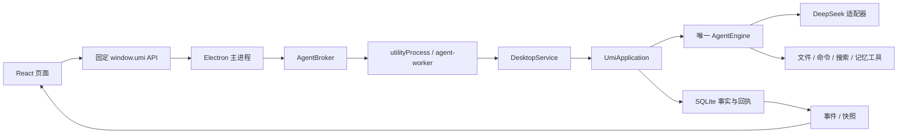

# Umi 新会话交接

> 交接日期：2026-10-10。用于恢复开发上下文，不代表重新完成全部验收。产品名称始终是 **Umi**。

## 1. 先确认工作位置和 Git 状态

| 项目 | 交接时状态 |
| --- | --- |
| 当前开发源码 | `E:\SOME_SEVEN_PROJECT-57\Umi_v2.0` |
| GitHub | https://github.com/QI-seven33/Umi |
| 分支 | `main`，跟踪 `origin/main` |
| 本次交接前的发布基线 | `c146ce275b2b23efc081549720e788523a6a1c6d` |
| 迁移前的旧实现 | 上述提交的父提交 `ca51df5ba06ef6fda664e9b4d60d620131bd08af`；在 Git 历史中研究 |
| 发布中转目录 | `E:\Codex\Workspace\umi-github-publication`；这是另一份检出，不是当前开发源码 |
| 本地交接备份 | `E:\Codex\Workspace\output\umi-handoff-20261010` |

新会话第一步应在实际源码目录执行 `git status --short --branch`、`git log -3 --oneline`、`git diff --stat`。不要假定新会话继承了此前 cwd，也不要在发布中转目录修改代码。表中的基线是交接前的代码提交；交接文档的最新提交请以 Git 日志为准。

### 尚未提交的工作必须保留

交接检查发现以下五个文件有本地修改：

- `apps/desktop/main.ts`
- `apps/desktop/preload.ts`
- `apps/desktop/service.ts`
- `packages/adapters/src/host-files/paths.ts`
- `packages/protocol/src/desktop.ts`

这些改动主要添加中文学习注释、调整排版，`main.ts` 还展开了部分代码块。四个文件去除注释并规范化空白后的 esbuild 输出与基线一致；`main.ts` 经完整 minify 后输出也一致。这是支持性检查，不代替类型检查、运行验证或对学习注释准确性的审核。未发现单文件物化或恢复逻辑已经被修复的证据。

本次没有代为提交这些既有改动，没有 reset、stash、清理或覆盖它们。新的文档提交仅包含交接材料和 README 导航。因此：**本机源码包括这五个改动；重新从 GitHub 克隆只得到已提交版本。**

本地备份包含：

| 文件 | 用途 |
| --- | --- |
| `manifest.json` | 基线、文件名、原始字节 SHA-256、时间和初次规范化检查结果 |
| `uncommitted-source.patch` | 相对于交接前发布基线的完整 Git diff |
| `working-files/` | 五个文件的原始字节副本，保留注释和换行 |
| `main-before.js` / `main-after.js` | 辅助比较输出，不是应加载的应用代码 |

备份不包含 API Key、个人会话数据库、依赖或便携包，也不随仓库上传。应用补丁前先检查是否已经存在相同改动；不要对现有源码重复应用。需要迁移到另一台机器时，可另行携带补丁/文件备份。当前应继续在原目录工作。

## 2. 阅读入口与证据层级

1. [当前项目详解与开发路线](current-project-report.zh-CN.md)：整体架构、数据、权限、上下文和已知问题，核对日期 2026-10-09。
2. [代码学习与开发指南](code-reading-guide.zh-CN.md)：具体文件、调用链、练习和修改入口。
3. [核心契约 C00–C14](contracts-v1.md)、[架构](architecture-v1.md)、[迁移与验收](migration-and-acceptance.md)：设计约束与阶段验收基线。
4. `stage-*.md` 等历史报告：对应阶段当时的状态，不是最新源码的全量验证结果。
5. 对应源码和测试：判定实际行为的依据；文档和注释有冲突时核对实现与证据。

早期报告中的“图片未接入”等内容已经过时；历史案例数量不能写成今天重新测试通过的数量。上一次发布执行过类型检查；本次交接只核对 Git、改动、备份和文档，不启动应用、不调用真实模型、不重新打包或跑测试。

## 3. 已实现的核心结构



渲染进程通过主进程请求已有核心，不直接持有 Agent 的 MessagePort。当前运行不需要旧 Python 后端。根目录只有一个 npm package 和 tsconfig，`packages/` 是职责划分，尚不是独立发布的 npm 包。

关键边界：

- 模型建议操作；应用判定权限并保存派发事实；执行器核验实际效果。
- SQLite 的消息、事件、回执、批准、执行记录与 artifacts 是恢复依据；模型摘要不能宣布交付成功。
- 文件以批准后的工作副本为编辑对象，真实来源写回需要冻结 ChangeSet 和具体批准。
- 宿主命令都经具体批准。当前没有 OS 文件/网络沙箱，cwd 不能限制访问范围。
- Windows Job 管理其覆盖的普通后代进程，不保证控制 WMI、外部服务或容器里的所有进程。
- 原始记录保留；上下文只是模型可见的投影。工具调用与结果按完整消息组维护。
- 恢复要先核验未知效果，不能把 resume 当成无条件重跑工具。

## 4. 最近界面工作与用户偏好

当前已纳入发布基线的界面工作包括透明横版品牌、紧凑圆形发送/停止按钮、英文 Off/Normal/High、复制成功反馈，以及输入区内的批准卡片。批准卡片沿用已有权限和事件入口。

继续修改时应延续以下偏好：

- 产品叫 Umi；本地目录名不是产品名。
- 浅色、干净、柔和材质，控件紧凑，圆角统一。不要恢复此前删除的五种彩色底板。
- 左栏选中和 hover 应清楚；用户最后要求 hover 使用选中的背景色。不要增加突兀阴影。
- 过程展开控件不用阴影；发送为蓝色圆形、停止为红色圆形，尺寸协调。
- 思考强度用英文，当前选中等级不加不干净的阴影；上下文环靠近模型名称。
- 工作区移除了独立向下箭头，但整行仍应允许折叠/展开。
- 无输入草稿不应作为已发送会话展示；输入区粘贴文本按钮已移除。
- 简单聊天不应强制追加工具交付说明，也不应正常回答后再生成一份重复总结。
- 活动标题为何不同于 Harness/Codex 已解释为工具参数、事件和展示投影共同作用；用户此前要求此项先解释，不作重大后端改变。
- UI 检验可由用户完成。是否测试按当次请求决定；涉及权限、恢复和持久契约的改动应给出针对性的验证计划，不把旧报告当新证据。

用户可能继续自行改 CSS 参数。修改前看 diff，避免覆盖。当前源码里新增的学习注释也需要保留，并以事实解释其准确性。

## 5. 尚未解决的问题与下一步顺序

### P0：单文件资源闭环

用户曾要求修复桌面的一个 HTML。实际实现把文件路径提升到父目录资源，再扫描/复制整个桌面，因此小文件也可能被无关大文件或目录数挡住，返回 `RESOURCE_LIMIT`。

相关入口：`packages/adapters/src/host-files/resources.ts`、`paths.ts`、`tools.ts`、`delivery.ts`，以及 `packages/protocol/src/resources.ts`、SQLite 资源记录和工具恢复。

建议下一次首先做契约与验收矩阵，再实施：

1. 发现、候选、授权、挂载、定位快照、复制、ChangeSet 和交付认识同一个资源范围。
2. 支持单文件/选定范围，旧目录资源仍能正确解释；新增持久结构时走版本迁移。
3. 不能只在 UI 写文件名而后台仍复制整个父目录，也不能靠提高所有限额掩盖范围错误。
4. 明确文件不存在、搜索没有覆盖、候选为空三者的区别。
5. 保留失败阶段和具体限额，区分扫描前失败、部分复制、效果未知。

最小验收场景：

| 场景 | 必须证明 |
| --- | --- |
| 大目录中的小 HTML | 只读取/复制获准文件，无关大文件不阻塞 |
| 同名文件/多个资源 | resourceId 与逻辑相对路径不会串目标 |
| 批准后文件变化 | 批准/前置条件核验失败，不用旧快照交付 |
| 复制中停止或崩溃 | 重启核验已发生效果，不盲目重复 |
| 旧目录记录 | 无需改写旧事实即可恢复解释 |
| 来源已被用户编辑 | 明确交付冲突，不覆盖新内容 |

### P1：恢复说明和重复展示

此前只读审计确认：两次“恢复”是顺序恢复，不是两个并发 Agent；第一次核验未物化后，模型再次提出同资源请求，又失败。没有截图触发停止的事件证据。

两条相同路径消息在数据库中是两个不同 commandId 的输入。不能仅凭记录判断用户主动重发还是前端触发了新输入，更不能删掉记录掩盖问题。需要记录操作来源并区分同一回执重试与新输入。

页面把同一个 run 的总耗时显示到多个输入片段上，可能看起来重复执行。“检查恢复”“核验效果”“重新复制”“继续模型”也需要清楚区分并展示结果。资源审计时用户要求排查、不修改代码，这些修复尚未实施。

本地详细审计：`E:\Codex\Workspace\output\umi-permission-audit.md`。它含个人路径和会话定位信息，不随仓库上传；公开概述已在当前项目报告第 10 节。

### P1：长任务预算与模型证据

- 当前预算阻塞使用 UTF-8 保守估算，和服务端实际 token 超限不同。小请求被 API 接受不证明完整请求可以接受。
- 原文全部保留在活跃上下文的策略仍可能无法解除预算阻塞。考虑有预算的活跃原文、永久可检索原文、可追溯要求索引及明确折叠说明。
- 大段输入转文本附件是原文存储/按需读取，不是语义压缩；附件和上下文仍有上限。
- UI 的 DeepSeek V4.1 Flash 等是静态配置名称；实际响应版本若要显示，需独立记录服务端证据。

### P2：整理与扩展

在上述日常任务闭环可靠后，逐步整理 CSS 覆盖、拆分 App 编排、完成国际化、检索索引和长任务/费用基准；随后推进可复现发布、安装器/更新/签名。第二厂商应接 ModelPort，通用插件需要独立生命周期和权限契约。当前 Docker/WSL 配置检查不等于专用执行 Runtime。

这些是建议顺序，不是已经完成的功能，也不是本次交接自动授权的重大改造。

## 6. 构建与“改了没变化”排查

```powershell
Set-Location 'E:\SOME_SEVEN_PROJECT-57\Umi_v2.0'
git status --short --branch
npm run typecheck
npm run dev
```

只有新克隆/依赖缺失时才需要 `npm ci --no-audit --no-fund`。其他入口：

| 命令 | 效果 |
| --- | --- |
| `npm run build` | 编译 TypeScript 到 dist |
| `npm run build:desktop` | 编译并打包 renderer/preload |
| `npm run desktop` | 启动已有 dist，不自动构建 |
| `npm run package:desktop` | 重新构建并生成 Windows 便携包 |
| `npm test` | 构建并执行测试；使用测试自身隔离目录 |
| `npm run demo` | 确定性替身模型演示 |

便携包入口：`release\Umi-win32-x64\Umi.exe`，需要完整目录。它读取 `release\Umi-win32-x64\resources\app\dist` 内的资源，源码构建更新的是根 dist，旧包不会自动变。

单实例锁会让第二实例只唤回旧窗口。关闭窗口只是隐藏；用 **Umi → 退出 Umi** 完整退出后再启动目标版本。Ctrl+R 只重新加载页面，不更新已加载的主进程、preload 或 Agent worker。不要为使 CSS 生效而删除数据库。

样式顺序：`global.css → desktop.css → surface.css`。检查最终 computed style、后加载规则、specificity 和 `!important`。品牌入口在 Sidebar / EmptyConversation，具体宽度应查当前最终选择器，不要只改被覆盖的旧声明。

真实模型脚本会调用付费 API，不是普通检查的默认步骤。生产用户数据目录由 main.ts 决定；调试与故障注入使用隔离数据目录。不要提交 Key、desktop-config.json、会话数据库、个人 evidence、node_modules、dist 或 release。

## 7. 边开发边学习的方法

先读调用链，再读大模块；每轮只解释一条实际流程：

| 学习顺序 | 文件 | 要能回答的问题 |
| --- | --- | --- |
| 1 | Composer → App → transport | 点发送后哪些数据发送？commandId 如何避免同一输入重试变新任务？ |
| 2 | preload → main → broker → agent-worker → service | 哪个进程能访问文件？参数在哪里校验？ |
| 3 | application → engine → store | 什么是消息、run、事件、回执？哪些事实在派发前保存？ |
| 4 | tools / host-files / delivery | 批准范围怎样绑定资源？副本和原文件何时发生变化？ |
| 5 | context / DeepSeek adapter | 模型看到的投影怎么构造？reasoning 和工具消息如何配对？ |
| 6 | reducer → activity → Timeline | 重载怎样重建同一过程？显示文字和真实执行数据有什么区别？ |

每次修改同时记录：触发条件、涉及契约/文件、行为前后区别、如何验证、剩余限制。注释可以帮助学习，但不能代替独立核对控制流和错误路径。

## 8. 新会话可直接使用的开场

见 [新会话开场提示](next-session-prompt.zh-CN.md)。新会话不必重新讲完整历史：读取本文件和两份报告，核对本地 diff 后即可接着工作。若从 GitHub 克隆，应明确缺少本地尚未提交的学习改动、个人数据和原始 evidence。
