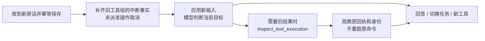

# 2026-10-12：自然消息优先、完整工具反馈与稳定缓存前缀

本次按用户“新输入先给模型判断，旧操作只核验不重跑”的授权实施。实际源码：`E:\SOME_SEVEN_PROJECT-57\Umi_v2.0`，产品名 Umi。沿用唯一 AgentEngine、现有适配器和工作副本；未引入独立调度器、直接源编辑或任务内宿主免审批模式。

## 用户能看到的变化

- 停止或异常中断后，直接发消息继续、换目标、修改要求或询问状态。会话中不再要求点“继续任务”。
- 等待批准时更改要求，旧准备操作取消、旧批准失效，先让模型处理新原话。程序已挂起就绪但尚未释放时，也会重新检查是否收到新输入。
- 停止清理或原工具失败期间收到的新消息不会只保存后卡住；每条新输入最多补启动一次，退出应用不自动续作。
- 所有留在当前窗口的工具正文保持完整。刚读到的范围、历史/资料/进程分页不会再按历史条数分摊后裁成首尾摘录。窗口压力大时维护完整旧消息组，原记录不删除。
- 长日志的即时预览与归档分开。具体命令的 `maxOutputBytes` 控制预览；实际模型预览最多 8,000 字节，脱敏归档独立最多 64 MiB，可用 `read_process_output` 按真实 UTF-8 范围追回。
- 设置中的最近缓存命中比例只使用服务端实际返回的 hit/miss token；没有字段就显示未知。请求前缀的沿用数量和重建原因在设置中可查，主会话不新增运行时面板。

## 新消息的具体顺序

`send` 不调用旧 `resume`。有未结算的旧执行时，宿主先补齐历史 assistant/tool 配对，告诉模型原 executionId 尚未核验；此处不核验程序、不重放准备操作。最新输入与真实状态随后进入同一个模型循环。

模型可以在未知旧结果尚未解决时回答用户或读取资料。环境有未决执行时，新副作用仍会在 Executor 和 SQLite 派发层被阻挡；失败反馈给出原 executionId，让模型选择检查。检查的范围限本会话、本环境，终态回执也不能跨会话读取。

`inspect_tool_execution` 调用现有唯一 ToolExecutor 的观察路径。宿主写入使用原适配器的 reconcile；未确认的普通读取不重新执行。已经提交的检查点/记忆读取原资料，不再次写入。变更集提供独立只读 inspect，按原 executionId 找到冻结快照；缺失时不重新扫描生成。

检查工具的配对结果承载新核验事实。原工具的 SQLite 状态和回执可以更新，但原工具消息正文不改写；`tool.reconciled` 记录检查 executionId，避免在尚未闭合的工具组中插入 system 消息。事实更新、模型已看到以及任务完成仍是不同的判断。

运行的 `completed` 表示本轮答复结束，验收报告另行描述用户目标。历史执行仍未知时，报告保持 blocked，派发阻挡继续有效。UI 过程区改称“本轮结束”，不把答复结束说成所有旧任务完成。

## 停止、旧接口和任务身份

停止按钮仍只发送停止请求；接收回执与 Job 清理完成分开。Broker 在等待 ready 前预留名额，普通请求最多 32 个，stop/shutdown 共享另外 2 个控制名额。控制通道有界，普通拥堵不能占掉它；不承诺任意数量停止请求无限排队。

保留显式 `resume` 接口供已有 CLI/恢复测试使用：没有新输入时可只核验原已派发操作；未知仍未知则停止恢复。尚未决定的旧批准可以恢复等待，必须等新的用户决定。已经允许但尚未派发的旧操作不会仅因 resume 自动执行。`approve` 对精确待批准对象的当前决定仍可执行；任意待应用新输入会取消这条分支。主会话自然消息不使用这些兼容分支。

已有 taskId 本来就能跨 run 保存。新增 `set_task_state(active/suspended/cancelled)`，逐字引用最新已应用原话，核对当前检查点版本；不删除目标、原验收项或旧证据。停止不自动取消目标。挂起/取消任务不占当前目标的验收汇总，重新激活后仍须核对新输入并重新验证需要的事实。

新目标可通过 `supersedesTaskId` 关联已挂起/取消的原任务；旧目标不可直接改写成新目标。模型负责理解自然语言中的关系，用户可以继续纠正。这里是既有检查点上的少量状态，没有额外分类模型、并行调度平台或自动扩大权限。

## 缓存：保护完整前缀，而非只保护 system

本次修复两个破坏前缀的来源：已读工具结果后来重新缩短，以及每轮替换此前的宿主状态尾段。

1. SQLite 从最近已冻结的 context snapshot 读取语义消息、来源 ID、窗口及投影版本。
2. system、工具规格、模型/思考设置、提示版本及历史窗口未变，且保留来源仍是原来源前缀时，沿用此前全部语义消息，只追加新消息及带时间语义的新事实快照。
3. 旧事实明确标为当次请求时的观察，最新事实优先；派发层仍使用当前宿主状态，不把旧快照当权限。
4. 系统/语言、工具、模型/思考、投影或窗口变化可以重建视图，记录原因，不承诺缓存永远命中。
5. 累积派生快照单独造成压力时，本地切换窗口释放旧派生快照，完整原文和工具组保留，不额外请求摘要模型。实际历史造成压力时仍按完整消息组维护，原历史可分页追回。

DeepSeekAdapter 保持当前思考工具历史的 reasoning_content 规则。语义 carry 在适配器编码前复用，测试比较真实 prepare 生成的请求消息前缀及工具 JSON，包含跨 run、重启和历史思考。

依据本轮此前已查官方 [DeepSeek 上下文缓存](https://api-docs.deepseek.com/zh-cn/guides/kv_cache/) 与 [思考模式](https://api-docs.deepseek.com/zh-cn/guides/thinking_mode/)，稳定前缀只是有利条件。SWA/缓存持久化粒度、构建和服务端命中属于供应商行为，不能用本地字节一致率代替 API 命中率。未采用旧版“64 token 就一定可缓存”的说法，也没有调用真实 API 来宣称命中率提升。

借鉴 Harness 的派生事实追加方式和 Reasonix 的缓存变化诊断；没有照搬其沙箱/权限档位。历史摘要维护仍沿 Umi 原有独立维护请求，尚未改成复用任务前缀的摘要调用。

## 长日志的真实边界

`ProcessArchiveBudget` 在脱敏后限制合计 stdout/stderr 的 UTF-8 连续前缀。首次溢出后不再补进后段，避免在归档中留下隐藏中间空洞。实际读页的 hash、范围与 nextStartByte 针对已归档的脱敏内容；`observedBytes` 是原进程回执中的观察字节数，两者不能混同。

`previewTruncated` 只说明预览不完整，`archiveComplete` 才说明归档是否完整。超过 64 MiB、旧版本已丢弃的输出或缺失回执都不能被虚构为可完整追回。测试覆盖超过旧默认 64 KiB 的真实日志及 UTF-8 容量边界；没有进行 65 MiB 的真实进程压力测试。

## 本次验收与证据

证据目录：`E:\Codex\Workspace\output\umi-natural-turn-20261012`。实施前的 221 文件快照及 hash 清单位于 `before/`、`before-manifest.json`，用于区分本轮修改与仓库原有多阶段未提交改动。

- 核心 TypeScript 构建及桌面 esbuild 构建通过。
- 全量测试 `acceptance.log`：376/376 通过。收尾检查发现“更新的旧检查点核验不应依赖当前 taskId 索引”，增加只读原提交端口后，关联复验 `task-observation-tests.log`：40/40 通过（含新增样本）。新自然消息测试共 16 项，包含停前未应用输入、清理期间消息、审批更正、原工具失败竞态、真实 Windows ready/go、任务挂起/取消/替代、跨会话核验、缓存前缀及日志分页。
- 本次重新执行小项目 11 文件读取→副本修改→真实 Node 测试；中文 CRLF 日常文件 17,120 字节分页读取→局部编辑→历史/资料追回。源文件仅在显式交付测试中按冻结批准写回。
- 缓存样本：6,910 字节读取，10 次真实 DeepSeek 请求编码（模型端口使用固定响应，0 API），多轮及重启后的旧消息前缀保持一致。没有真实供应商缓存命中率数据。
- 日志样本：280,533 字节真实 Node stdout，命令预览上限 1,024 字节，五页追回完整正文和末尾关键行，归档完整。
- 60 次隔离 Electron 链测量：实际应用 renderer 中 `window.umi` → 生产 preload → 最小隔离主处理器 → 生产 Broker/worker；57 次暖启动停止接收 p50 4.3ms / p95 6.6ms，终态 p50 10.6ms / p95 23.2ms，32 普通请求拥堵时 stop 到达。固定模型任务、隔离临时数据库；不是生产主处理器全链、真实鼠标点击或生产会话 p95。临时目录已在进程退出后验证范围并清理。

没有调用付费模型、读写生产会话数据库、发布、同步便携包、修改 Windows 配置或重置 Git。宿主文件/网络没有 OS 沙箱的事实不变；具体宿主命令与交付批准仍保留。

## 结合代码学习

| 入口 | 核心职责 | 建议观察 |
| --- | --- | --- |
| apps/headless/src/application.ts send/start | 幂等接收、新输入启动、一次排队补启动 | 收消息和恢复旧操作分开；退出不续作 |
| packages/agent/src/loop/engine.ts run | 完整配对、应用新原话、唯一循环 | 新输入优先，兼容 resume 分支明确 |
| packages/agent/src/tools/recovery.ts / executor.ts inspect | 原执行观察、当前租约与会话校验 | inspect 不进入 prepared 执行分支 |
| packages/adapters/src/sqlite/store.ts dispatch/assertApprovedExecution/settle | 最后派发边界、ready/go 原话检查、追加事实 | UI 状态不能代替这里的授权事实 |
| packages/adapters/src/sqlite/tasks.ts transition/assess/complete | 原话绑定生命周期、目标验收与轮次结束 | taskId 跨 run；结束不是目标完成 |
| packages/agent/src/context/manager.ts project/prepareTurn | 稳定完整请求前缀及完整窗口维护 | carry 与原始 history 各有职责 |
| packages/adapters/src/host-process/log-policy.ts / runner.ts / tools.ts | 归档容量、流式反馈和分页 | 预览、归档、原进程观察字节分开 |
| apps/desktop/request-admission.ts / broker.ts | 普通与控制请求独立名额 | ready 等待也计入名额，finally 释放 |
| tests/natural-turn.test.ts | 小而明确的行为回归 | 对照每条用户可见契约读取断言 |

## 下一步的边界

保留工作副本路线。普通 task 起初创建 scratch/artifacts/research/logs；可选 preparation 会按需创建 task/cache，不能概括成从来没有 cache。用户选择 Umi 工作资源根、工作副本位置、任意项目交付目标尚未对齐，现有项目 ChangeSet 仍主要写回来源，独立成果已有另处导出。

后续先对照真实日常任务观察卡点，再讨论明确且可撤销的任务内宿主信任，减少逐命令审批疲劳；网络主入口的网页读取与宿主命令联网分别声明。两者都是授权边界设计，不是 Windows OS 隔离保证。尚未落地免审批宿主范围，也不以安装器、TTL 留存或沙箱作为全部任务前置。真实模型任务质量与缓存命中率需要另行安排有预算的验收。
