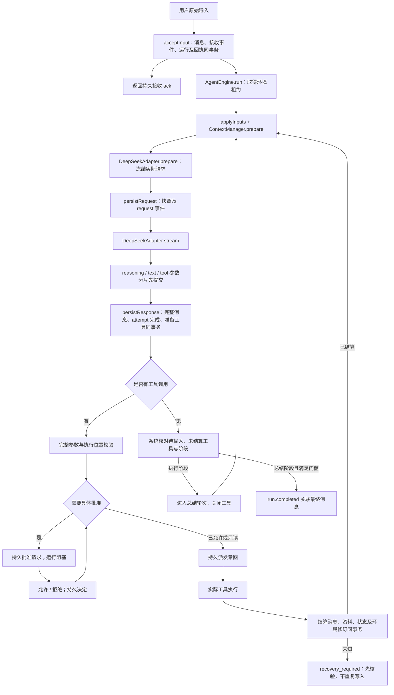

# Umi 阶段 2：实现与验收报告

> 阶段技术记录：本页能力和验收数字只对应原文日期；当前实现以[当前技术状态](current-state.zh-CN.md)和[运行契约](runtime-contracts.zh-CN.md)为准。

日期：2026-10-04。产品名称：**Umi**。开发目录：`仓库根目录`。

## 1. 本次结果

已建立可运行的无界面 TS 核心，并贯通真实模型流、批准、托管测试写入、持久化、停止、订阅和恢复。不是只创建接口，也没有引入第二套 Agent 或大型编排框架。

当前具有 33 个自动验证案例，其中 5 个实际启动并强制终止子进程。真实协议验收完成 6 次 DeepSeek 模型调用和 1 次独立搜索 HTTP 请求，记录见 脱敏证据（维护者本地证据/生成产物，不随源码仓库分发）。搜索服务在该次请求中报告 3 次内部网页搜索；请求中的 `max_uses: 2` 不能据此宣称为客户端强制的费用上限。

旧项目、旧数据库、旧前端和旧凭据文件不参与迁移写入。真实验证只借用进程环境读取既有凭据，不输出密钥、不复制 `.env`，文件效果仅发生在独立托管测试环境。

## 2. 实际职责划分

| 模块 | 实际文件与关键方法 | 负责什么 |
|---|---|---|
| 协议 | `packages/protocol/src/model.ts`：settingsSchema、messageSchema、executionContextSchema、validatePairs | 设置、原始消息、执行定位和工具配对的运行时校验 |
| 事件 | `packages/protocol/src/events.ts`：eventSchema | 关闭的事件类型集合、字段及 run/turn/attempt/call/execution 归属 |
| 归约 | `packages/protocol/src/reducer.ts`：reduceConversation、projectConversation | 唯一状态归约；模型轮次、块、工具、批准、最终消息引用；完成后默认收纳的界面数据 |
| 应用 | `apps/headless/src/application.ts`：UmiApplication | 组装具体适配器；接收输入、批准、停止、恢复和订阅 |
| 循环 | `packages/agent/src/loop/engine.ts`：AgentEngine.run | 唯一模型—工具循环、冻结请求、有限重试、完成门槛 |
| 上下文 | `packages/agent/src/context/manager.ts`：ContextManager.prepare | 原始已接纳会话、来源、状态尾部、预算及工具组校验 |
| 提示词 | `packages/agent/src/context/prompts.ts`：PERSONA、PROMPT_VERSION | Umi 人物原则、阶段进展、来源不可信、结果不编造 |
| 工具 | `packages/agent/src/tools/registry.ts`：ToolRegistry、registerHistory | 注册、稳定排序、完整 JSON 参数校验、同会话历史工具 |
| 调度 | `packages/agent/src/tools/executor.ts`：ToolExecutor.execute | 批准前阻塞、重新核对请求、派发前持久化、结果和未知效果处理 |
| 模型端口 | `packages/agent/src/ports.ts`：ModelPort、PreparedRequest、ModelFrame | 隔离具体 API；语义输入转实际请求，输出增量与完整响应 |
| 持久化端口 | `packages/agent/src/persistence.ts`：PersistencePort | 核心提交领域事实，不导入 SQLite 驱动 |
| 模型适配 | `packages/adapters/src/deepseek/adapter.ts`：DeepSeekAdapter.prepare、stream | DeepSeek 请求参数、思考回传、工具重组、结束判定和 usage |
| 流解析 | `packages/adapters/src/deepseek/sse.ts`：readSse | SSE，即服务端事件流；连续 UTF-8、CRLF、多行、取消和单事件大小限制 |
| 搜索 | `packages/adapters/src/deepseek-search/search.ts`：registerWebSearch | 当前可用 Anthropic 兼容接口；正文与结构化来源分别解析 |
| 仓储 | `packages/adapters/src/sqlite/store.ts`：SqliteStore | 唯一写入锁、事务、序号、不可变消息/资料、环境租约及启动核验 |
| 文件执行 | `packages/adapters/src/host-files/scratch.ts`：hostContext、registerScratch | 仅 scratch 的真实 UTF-8 写入、路径检查、前置条件和效果核验 |
| 开发入口 | `apps/headless/src/cli.ts` | 每行 JSON 命令、ready 握手、ack、查询、事件订阅 |

`packages/protocol` 仅依赖 Zod，不导入文件系统、Electron 或数据库。Agent 核心依赖协议与领域端口；具体驱动位于 adapters，组装位于 apps。模型模拟器仅替换 ModelPort，仍使用产品中的同一循环和仓储。

## 3. 完整运行流程

### 3.1 输入和环境

`createConversation` 校验已存在的工作区目录，创建工作区、会话和持久环境关系。相同工作区下的新会话使用独立环境；同会话的新 run 复用环境。

`send → acceptInput` 保存原文，再返回 ack。相同 commandId 和内容返回原回执；不同内容返回冲突。已接收消息在进程退出后仍存在。

任务正在运行或等待批准时，补充要求仍保存为独立用户事实，绑定原 run。它不伪造批准。`applyInputs` 在安全边界接纳原文，模型投影将其放在完整工具组之后，避免把 assistant 工具调用与 tool 结果拆开。原始消息的接收顺序和时间不修改。

应用退出或订阅断线不会创建新的 userTurn。批准也不是普通用户消息。

### 3.2 每轮模型看到什么

唯一入口是 `ContextManager.prepare`：

1. 稳定 Umi 提示词及独立的答复/思考语言偏好。
2. 完整已接纳历史，包括用户原文、完整模型消息和配对工具结果。
3. 当前真实运行状态尾部，包括环境修订、阶段、工具状态和结果资料引用。
4. 稳定排序的当前工具规格。

全部持久事件、界面 loading、订阅 cursor、未完成网络分片不直接塞给模型。成功模型正文保存为原始消息；失败尝试的正文前缀留作事件和界面事实，不伪造成完整 assistant 历史。

冻结快照保存语义上下文、实际 wire 请求、设置、工具规格、版本、来源和预算。JSON 往返切断引用；后续设置变化不修改已发送请求。重试使用同一冻结请求，但创建独立 attempt。认证头和 API Key 不进入快照。

当前只实现基础预算与历史检索，**没有压缩、要求清单、长期笔记或硬窗口切换**。超预算时明确失败，原文不删除。输入估算采用 UTF-8 字节加结构余量，是保守估算；API 的真实 prompt/completion/cache usage 独立保存，不能把估算显示成真实 token。

### 3.3 DeepSeek 的特殊适配

主模型采用 Chat Completions；搜索独立采用已有 Anthropic 兼容接口。未改回曾经争议的 Responses 搜索路径。

off 对应关闭 thinking；normal 对应 low；high 对应 high。带工具的思考请求回传全部保留历史的原始 reasoning，包括之前没有调用工具的轮次。正文与 reasoning 可在同一个分片同时出现，分别处理，不使用会吞掉另一字段的二选一逻辑。[DeepSeek 思考模式文档](https://api-docs.deepseek.com/guides/thinking_mode/)

当前官方将 `deepseek-flash` 标为 DeepSeek-V4.1-Flash，Flash/Pro 上下文均为 1M。真实响应只报告 `deepseek-flash`，所以证据分别记录请求 ID、响应 ID 和官方已知别名含义，不把文档版本冒充响应证明。384K 是官方输出上限；Umi 的阶段 2 输出预算保守设为 off 8192、normal 32768、high 65536，验收脚本为控制成本使用 4096。[DeepSeek 模型资料](https://api-docs.deepseek.com/quick_start/pricing/)

reasoning 原文保存、回传和投影，不摘要、不翻译、不做语言“清洗”。语言指令用于引导，不能承诺模型每次都遵从。本阶段未统计中文思考命中率。

### 3.4 流式显示的事实基础

模型分片进入 `model.block_started / model.delta`，**提交后**订阅方才能读到。每个 block 带 run、turn、attempt、通道、显示身份、增量序号和结束状态。

`persistResponse` 校验正文及 reasoning 与已提交增量一致；完成引用不会再次追加整段正文。完整 provider response 以不可变 artifact 保存，并由 `model.attempt_completed.responseRef` 关联本次 attempt。

`reduceConversation` 是实时、历史和重放的同一个纯函数。重复已覆盖事件不推进；缺口、错误 stream/epoch、错误轮次或工具归属明确拒绝。cursor 是会话流 ID＋日志版本＋字符串序号，不再按 run 与显示块各自混用。

`projectConversation` 只在实际 reasoning 块仍运行时生成 activeReasoning；完成运行默认收纳过程。这里只交付给前端的正确数据，**没有改现有 React 界面**。

### 3.5 工具与批准

工具参数只有形成完整模型响应后，才经 JSON 与 Zod 校验进入执行。损坏参数不以空对象替代；不完整网络响应不准备工具。

工具分别持有 providerCallId、callId、executionId、turn 和 attempt。多个工具顺序处理，某个等待批准时后续工具不会先启动，也不调用模型继续“想办法”。

阶段 2 的 `write_scratch` 始终需要具体批准。请求绑定参数、环境 ID、修订、物理根身份、目标前置内容和期望 hash。等待中目标内容改变会使原批准失效，重新等待具体决定。相同决定幂等，相反决定冲突。

拒绝回填 denied；取消、失败和未知分别回填。不从模型正文、网页文字、普通“继续”输入推断已经批准。批准只授权本次测试写入，不是对项目源目录的写回批准。

派发前先提交 `tool.dispatch_intent`；提交失败不执行文件效果。执行后将工具结果、消息、事件、状态及修订同事务结算。工具结算幂等，不因重复结果重复累计修订。客户端漏收结果时重放日志，不重新执行。

### 3.6 停止、断线和恢复

| 场景 | 实际行为 |
|---|---|
| 取消订阅 | 只结束观察，运行继续 |
| 应用退出 | 取消当前执行器并保存 interrupted；不冒充用户点击停止 |
| 用户停止 | 先保存 stop_requested，再取消；准备中的工具结算 cancelled，待批准请求失效 |
| 新实例启动 | 取得唯一写入锁；检查旧 run/attempt，已派发无结果工具记为 unknown |
| 部分正文硬退出 | 保留已提交前缀，补充 attempt 中断事实，历史不永久 loading |
| 批准已保存但未派发 | 恢复原请求，重新核对环境与对象后继续 |
| 写入效果已产生但结果未提交 | 用原定位快照核验；内容已满足时记 desired-state-verified，不重复写入 |
| 原目标缺失或已变化 | 保持 unknown/recovery_required，禁止自动重试及绕过到新任务 |
| 结果已提交但界面没收到 | 原成功事实重放，不重新派发 |

`resume` 必须显式调用。重启不会自动继续任务。核验结果是新事实；原始未知结果不改造成当时已成功。首次 tool 结果已保存时，后续核验以系统观察消息补充，不重复生成同一个 tool_call_id 的工具结果。

内容相同仅证明预期状态已满足，不证明文件是原对象或本工具曾经执行。定位快照同时保留逻辑环境、区域根引用、相对路径、物理根绑定、根身份、前置条件和期望 hash；实际观测另存结果。阶段 3A 的挂载标签已定义，执行器目前只实现 task/scratch。

## 4. 持久化边界

实际数据库为独立的 `umi.sqlite`，WAL、外键和 FULL 同步启用。只有持有进程写入锁的实例工作；环境执行另以 generation 防止旧执行者提交。

| 表 | 保存内容 |
|---|---|
| workspaces / conversations | 工作区与会话关系、配置和版本、日志 epoch 与下一序号 |
| environments / runs | 持久根身份、修订、活动运行、执行代次、阶段、停止标志和计数 |
| commands | 输入幂等 hash 与原接收回执 |
| messages | 原始用户、模型和工具消息；提交事件引用、内容 hash、原时间及接纳标记 |
| events | 按会话连续分配的权威事件事实；版本、归属和幂等键 |
| model_requests / context_snapshots | 冻结实际请求、上下文来源与版本、资料引用 |
| tool_executions | 工具身份、参数、环境、定位快照、执行状态与结果引用 |
| approval_requests | 固定请求 hash、决定和有效性；多次失效请求各自保留 |
| artifacts | 本阶段有大小限制的不可变 JSON 资料、内容 hash |
| schema_migrations | 当前 schema 版本与迁移标识指纹；不兼容版本拒绝启动 |

消息、事件和资料有禁止更新的触发器；资料及原始消息读取时核验 hash。相关索引与事件同事务更新，界面 state 从事件纯归约生成。

大型文件 blob、清理保留策略、旧数据库导入、跨目录迁移工具和完整历史索引重建仍是后续工作。当前迁移指纹用于识别已知版本，不等于逐个证明所有外部修改后的 SQL 对象仍完整。

## 5. 验收证据与范围

执行命令：`npm test`，结果 **33/33 通过**；`npm run demo` 实际批准写入并回读。测试使用 Node 自带测试运行器，没有增加测试框架。

| 文件 | 证明的关键边界 |
|---|---|
| tests/core.test.ts | 输入幂等、即时正文、重放/cursor、批准恢复、拒绝、中途要求更正、超预算、配置保存 |
| tests/adapter.test.ts | 中文 UTF-8 拆分、CRLF、多行 SSE、交错字段、多工具参数、截断/损坏、取消、原始思考回传、搜索证据 |
| tests/boundaries.test.ts | 多会话身份、唯一写入者、错误归属、事务故障、具体批准、流中停止、工具效果后停止、重试/停滞、两小时前原话检索、特殊路径、不兼容 schema |
| tests/recovery.test.ts + crash-worker.ts | 实际子进程在批准后、派发后、效果后、结算后、部分正文处强制退出，再启动读取 WAL 并恢复核验 |
| tests/cli.test.ts | 实际命令入口的 Umi ready、设置、输入 ack、历史、错误和正常退出 |
| scripts/verify-deepseek.ts | 真实模型、思考、多轮历史检索、批准、写入回读、最终回复以及真实搜索接口 |

两小时前的历史案例使用仓储注入的受信时钟生成真实时间跨度，普通 CLI 输入不能自定义消息时间。真实模型另完成“蓝色原要求 → 绿色更正 → 找回原话 → 批准写入绿色”的闭环。模拟时钟不冒充真实经过了两小时。

测试编号是设计验收 ID 的关联，不表示阶段 3—5 的全部组合已经通过。A34/A35 目前只验预算和原文保护；A44 只验核心流和投影；A45 只验 scratch 与恢复基础。压缩、working 挂载、交付、桌面样式另验。

实际环境：Node 24.11.0、npm 11.6.1、SQLite 3.50.4、TypeScript 7.0.2、Zod 4.6.5、Node 类型 24.10.0。当前事件、数据库和 DeepSeek 适配器版本均为 1。

## 6. 仍存在的限制

1. 无 GUI；CLI 是开发入口，不是最终 Electron 进程协议。create 是显式新建操作，尚未增加断线重发的新建命令回执机制。
2. 工作区现在只有身份；没有真实资源发现、物化、工作副本、ChangeSet、交付或原生回收站。
3. 没有 Shell 或宿主代码执行，也没有 Docker/WSL 插件。文件路径检查不是 OS 沙箱，不能抵抗全部宿主级竞态或同权限恶意程序。
4. 尚未实现压缩、要求清单、Notes、历史全文索引和持久成本预算。历史检索当前扫描本会话原文；长任务体量扩大后再优化。
5. Node 的 SQLite API 仍为实验性。数据库整个磁盘不可写时，可能无法再持久保存错误状态；重启后须从最后成功提交的边界核验。
6. 写入锁对 PID 存活采用保守拒绝。若在极短的启动加锁阶段硬退出，`writer.starting` 可能保留；没有自动猜测并清除无法核验的启动锁。可用清理器与完整进程身份机制留到进程阶段。
7. 应用数据根采用持久绝对位置。手工移动数据库或环境目录不会自动重解释旧执行位置；位置不符时拒绝核验，而不是使用新目录冒充旧对象。
8. 当前无工具的阶段结论仍进入独立总结轮次，确保最终身份可核对。这会多一次模型调用；后续可在完成门槛不弱化的前提下优化，不能把成本隐藏成“每次只调用一次”。
9. 真实验证覆盖 Flash normal 档位；Pro、high、大窗口上限、图片附件和长时间成本尚未实测。本阶段不宣传缓存命中率或中文思考遵从率。
10. 阶段 2 固定的 JSON schema 不等于所有后续阶段永不迁移。正式格式变化必须增加版本与兼容规则，不修改历史含义。
11. 当前共享归约采用不可变状态副本，历史工具直接扫描原文；在百万级历史和长输出下尚未压测。阶段 4 需要验证增量批次、状态复制成本和检索索引，不能把 1M 容量当成已证明的长任务性能。

## 7. 下一阶段

下一步是阶段 **3A**，在当前唯一循环与持久环境上增加：初始资源绑定 → 外部元数据发现 → 具体资源批准 → 多资源物化 → 工作副本读写 → 固定变更集 → 独立交付批准 → 冲突核验与逐项回执 → 原生回收站。

维持当前 turn、事件、定位快照、环境代次和停止恢复入口，不另外建立一套 Agent。先验证源文件边界，再进入阶段 3B 的受控命令与进程清理。
