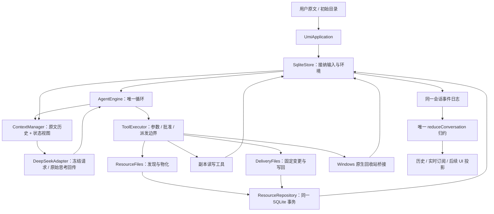

# Umi 阶段 3A：受控资源、工作副本与交付

日期：2026-10-04（Asia/Shanghai）。产品名为 **Umi**；开发目录为 `E:\SOME_SEVEN_PROJECT-57\Umi_v2.0`。本阶段沿用阶段 2 的唯一 Agent 循环、事件归约和数据库写入者，没有新增框架、第二套 Agent 或通用命令执行入口。

## 1. 已完成与下一阶段

| 能力 | 当前实现 |
|---|---|
| 初始工作区 | 记录来源身份，授权并物化到同会话持久环境；不直接编辑来源 |
| 外部资源发现 | 已知绝对路径定位，以及常用目录有界枚举；发现只返回元数据 |
| 资源授权 | 读取或编辑副本的权限成组批准；外部批准限本次运行 |
| 工作副本 | 多资源分别挂载，读取、搜索、创建、修改、删除；编辑不逐文件询问 |
| 变更集 | 从基线与副本生成不可变 ChangeSet（固定变更清单），支持批量预览 |
| 交付 | 独立具体批准、来源冲突校验、逐项意图及核验回执 |
| 系统回收站 | Windows 固定原生桥接；无 `.trash` 替代逻辑 |
| 恢复 | 物化、变更快照、写回效果可按原定位核验；未知副作用不盲目重试 |
| 历史检索 | 直接查询符合条件的原文记录，避免先加载整个会话；返回有界 |
| 前端接口 | 同一会话事件流、归约状态及文件/变更预览入口；尚未接现有 React |

下一阶段为 **3B：受控宿主命令执行**。长任务压缩、要求清单和窗口切换是阶段 4；Electron 与 UI 接入是阶段 5。当前没有 Docker、WSL 或 Python 服务依赖。

## 2. 用户视角的一次完整工作

1. 选择已有工作区目录。系统创建 conversationId（会话身份）及 environmentId（持续工作环境身份），读取该目录并生成托管副本。
2. 用户提出任务，完整原文按阶段 2 的既有方式接纳、持久化并进入上下文。
3. 模型发现还需要外部目录时调用 `discover_resource`（资源发现）。系统只返回候选路径、身份和扫描覆盖范围，不读取正文。
4. 模型选定候选，调用 `request_resource`（资源请求）。批准卡片说明真实来源、用途、读取/编辑副本范围及任务期限；循环阻塞等待批准或拒绝。
5. 允许后，系统将来源复制到独立挂载。模型用 mountId（具体副本标识）与相对路径操作。多个资源中的同名文件不会混为一个文件。
6. 模型自动读、搜索、编辑副本。副本编辑不是对原磁盘项目的修改，不会每改一文件就打断用户。
7. 模型调用 `build_changeset`（建立变更集），系统固定文件路径、操作、原/新内容 hash（指纹）和快照内容。
8. 模型调用 `deliver_changeset`（交付变更集），系统展示写回目录和完整文件清单。预览正文有截断标记，文件范围不会因正文截断而隐去。
9. 用户批准后，系统再次校验来源及副本，逐文件写回并保存回执。出现冲突则不强行覆盖；部分完成会记录哪些已完成，哪些未完成或未知。
10. 交付工具结算后，循环才进入后续模型轮次及最终总结。等待权限期间不能发布最终身份的总结。

拒绝后的决定持久保留；更换用途文字不解除同一资源的等价拒绝。普通“继续”输入不代替批准。断开订阅只断开观察，不停止后台运行；主动停止则写入停止事实并取消执行信号。重启后的续跑仍需明确 `resume`（恢复）入口。

系统保证的是**具体获准操作的范围与核验**。任务是否遗漏某个用户要求、是否选对全部待交付文件，目前仍受模型判断影响；不能把一次工具成功等同于整个自然语言任务必然完成。

## 3. 系统链路与代码位置



| 步骤 | 文件与方法 | 责任 |
|---|---|---|
| 组装 | `apps/headless/src/application.ts`：构造函数 | 注册资源、回收站、历史等工具，组装同一个循环与仓储 |
| 初始环境 | 同文件：`createConversation`；`ResourceFiles.initialize` / `bindInitial` | 建立来源与副本；物化失败保存事实，不使普通模型任务无法进行 |
| 接纳/启动 | `UmiApplication.send` / `start`；`SqliteStore.acceptInput` | 幂等输入、环境独占及运行身份；不重复启动已完成命令 |
| 循环 | `packages/agent/src/loop/engine.ts`：`AgentEngine.run` | 恢复原未知工具、构建上下文、调用模型、调度工具、最终边界 |
| 上下文 | `packages/agent/src/context/manager.ts` | 延续完整已接纳会话与请求快照，不塞入整个事件日志；增加可信资源状态视图 |
| 工具调度 | `packages/agent/src/tools/executor.ts`：`ToolExecutor.execute` | 具体执行定位、权限等待、派发记录、结果结算和恢复核验 |
| 发现/物化 | `packages/adapters/src/host-files/resources.ts`：`discover` / `resourceContext` / `materializeAsync` | 有界发现、确定源与副本位置、保存复制计划、逐文件复制、发布挂载 |
| 路径与对象 | `host-files/paths.ts`：`safeRoot` / `safeFile` / `observe` / `scan` / `atomicWrite` | 路径防护、内容及对象身份、完整清单、同目录暂存替换 |
| 文件工具 | `host-files/tools.ts`：`registerFiles` | 发现、请求、列举、读取、搜索、写入、删除、建立/交付变更集的统一注册 |
| 变更/交付 | `host-files/delivery.ts`：`build` / `preview` / `prepare` / `apply` / `reconcile` | 固定快照、预览、冲突核验、逐项执行、未知效果核验 |
| 资源存储 | `packages/adapters/src/sqlite/resources.ts`：`ResourceRepository` | 身份、能力、挂载、物化计划、变更集、逐项意图与回执 |
| 原生回收 | `host-files/recycle.ts`：`registerRecycle` | 固定 Windows FileIO 回收接口和 Shell 回收条目核验；不开放模型脚本 |
| 展示/恢复 | `UmiApplication.previewFile` / `previewChangeSet` / `inspectRecovery` / `subscribe` | 使用原事实与同一 cursor（会话游标）提供预览、历史和实时增量 |
| 协议/归约 | `packages/protocol/src/resources.ts`、`events.ts`、`reducer.ts` | 运行时字段校验、资源/交付事件、同一纯归约函数 |

## 4. 环境、挂载与基线

```text
<dataRoot>/
  umi.sqlite                 数据库，schema 版本 2
  writer.lock                唯一写入者锁
  environments/<environmentId>/
    task/scratch/            阶段 2 的旧工具位置，升级后不改变解释
    task/artifacts/content/<SHA256>.bin
                             基线/变更的不可变内容资料
    working/<mountId>/       每次物化的具体可编辑副本
```

environmentId 是逻辑身份，不是物理路径。每条文件执行的 locations（对象定位集合）包含带标签 rootRef（根引用）、相对路径、物理根绑定及身份、beforeHash（前置内容）和 desiredHash（预期内容）。源对象以 resourceId 区分；副本以 mountId 区分；旧 scratch 不会在升级后被解释成某个 working 目录。

**基线不是另一棵目录。** baselineRef 引用不可变 manifest（文件清单），文件内容按 SHA256 存储。来源基线中的对象身份与副本对象身份不同，不能要求两者 inode（文件系统对象编号）相同。核验源对象时比较来源身份；核验副本时比较副本身份及内容。

同会话后续运行保留未交付副本和基线；重新申请资源不会覆盖已有编辑。外部能力限原 run（连续运行），新运行可能需要重新授权。初始用户选定工作区的能力为会话范围。当前没有来源自动刷新、三方合并或环境搬迁接口；未实现能力不能借升级绑定把旧记录重新解释。

数据根是开发者 CLI 的 `--data` 配置。当前不会把托管数据库和所有副本直接写进用户选定的来源目录。桌面端默认数据根留到阶段 5。

## 5. 权限与交付策略

| 操作 | 当前处理 |
|---|---|
| 发现候选元数据 | 自动、有界；不读取正文 |
| 初始用户选定目录读取/副本编辑 | 初始选择授权，会话范围 |
| 新外部来源读取或副本编辑 | 请求具体资源批准，限本次运行 |
| 已获准副本的读/编辑 | 自动执行，参数与路径仍受校验 |
| scratch 测试写入 | 保留阶段 2 的具体批准，不把它泛化成真实副本策略 |
| 源目录交付 | 固定 ChangeSet 独立批准；批准不覆盖后续不同变更 |
| 源文件回收 | 具体源对象独立批准，原生能力与结果均核验 |
| 通用 Shell / Git / 构建测试 | 尚未开放，阶段 3B |

协议中的 source.read（来源读取）、copy.read（副本读取）、copy.edit（副本编辑）、source.deliver（来源写回）、source.recycle（来源回收）仍是不同操作。现阶段前两类资源能力在存储中组合为 read/edit（读取/编辑副本），交付与回收仍绑定具体执行批准，不产生五个强制连续弹窗。

ask/auto（询问/自动）设置继续持久保存；这两档当前都不会绕过新增外部来源及源副作用批准。等价资源拒绝会阻止改用途重试，当前没有清除拒绝记录的管理入口；后续 UI 权限管理需明确重新授权语义。

交付预览包含每个文件的 create/modify/delete（创建/修改/删除）、前后指纹及文本摘录。单次最多 200 文件；摘录按预算截断，不把截断内容伪装成完整差异。二进制仅显示指纹和元数据。delete 是明确批准后的**永久删除**；“移入回收站”必须使用独立原生工具。

## 6. 持久化和事件边界

数据库从版本 1 事务迁移至版本 2；新迁移 checksum（指纹）对实际 SQL 原文计算。旧 messages、tool_executions、approval_requests、artifacts 和事件日志保留。阶段 2 的定位字段没有被替换为绝对路径或新副本位置。

| 新表 | 保存什么 |
|---|---|
| `resource_candidates` | 候选根、身份、所属环境与是否初始来源；不保存未授权正文 |
| `resources` | 已授权资源身份，与候选及环境关联 |
| `capabilities` | 读取/编辑副本能力、会话/运行范围、批准来源 |
| `resource_denials` | 等价拒绝守卫，是持久权限索引，不是模型对话内容 |
| `mounts` | 具体副本根及身份、资源映射和当前 baselineRef；根绑定不可改写 |
| `materializations` | 复制前原计划 artifact 引用、首次创建的副本根身份 |
| `changesets` | 不可变变更 artifact 与原 executionId；恢复复用原快照 |
| `delivery_items` | 逐项 intent/settled 状态、回执引用与确定的同目录暂存位置 |

新增事实事件：`resource.discovered`、`resource.authorized`、`resource.materialization_started`、`resource.materialization_root_bound`、`resource.materialized`、`resource.materialization_failed`、`changeset.created`、`delivery.item_intent`、`delivery.item_settled`。全部沿用同一会话日志和归约，不另建资源游标。

物化顺序：派发意图 → 授权事实 → 原来源清单及目标计划持久化 → 创建根 → 根身份持久绑定 → 复制文件和内容资料 → 来源一致性核验 → 发布挂载 → 工具结算。

交付顺序：固定变更集 → 执行定位/批准请求 → 决定与重新校验 → 派发意图 → 每文件写入意图及暂存定位 → 磁盘效果 → 回执/基线推进事务 → 工具结算。SQLite 与磁盘之间不构成同一个事务，不能声称多文件交付完全原子。

事件是事实来源；归约状态是展示视图。模型只看到完整会话、工具观察和当前可信资源状态，不接收全部底层事件。初始物化失败、未完成计划、已获准挂载和排除范围进入状态视图；大内容仍通过文件工具按范围读取。

## 7. 恢复判定

| 中断位置/观测 | 处理 |
|---|---|
| 批准等待前后 | 恢复原审批及定位，不重新生成另一张同义卡片 |
| 物化仅复制部分文件 | 核验原计划；保留部分副本，结算为未完成，不自动重新复制 |
| 物化已完整但尚未发布挂载 | 核验原根、清单和内容资料后发布原挂载，不重新读取来源 |
| 已有挂载或部分根身份异常 | 无法证明安全时保持未知/阻塞，不覆盖旧目录 |
| 变更集已存但结果未提交 | 从原 executionId 取回相同变更集，不根据后来副本重新生成 |
| 源文件仍为原对象及原内容 | 核验为未应用，不执行原写入 |
| 无回执但文件满足 desiredHash | 标为已满足，不捏造本次工具一定执行成功 |
| 有已结算回执 | 校验其观测对象与内容，保留原事实 |
| 来源出现不相关内容、对象替换或暂存文件无法核验 | unknown（未知）并阻塞；修复条件后可再次显式核验 |
| 效果发生而回执或工具结果事务失败 | 运行保持 recovery_required（需要恢复）；不永久结成不可恢复失败 |

一个文件失败不会使已交付文件“回滚成未执行”。剩余变更应根据最新真实基线建立新变更集和新批准。暂停/恢复不等于重复执行。

外部复制定期让出事件循环并检查停止信号，已验证物化开始后停止。初始物化与文件枚举仍包含同步文件系统步骤，在慢盘上可能短暂阻塞；不是硬实时取消或大项目性能承诺。

## 8. 验收证据

### 自动验证

最终测试清单为 **66 个案例**：阶段 2 原有 33 个，以及本阶段资源、交付、物化和原生回收相关 33 个。包含：

- 多文件副本编辑一次交付批准；权限等待时没有最终正文身份。
- 外部元数据发现、批准/拒绝、等价拒绝重试、多挂载同名文件。
- 来源内容/身份与副本变化冲突、路径穿越/设备名/ADS（备用数据流）/junction（目录联接）。
- 未交付副本跨运行/进程保留；阶段 2 数据库升级及旧 scratch 定位、游标保留。
- 派发事务失败、效果后回执事务失败、结果事务失败及原变更快照恢复。
- 实际交付子进程强制退出 **9 种边界**，物化实际进程退出 **2 种边界**；加原有阶段 2 的 5 种，共 16 个真实进程退出场景。
- 原生回收能力不可用明确失败；真实 Windows 桌面用户的系统回收站条目与指纹核验。
- 100 次工具调用后的原文检索，以及复制过程主动停止后的显式恢复核验。

本次物化/交付集中验证的 31 个案例已全部通过。最终全套结果与工程文件指纹见 [最终验收记录](evidence/stage-3a-validation.json)。原生回收须在实际桌面用户会话验证：受限测试账号无法列举真实用户回收站时保持未知，不能计为成功。

### 历史检索

同本机小型 fixture（确定性样本）104 条消息、100 次工具调用，20 次检索：调整前中位约 129.83 ms、P95 137.06 ms；集中验证调整后中位 **2.0453 ms**、P95 **2.3308 ms**。最终全套运行数据记录在验收 JSON。

改进为 SQL 先选出原文命中项与有限返回行，再校验结果；没有引入全文检索系统。子串匹配仍随历史规模增长，计数也扫描匹配范围；这不是百万 token 历史或冷盘性能保证。后续按真实规模再决定 FTS（全文索引）及预算。

### 真实 DeepSeek

脱敏证据：[deepseek-stage3a.json](evidence/deepseek-stage3a.json)。2026-10-04 16:39（北京时间），`deepseek-flash`、high（高思考强度），实际 **8 次模型调用、2 次批准**。外部配置从 3000 改为 4100，并创建说明文件；批准前原文件不变，固定两文件交付后内容核验通过。全部 8 个工具成功，8 次响应带原始思考并被后续请求接受。

此真实样本验证协议与多轮受控文件行为；后来补充的存储故障和停止边界由自动测试验证。单个 Flash high 短任务不能代表 Pro、长任务、图片、1M 大窗口稳定性或语言遵从率。真实 API 记录无密钥、完整个人文件或认证头。

累计输入 46,023 token、缓存命中 28,672 token、输出 1,860 token，仅作为样本观察。最终无工具总结请求改变 tools 前缀，最后一轮缓存命中降为 128；不把本样本比例定为产品指标。阶段 4 还需协调完成边界与稳定请求前缀。

## 9. 当前安全与能力限制

1. **没有 OS（操作系统）沙箱。** 路径检查、对象核验和批准限制结构化工具，不保护未来任意宿主代码。恶意外部进程并发替换造成的 TOCTOU（检查与使用之间的时间差）风险未被 OS 级隔离消除。
2. 默认发现仅扫描工作区/父目录及常用用户目录，深度 2、最多 2,000 目录、20 候选、约 1.5 秒预算；可直接给已知路径。不是全盘索引，不保证发现所有桌面项目。
3. 物化单文件最多 4 MiB、总内容 32 MiB、5,000 目录项、深度 16；枚举时间约 10 秒上限，外部复制另有 30 秒预算。超过限额明确失败，不用不完整基线交付。
4. 排除 `.git`、`node_modules`、`.venv`、`__pycache__` 和托管运行数据；不支持链接、网络共享或设备路径。副本不是可直接构建的完整依赖环境。
5. UTF-8 预览和搜索支持字节范围；二进制只展示元数据。没有 Office/PDF 解析、图片视觉、ACL/时间戳/元数据忠实镜像或空目录交付。
6. 来源变化不自动刷新现有副本；交付不做三方合并、项目事务回滚。永久删除与系统回收明确区分。
7. 原生回收站通过固定 Windows/.NET/Shell 桥接，模型无法提交 PowerShell；桥接子进程不继承 API 密钥，必须有对应桌面会话能力。跨平台回收暂未实现。
8. 旧 Python 项目、旧前端及旧数据库未迁移或修改。新核心只经 CLI/应用接口运行，没有伪造已完成 GUI 对接。

## 10. 开发与后续工作

```powershell
cd E:\SOME_SEVEN_PROJECT-57\Umi_v2.0
npm run typecheck
npm test
npm run demo
node --env-file=.env dist/apps/headless/src/cli.js --data .umi
```

本项目未复制旧密钥文件；真实模型由开发者按 `.env.example` 配置。基础开发、自动测试与 demo 不依赖 API。Node 24 的 SQLite 实验性 API 提示仍存在。

阶段 3B 将先固化具体程序、参数、cwd（工作目录）、脚本版本与环境修订的执行/批准契约，再接子进程输出限制、超时、停止清理和未知结果核验。项目代码执行与普通结构化副本编辑不能共用“工作副本就安全”的假设。命令执行仍经同一 ToolExecutor 和事件日志，Docker 与 WSL 后续分别作为可选适配器。
