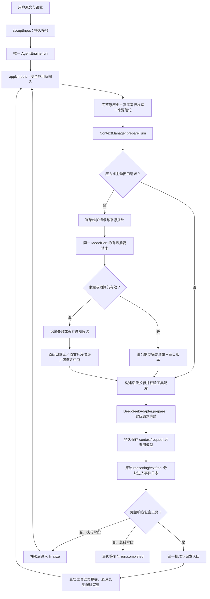

# Umi 阶段 4：长任务上下文、来源记忆与恢复

日期：2026-10-04。产品名称为 Umi，开发目录仍为 `E:\SOME_SEVEN_PROJECT-57\Umi_v2.0`。本阶段完成无界面核心中的长任务上下文维护，没有创建第二个 Agent，也没有改动旧前端。

## 1. 本阶段交付

- 用户原话要求清单：每条已应用用户消息都有稳定的要求来源 ID；完整原文持续进入当前模型上下文，不靠模型摘要保留要求。
- 有来源的模型笔记及要求候选：区分逐字观察和模型判断，记录失败、否决原因及下一步；不把模型记录当权限或执行凭证。
- 自动压缩与主动窗口切换：以完整模型/工具消息组为边界，只退休旧模型和工具记录；原始历史、思考和工具结果不删除。
- 维护请求、原始响应、摘要、清单、失败和用量持久化；来源变化时丢弃旧候选。
- 恢复原窗口和原笔记；维护中断不会自动重复收费请求，工具记忆提交中断按原执行身份核验。
- 同一事件归约器生成窗口状态和上下文统计；估算、实际 API 用量、维护费用分别报告。
- 宿主命令在持久派发及目标进程释放前强制核验具体批准。

## 2. 一次任务的完整路径

维护是唯一上下文入口内的一次无工具模型请求，不拥有独立任务循环。维护流不会被伪装成用户消息、工作正文或工具执行结果。工作流式块的原有轮次、attempt、sequence 和历史展示保持。

## 3. 代码职责与方法

| 文件 | 方法与职责 |
|---|---|
| `packages/agent/src/loop/engine.ts` | `AgentEngine.run`：结算未知工具、应用输入、调用上下文入口、冻结实际请求、编码后预算检查、流式提交、执行工具和阶段推进。预算不足成为可恢复 interrupted。 |
| `packages/agent/src/context/manager.ts` | `prepare`：纯投影和预算检查。`prepareTurn`：判断维护时机、选择完整组、冻结来源、调用同一模型端口、校验摘要、事务提交、处理过期与降级。 |
| `packages/agent/src/context/projection.ts` | `ordered`：按已应用顺序构建历史。`messageGroups`：完整工具组。`validateArchive`：拒绝半组、用户原话、跨来源或指纹不符。`memoryProjection`：来源清单与有限笔记。`sourceViews` / `extractiveSummary`：有明确范围与截断标记的维护资料/降级片段。 |
| `packages/agent/src/tools/memory.ts` | `registerMemory` 注册五个工具：`record_work_note`、`record_requirement`、`request_context_reset`、`read_work_memory`、`read_artifact`。 |
| `packages/agent/src/tools/registry.ts` | 已有 `search_history` / `read_history` 仍查原始会话，不查摘要。 |
| `packages/protocol/src/memory.ts` | Zod 运行时约束：UTF-8 来源范围、笔记、候选要求、摘要、统计和维护计划。TS 类型不是唯一校验。 |
| `packages/adapters/src/sqlite/memory.ts` | `fingerprint`、`load`、`source`、`accessible`、`save`、`start`、`finish`、`fail`：唯一数据库内保存来源、恢复窗口、验证归属、提交维护事实。 |
| `packages/adapters/src/sqlite/memory-schema.ts` | schema 4 的两张表和不可变记录约束。 |
| `packages/protocol/src/events.ts` / `reducer.ts` | 新事件运行时校验和唯一纯归约；没有第二个 cursor 或独立前端维护状态机。 |
| `packages/adapters/src/sqlite/store.ts` | 事务、schema 迁移、启动时维护对账、实际请求快照；`dispatch` 和 `assertApprovedExecution` 核验批准。 |
| `packages/adapters/src/host-process/tools.ts` | `CommandTools.execute`：准备后及挂起就绪、释放前核验批准；原进程恢复不重复执行。 |
| `apps/headless/src/application.ts` / `cli.ts` | 组装原循环；`contextStatistics`、`context`、`memory` 暴露可供未来 UI 对接的真实记录。 |

## 4. 模型看到什么

顺序为稳定人格/职责/语言规则 → 旧记录的有损摘要 → 按原顺序保留的用户原话和近期完整组 → 最新真实运行状态及来源记忆。

**原始事实层**：全部用户消息、完整模型响应及 raw reasoning、实际工具结果持续保存。压缩不 UPDATE 或 DELETE 原历史。

**系统状态层**：环境与修订、阶段、挂载授权、最近工具状态与总数。它来自数据库及原事件归约，不来自模型笔记。当前模型投影最多列出最近 32 个工具状态；详细结果仍可查历史和资料。

**模型记忆层**：每条用户消息产生 `requirement:<messageId>` 来源记录。模型提取的要求必须是用户消息的一段逐字引用；`supersedes` 仅提出解释候选，不能撤销原文。观察笔记要求单一来源的逐字引用；推断/决定/失败/下一步可以由模型表述，但必须有有效来源。来源有效不等于推断已获证实。

模型投影展示最近 24 项笔记/要求候选，每项文字最多 1,200 字符，明确标注缩短与剩余数量；全部记录可通过分页和资料工具读取。事件日志、进程碎片事件、维护审计记录不全部塞给模型。

`read_artifact` 只允许读取当前会话拥有的工具结果、请求上下文、过程输出及记忆/维护资料，按 UTF-8 范围最多 64,000 字节。不会因知道其他会话的 artifact ID 就获得读取权。

## 5. 预算与压缩策略

| 项目 | 当前行为 |
|---|---|
| 默认容量 | 1,000,000；依据当前 DeepSeek 官方模型容量。不是实际装满 1M 的性能承诺。 |
| 输出预算 | off 8,192；normal 32,768；high 65,536。产品预算，不冒充厂商最大输出。 |
| 安全余量 | 16,384。输入上限＝窗口－实际输出预算－余量。 |
| 触发/目标 | 保守估算达到输入上限 75% 时维护，目标约 50%；保护内容可能使目标无法达到。 |
| 常规保护 | 全部已应用用户原文和最近 6 个完整 assistant 消息组。 |
| 主动窗口切换 | 模型通过工具提出理由及保留来源；工具组结算后执行，至少保留最新完整组及指定来源所在完整组。 |
| 摘要输入 | 最多 64 个来源视图，每条正文最多前 1,600 UTF-8 字节；上次摘要取最近 8 项、每项最多 800 字符，显式说明缩短。输入进一步按维护预算缩减。 |
| 维护预算 | 输入保守上限不超过 128,000，且不能超模型窗口扣除输出 4,096 和余量后的预算；发送前再次检查维护请求体。 |
| 摘要输出 | 无工具、thinking off，最多 4,096 输出预算；严格 JSON、最多 24 项、每项最多 1,600 字符、来源 ID 必须属于退休清单。 |
| 尝试边界 | 每 run 最多 4 条维护记录；同窗口版本＋来源指纹＋模式失败后不重复请求。最多一次来源变化重建。 |

UTF-8 字节数加消息及工具结构余量是保守估算，**不是实际 tokenizer 结果**。主请求经适配器编码后再次检查真实请求体大小；API usage 原样另存。不能把实际上一请求的 token 数显示成当前请求的精确用量。

摘要失败、JSON 错误、引用失效或额度不足：若原投影仍在硬预算内，记录失败后继续原窗口。若已超硬预算或模型主动请求窗口重建，尝试原文片段降级，标记截断及来源，不冒充完整摘要。仍超预算则 interrupted，调整预算后可 resume，同一 run 与环境不变。

**当前明确取舍**：不静默压掉用户原话。因此极长用户要求累计本身超过预算时会暂停，不能宣称已经解决无限长会话。对截断旧工具日志或摘要遗漏的重要信息，模型须按来源检索；摘要覆盖不了未读原文。

DeepSeek 的保留 assistant reasoning 原样回传，工具调用和结果成组校验；退休完整组只是退出活跃模型视图，raw reasoning 仍保存在历史及事件中。缓存前缀在正常追加时稳定；维护、语言/模型切换或用户更正可以合法降低命中率，正确性优先。

## 6. 持久化、恢复与前端边界

schema 从 3 事务升级为 4，只新增 `memory_entries`、`context_maintenance`。既有 messages、events、tool_executions、approval_requests 和 artifacts 继续复用。

- `memory_entries`：不可变模型记录，绑定唯一 executionId 与原工具参数；重复结算只返回原记录，不推进环境文件修订。
- `context_maintenance`：冻结计划、来源指纹、基准版本、模式、started/failed/completed、摘要和清单引用。
- artifacts：冻结维护请求、原始响应、结构化摘要、来源清单与 usage。原始维护响应和用量通过事件引用，不成为无来源孤立资料。
- events：`memory.recorded`、`context.maintenance_started`、`context.maintenance_response`、`context.maintenance_usage`、`context.maintenance_failed`、`context.window_committed`。沿同一个 conversation sequence；主请求继续 `context.snapshot_created` 与 `usage.recorded`。

维护生成期间用户输入、设置、环境修订、阶段、记忆或窗口改变，候选必须废弃。窗口清单、摘要、版本事件在同一事务提交；失败事务不发布新窗口。启动发现 started 维护时记录 `MAINTENANCE_INTERRUPTED`，不自动重发收费请求。

笔记已经提交、工具结果尚未结算时硬退出：按原 executionId 找回不可变记录，再结算工具；不重复新增笔记。应用退出与用户停止仍是不同状态；事件订阅断线不停止任务。

前端未来通过原 snapshot / event projection 接收上下文 metrics；`context` 命令同时返回当前窗口、最近请求估算、对应实际 usage 和各维护费用。`memory` 可读取全部来源记录。**本阶段没有对接旧 GUI，也没有修改其 UI**；该工作属于阶段 5。

宿主批准没有扩权：派发事务必须有同一工具、同一 run、同一请求 hash 的有效 allow；挂起目标释放前再检查。ask/auto 都要求具体宿主批准。结构化副本操作仍按既有能力自动进行。无 OS 文件/网络沙箱的事实不变。

## 7. 验收证据

最终结果见 `docs/evidence/stage-4-validation.json`，真实模型见 `docs/evidence/deepseek-stage4.json`。

- 完整自动套件：117 个案例，包括原 94 个回归；新增 23 个上下文/记忆/批准场景。新增 3 个真实子进程强制退出，连同原 22 个，共 25 个真实退出场景。
- 包含来源指纹与 UTF-8 范围、用户保护、半工具组拒绝、过期摘要、事务回滚、配对与思考回传、低压力不维护、失败不重复收费、原文降级、预算恢复、schema 升级、笔记读取期间未完成组，以及目标释放前撤销批准。
- 真实 DeepSeek Flash high：2 次真实摘要＋4 次工作调用；上下文版本推进到 3。实际检索原始要求、保存逐字笔记，最新灰色要求与否决原因正确呈现在最终答复。保留 raw reasoning 在后续带工具请求中回传。
- 12 条长历史为明确标记的合成负载，用于触发预算，不冒充 12 次真实模型操作。真实模型样本为一个短任务，窗口设置 200K。
- 首次真实验收脚本把窗口版本错误地固定为 2，实际合理维护两次到了 3；任务已完成。改为验证有效版本推进与每次维护成功，并从同一持久记录生成证据，没有重复 API。随后维护输入限额、编码预算和规范默认值的加固由最终自动套件核验；真实样本不声称覆盖每一种维护资料形状。
- 旧项目 176 个基线文件未改变，Git 状态未改变。当前目标通过源码指纹同步后在目标目录再次完成 typecheck、完整测试和 demo。

## 8. 对照资料与后续

DeepSeek 官方 [模型能力](https://api-docs.deepseek.com/quick_start/pricing) 当前说明 Flash 别名对应 V4.1 Flash、Pro 为 V4 Pro，1M 容量；实际 API 返回的别名另存，不根据别名臆造精确版本。本阶段不改模型菜单，也不宣称 Pro 已验。

[思考模式协议](https://api-docs.deepseek.com/guides/thinking_mode/) 要求带 tools 时保留需要回传的 reasoning。当前验证覆盖保留组的原始思考；摘要不替代 reasoning。

参考本机 Harness 提交 `639ed015397290b3745d163aafe02ffee4aa3f84` 的 `packages/compaction/compaction-basic/src/region.ts`：完整配对边界、维护前后来源复核及持久化生命周期；参考 [Harness 仓库](https://github.com/deepseek-ai/DeepSeek-Harness) 的版本化源码，而非把插件框架搬入 Umi。

参考 Reasonix 提交 `68a311ad02eb29ccfd4e394db02351c6beb598ac` 的 `internal/runtime/agent/compact_user_turns.go`、`compact_summary_failure_test.go`：用户原文保护、维护输入预算、失败机械降级和失败去重。其用户保留有可配置预算；Umi 本阶段选择全部原文保护，超预算明确中断，区别已说明。来源为 [Reasonix 仓库](https://github.com/esengine/DeepSeek-Reasonix)。

剩余阶段 5：既有 React 界面对接共享协议、桌面进程生命周期与受限 IPC；Docker、WSL 分别作为可选开发者能力。此次没有预建这些模块。图片、Pro、大窗口装满、数小时长任务表现、长期缓存成本和百万历史索引还需要各自明确验收。
