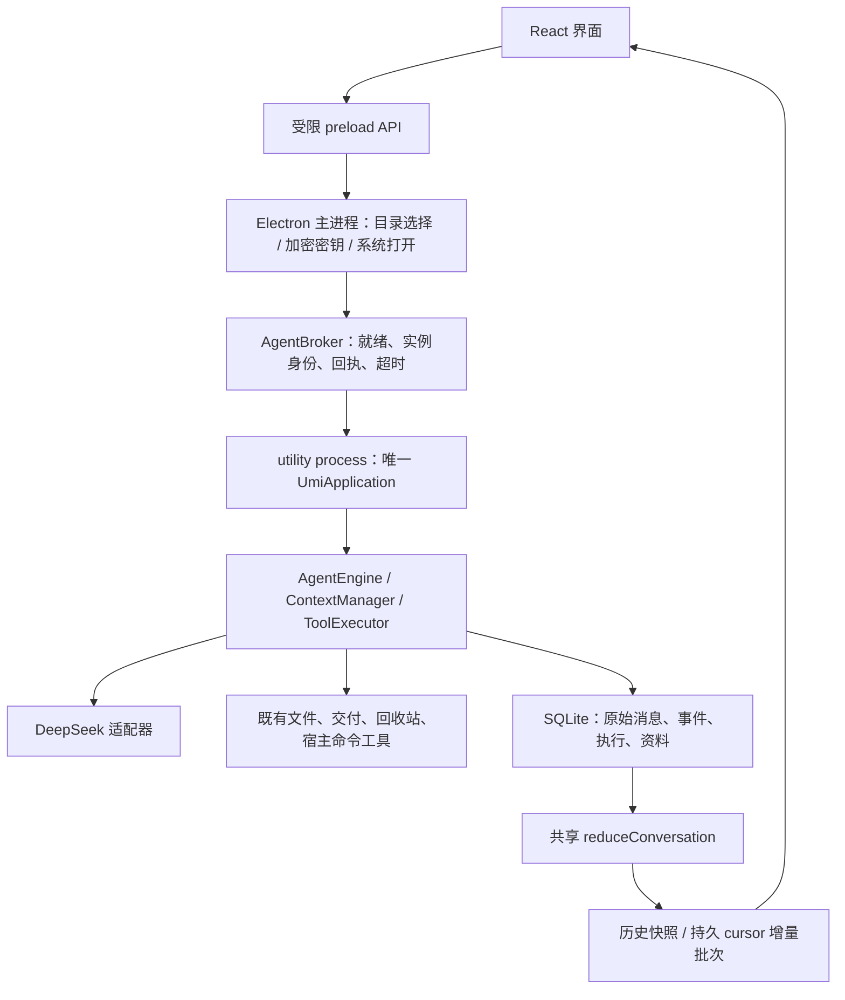

# Umi 阶段 5：桌面对接与预算阻塞恢复

日期：2026-10-04。产品名称为 **Umi**。开发目录为 `E:\SOME_SEVEN_PROJECT-57\Umi_v2.0`，旧 Umi 项目未修改。

## 1. 本阶段结果

已接入现有 React 界面与 Electron 桌面进程，使用阶段 2—4 的唯一 AgentEngine、工具执行器、SQLite 仓储和事件归约器。没有第二套 Agent、Chat/LangGraph 服务或新的大型框架。

沿用原侧栏、输入框、头像和用户名、主题、右侧文件预览区域、历史刻度与主要 CSS。仅迁移组件和显示参数，没有迁移旧 HTTP/SSE 控制器、旧工具状态类型或旧后端。前端现在消费同一会话的持久事件；桌面传输是有界 IPC 拉取，不是新增 SSE 服务。

新增预算阻塞事实、只读恢复检查与重复恢复拒绝。提高有效预算、降低输出预留等条件变化后，可继续原 run；条件未解除不会重复调用模型。

## 2. 进程与完整工作流程

1. **启动**：`apps/desktop/main.ts` 注册本地 `umi://app` 页面并创建隔离窗口。`AgentBroker.ready()` 启动 utility process（Electron 提供的独立 Node 执行进程），等待协议、数据库版本和实例身份的就绪确认。Agent 的进程退出不等于任务停止。
2. **目录选择**：主进程的原生目录选择器签发短期、一次性的 selectionId（选择证据）。页面不提交任意真实目录。主进程重新核验根对象身份后调用原 `createConversation()`；初始资源物化和工作副本逻辑保持原样。
3. **新会话**：`DesktopService.handle(new_conversation)` 复用已选择工作区的证据并核验身份；创建独立 conversation/environment。工作区行旁的新建按钮明确传入该工作区身份，避免使用尚未更新的 React 选择状态。
4. **提交输入**：页面先提交持久设置，再以固定 commandId 发送原文和附件身份。`acceptInput()` 在原事务中接纳输入并返回回执。回执未知时保留同一 commandId，可查询原回执；不会用一个新身份悄悄重发。
5. **构建请求**：仍由 `ContextManager.prepareTurn()` 统一读取消息、来源记忆和真实状态。输出预留、安全余量和有效窗口都参与预算；编码后的请求体再次核验。整个事件日志不进入模型。
6. **流式执行**：DeepSeek 的 reasoning/text/tool 参数沿原 Model Turn 和 attempt 身份逐块提交事件。前端在约 120 ms 的消费间隔拉取最多 128 个事件，通常限制在 512 KB；单个事件可超过该批次软限额。共享归约器拒绝不同会话/日志版本和序号缺口，重复事件不重复应用。
7. **工具与批准**：工具准备、具体批准、派发、核验和结果仍由原 ToolExecutor 完成。批准期间显示阻塞卡片；允许/拒绝只提交原批准身份。工具异常、拒绝、取消和未知结果保留不同状态，不都画成成功。
8. **阶段正文**：执行轮正文即时显示在对应轮次，与思考、工具按日志序号排列。后续用户指令插入正确的位置。UI 使用 input.accepted（输入接收）的顺序；模型历史使用 input.applied（实际应用指令）的顺序，两者没有混用。
9. **交付与总结**：沿原固定 ChangeSet（变更集）批准和逐文件交付回执。工具尚未结算、批准尚未决定时不进入最终总结。完成后执行片段默认折叠，最终正文独立保留；总结轮的 reasoning 也归思考区域，不漏入正文。
10. **刷新与断线**：重新加载页面先读取历史快照，再从同一持久 cursor（会话、日志版本、序号）续读。订阅只观察，不取消任务。utility process 崩溃后，新实例重建并核验状态；不自动恢复任务。旧实例的迟到回执被忽略。
11. **停止与退出**：输入框停止提交原 stop 请求。关闭窗口会隐藏窗口，任务继续；可再次启动 Umi 唤回窗口。菜单“退出 Umi”关闭执行器，保留中断事实，不冒充用户停止。未知副作用仍须沿原执行记录核验。

## 3. 预算阻塞的识别与恢复语义

`packages/protocol/src/budget.ts` 定义 ContextBudgetError 和运行时字段校验。主任务在以下位置明确阻塞：

| stage（检查阶段） | 意义 |
|---|---|
| configuration | 输出预留与安全余量已经占满窗口 |
| protected | 完整用户原话、必需状态与稳定前缀超过输入预算 |
| projection | 已构建的历史投影或降级窗口仍超过预算 |
| encoded | 适配器编码后的实际请求体超过预算 |

原日志新增 `context.budget_blocked`，保存保守估算、受保护部分估算、输入预算、窗口、输出预留、安全余量、估算版本、来源指纹和策略指纹；随后 `run.interrupted` 保存明确错误码。预算阻塞不等同于厂商额度耗尽，也不等同于连接断开。

`AgentEngine.recoveryBudget()` 是只读检查：读取当前原文、记忆、资源和设置，重新构建候选请求并核验编码大小，不派发 API、不创建执行世代、不提交新的运行事件。

- **相同条件且仍超预算**：`UmiApplication.resume()` 返回 `CONTEXT_BUDGET_BLOCKED`。直接重试和重启不会解除原因。
- **受保护原文仍超预算**：新增“继续”消息或改语言不能凭空腾出预算。检查明确返回不可恢复。
- **提高有效窗口、减少输出预留，或原投影条件发生有效变化**：可显式恢复原任务；恢复后仍走完整上下文预检。只有下一请求真正通过时才提交 `context.budget_cleared`。
- **只改了条件但依然不够**：保持阻塞，或在确有可退休历史时重新进行维护；不会承诺任何设置变化都能恢复成功。
- **达到模型窗口上限后，用户原文本身仍装不下**：继续保留原文和阻塞原因。本阶段没有引入自动折叠用户原文，也不宣称解决无限长会话。后续有预算原文投影必须另定来源、覆盖范围和显式告知契约。

估算仍为 UTF-8 保守上界方法，不是 DeepSeek 实测 token。界面分别展示最近请求估算与响应实测 usage（用量）；无记录时显示未知。恢复检查与系统执行核验是不同职责，预算放行不代表未知副作用已被确认。

## 4. 设置、附件和文件展示

- 模型、思考档位、权限模式、语言偏好、有效上下文窗口进入原 settings 事实；下一请求生效，当前冻结请求不改写。最近请求统计来自已保存的请求/usage，重新打开会话可以恢复。
- 头像、用户名、主题、预览宽度和最后会话属于本地界面偏好。没有导入旧浏览器 origin 的 localStorage，也没有导入旧 Python 数据库。
- API Key 仅在主进程和 Agent 进程中存在；磁盘配置使用 Electron safeStorage（Windows 系统加密），原子替换。页面仅获得 hasKey，不获得密钥；系统加密不可用时不落盘明文。
- 文本附件独立保存为原始资料，与原用户消息绑定。模型通过 `read_attachment` 有界读取，草稿附件不能被模型读取。发送后仍显示附件卡片，不把资料全文塞到用户气泡。支持文本类附件，最多 8 个，每个 1 MB；图片、PDF 和压缩包附件尚未接入。
- 已挂载副本的文件、固定变更集及附件可以在右侧预览。变更集预览包含新增/修改/删除与前后内容；删除文件使用原快照展示，不假装能读取已不存在的当前文件。打开本地位置只接受当前会话中已核验的副本文件。
- 普通 Markdown、代码和路径沿原配色；只有能够明确绑定挂载的文件标记才生成点击入口。未明确绑定的任意路径不会被猜测为授权文件。
- 历史会话归档仅隐藏列表，保留事件、资料和未交付副本；活动或未知执行不能归档。没有提供会静默丢弃恢复依据的工作区删除入口。

## 5. 桌面与插件边界

窗口使用 `contextIsolation: true`（隔离页面环境）、`nodeIntegration: false`（页面无 Node 权限）、`sandbox: true`（Electron 渲染器沙箱）。preload（预加载桥）只暴露受限 API。主进程验证页面来源和顶层 frame，命令通过 Zod 校验，拒绝任意 SQL、程序和宿主绝对路径的 IPC 请求。

这保护页面进程，**不是 Agent 宿主命令的 OS 文件/网络沙箱**。Agent 命令仍沿既有具体批准、请求快照和 Windows Job 进程组；服务、WMI、Docker 后台容器和 WSL 内部进程不在普通 Job 保证内。

Docker 和 WSL 在设置中独立启用与配置。固定的“检查可用性”入口仅查询服务版本或已安装发行版；`get_execution_plugins` 给模型提供配置事实。开发者实际调用仍走 `run_command/run_shell` 的具体批准。本阶段不安装、不启动 Docker 服务，不创建/管理 WSL 发行版，不提供专用容器隔离执行器，不将二者绑定为 Umi 必需子系统。

## 6. 数据库与代码导航

SQLite schema 升级至 5，保留版本 1—4 的迁移指纹、原消息、事件、执行定位和游标。新增 conversation_views（会话显示名称/归档）、attachments（附件原始资料引用）、message_attachments（消息附件绑定）。没有新增平行的事件、轮次、工具结果或 Agent 状态表。

| 文件/函数 | 职责 |
|---|---|
| `apps/desktop/main.ts` / installIPC、createWindow | 桌面生命周期、目录证据、受限系统操作、加密配置 |
| `apps/desktop/broker.ts` / ready、request、close | 就绪确认、实例边界、超时、待处理上限、失败退避 |
| `apps/desktop/agent-worker.ts` | 同一 UmiApplication 的独立进程入口 |
| `apps/desktop/service.ts` / snapshot、handle | 应用命令与 UI 数据投影，不直接新增业务循环 |
| `packages/protocol/src/desktop.ts` | IPC 请求、回执、就绪和配置的运行时约束 |
| `packages/protocol/src/budget.ts` | 预算原因及可持久化字段 |
| `packages/agent/src/context/manager.ts` / inspect、policy、prepareTurn | 只读预检、预算策略、唯一上下文维护 |
| `packages/agent/src/loop/engine.ts` / recoveryBudget、run | 阻塞判定、恢复门槛及下一请求放行边界 |
| `packages/adapters/src/sqlite/desktop-schema.ts` | 新显示与附件数据结构 |
| `packages/agent/src/tools/attachments.ts` | 已发送附件的受控读取 |
| `apps/desktop/renderer/src/transport.ts` / applyBatch | 同一归约器消费持久增量；消息应用状态同步 |
| `apps/desktop/renderer/src/Timeline.tsx` / Run、Tool、Approval | 分轮流式展示、批准、恢复、完成折叠 |
| `apps/desktop/renderer/src/App.tsx` | 会话选择、设置、输入回执、右侧预览与原组件接入 |
| `apps/desktop/plugins.ts` | 独立执行插件配置的只读工具 |
| `scripts/build-desktop.mjs`、`scripts/package-desktop.mjs` | 页面构建、隔离 preload 构建、Windows 便携目录打包 |

## 7. 验证证据

- TypeScript 编译及桌面构建通过。
- **132 个自动案例全部通过**：保留之前 117 个案例，新增 15 个预算、迁移、事件、附件、设置、批准和 UI 顺序场景。
- **真实 Electron 开发运行 15 项检查通过**。
- **实际 Umi.exe 打包运行 15 项检查通过**；Electron 44.5.1、内嵌 Node 24.21.0，`node:sqlite` 可用。
- 桌面检查覆盖窗口重载、批准卡片重建、无 Node/原始 IPC、具体写入、真实 Windows Job 命令、窗口隐藏、不自动续跑、真实 utility process 强制退出、停止区别、附件身份和预算拒绝/解除。
- 桌面验收仅替换模型端口，使用确定性响应；全部运行仍经过产品唯一 AgentEngine。**本阶段未新增真实 DeepSeek 调用**，不把桌面替身验收说成模型行为或成本验收。
- 自动检查覆盖 DOM 和生命周期，不等同于全面视觉、长时间性能及多语言 UI 验收。

可复核资料：`docs/evidence/stage-5-validation.json`、`desktop-runtime.json`、`desktop-packaged.json`。

## 8. 开发与交付入口

在项目目录执行 `npm run dev` 可构建并打开 Umi。便携程序为 `release/Umi-win32-x64/Umi.exe`；整个目录必须一起保留，不能只复制 exe。首次在设置中填写 DeepSeek API Key，或在启动前提供 DEEPSEEK_API_KEY 环境变量。

无界面 CLI 仍可用于核心开发与诊断，没有被 Electron 替换。已有开发库 `.umi` 与桌面默认资料目录分开；不自动合并或覆盖旧历史。旧数据导入、用户原文有预算投影、专用 Docker/WSL Runtime、长任务模型成本评测、安装包/更新器和额外模型适配器仍需后续明确实现。
