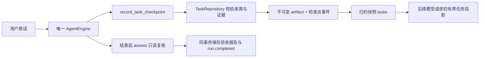

# Umi 任务验收与续作：第一阶段

> 阶段技术记录：本页能力和验收数字只对应原文日期；当前实现以[当前技术状态](current-state.zh-CN.md)和[运行契约](runtime-contracts.zh-CN.md)为准。

核对日期：2026-10-11。本文对应本轮真实源码和临时测试，不把历史阶段的数量作为本次验收。

## 本轮落地的契约

Umi 仍只有一个 AgentEngine。新增任务检查点工具和一个窄任务端口，不引入第二个 Agent、后台调度器或动态插件容器。检查点记录用户目标的模型解释、逐字原话来源、固定验收项、进度、证据执行身份及下一步。

`record_task_checkpoint` 创建时不传 taskId，baseVersion 为 0；返回的 taskId 在后续运行中保持不变。更新提交原 taskId 和 baseVersion，系统追加下一版本。目标、原话来源和验收项不可替换、删除或降低；所有进度必须完整对应唯一验收项。用户改变目标时，本阶段保留原任务和来源，不自动替用户判断撤销关系。后续需专门设计有来源的范围变更/关闭契约。

`acknowledgedInputId` 必须指向最新已应用用户消息；source.messageId 必须是本会话已应用用户消息，quote 必须逐字存在于该消息。核对身份只证明模型引用了原话，不能证明它理解了全部要求。

状态包括 pending、in_progress、blocked、needs_review 和 verified。blocked/needs_review 必须解释原因；verified 必须引用已成功结算且属于同一会话的真实工具。工作笔记仍用于记录判断、失败原因等，不承担这些状态的可信存储。

| 验收项 | 必须匹配的证据 | 结束前的只读复核 | 不代表什么 |
| --- | --- | --- | --- |
| file_hash | stat_file 的 mountId、path 和目标 SHA-256；null 表示不存在 | 原资源范围、根身份、当前文件哈希 | 副本哈希通过不代表源文件写回，也不代表内容质量正确 |
| command_exit | 指定 run_command/run_shell 的完整规范参数；真实进程回执、退出零、gate 已释放、Job 已结束 | 原 cwd 身份与执行后的目录指纹仍匹配 | 不能证明网络、cwd 外的副作用或完整用户目标 |
| delivery | 指定固定 ChangeSet 的 deliver_changeset 成功结果 | 每项回执完整且源文件仍符合冻结目标，包括删除状态 | 不覆盖之后新增的变化或其他文件 |
| review | 保持 needs_review 等未核验状态 | 本阶段没有可信人工审阅端口 | 模型不能通过提供任意工具身份将主观质量变成 verified |

命令参数先按同一协议 schema 补齐默认值，再比较规范内容，避免“省略默认超时”和“显式写默认超时”误判为不同请求。新鲜度按证据对应的对象复核，不把全局环境修订号直接当验收否决条件；正常源交付不使内容未变的副本测试失效。原批准仍严格绑定环境修订，批准规则未放宽。

最新用户消息比证据更晚时，旧 verified 退回待审。跨 run 继续需要先核对新原话并取得新的证据；停止/恢复同一个 run 不会自动重跑已结算工具。当前检查是某一时刻的观察，不构成 OS 级隔离或无竞态保证。

## 结束与续作的真实调用链

1. [application.ts](../apps/headless/src/application.ts) 组装 umi.tasks 模块、TaskRepository 与 currentTaskEvidence，然后注入唯一循环。依赖来自明确构造参数，任务模块不访问全局服务容器。
2. [task.ts](../packages/protocol/src/task.ts) 定义输入结构和每种证据契约；[tools/tasks.ts](../packages/agent/src/tools/tasks.ts) 只负责注册工具和调用端口。检查点使用已有 memoryExecutionId 携带执行身份，不新增系统权限。
3. [sqlite/tasks.ts](../packages/adapters/src/sqlite/tasks.ts) 核对真实 ToolRow、原参数、结果 artifact、用户来源和检查点版本；[task-evidence.ts](../packages/adapters/src/host-files/task-evidence.ts) 只观察当前文件、目录指纹和交付目标，不启动程序或重新写回。
4. [events.ts](../packages/protocol/src/events.ts) 增加 task.checkpoint_recorded、run.acceptance_reported；[reducer.ts](../packages/protocol/src/reducer.ts) 纯归约并检查版本连续性。复用已有 events/artifacts 表，没有新增 SQL 迁移或修改旧迁移校验值。
5. [engine.ts](../packages/agent/src/loop/engine.ts) 在工具结算和新输入检查之后评估。当前输入对应的 pending/in_progress 仍存在时，同一评估指纹最多给一次继续机会；有实质进展会形成新指纹。总调用仍受既有 maxTurns 限制。无进展则保存 needs_work，阻塞/待审也可结束本次运行，不能标为验收通过。

`run.completed` 仍表示运行结束。另一个 acceptance 字段描述本会话已记录检查点的评估：untracked / criteria_verified / needs_work / blocked / needs_review。没有检查点的普通问答是 untracked；已有其他任务的待办不会因新一轮寒暄而强迫执行。报告覆盖会话检查点，不是一个能自动判断当前原话全部语义的裁判。

报告和 run.completed 在同一事务中写入，不能留下“报告已通过但结束提交失败”的半份事实。最终提交失败保留可人工恢复状态；派发事务失败仍沿用原终止规则。存在 dispatched/unknown 时仍优先 recovery_required，先核验原工具。检查点已写入但工具结算中断后，恢复复用原执行身份的检查点，不增加版本或重放副作用。

`read_task_checkpoints` 可按任务身份或分页读取完整记录。活跃投影最多 6 个任务，未完任务优先；目标/下一步有短摘录，保留总量和省略数。每个任务最多 12 个验收项，每会话最多 64 个任务；完整 artifact 与历史原话保留。当前读取/核验仍可能遍历历史或目录，长会话性能尚未量化。

完成的 run 不会被 resume 重新运行。用户发送“继续”通过正常 send 创建新的 run，沿原检查点推进；中断/停止等既有可恢复 run 仍使用 resume。没有无人值守续作、定时唤醒、自动扩大权限，也没有任务卡片或新的前端操作流程。已有快照中的 runs[runId].acceptance 及 inspectRecovery.taskAcceptance 可以读取评估；历史报告保存当时观察，重新 inspect 得到当前观察。

## 仍需补齐什么

本阶段证明的是“所记录验收项满足证据条件”，不是“完整用户目标已实现”。模型可能漏列要求、选择弱测试，或提出与目标无关但容易通过的检查；命令退出零也不能替代测试内容与产物质量审查。真实模型的要求覆盖率、复杂项目修复率、日常交付质量、费用与耗时尚未验收。

接下来应把项目原有测试、明确交付格式和用户限制纳入稳定验收来源，允许带用户来源的范围调整、任务关闭和人工审阅；再测失败后修复的完成率。逐步增加这些能力，避免先复制大型目标调度框架。本轮没有真实 API、生产会话库、产品启动、发布或 Windows 变更。

参考与文件边界的后续计划见 [当前技术说明](current-state.zh-CN.md)。新事件使用 schemaVersion 1 的加法扩展，当前代码能读旧历史；旧程序读含新事件的会话不承诺降级兼容。

## 本轮验证

本轮新增 21 项专项场景，覆盖虚报完成、真假哈希、跨会话、版本冲突、来源伪造、组合验收、批准/拒绝交付、零/非零命令回执、用户更正、跨 run 续作、停止重启、结算中断幂等和结束事务回滚。真实 AgentEngine/仓储/文件路径参与验证，模型与原生进程使用固定替身；临时测试目录与数据库不使用生产会话。

最终相关回归数量与构建结果以本轮日志为准，集中在 E:\Codex\Workspace\output\umi-task-acceptance-20261011；before 保存修改前 182 个项目文件的原字节与 Git diff。本文不把以前的 154 或 93 项视为本次结果。

最终本轮验证：相关 13 文件 165/165 通过（包含新增 21 项），类型检查及核心/桌面构建通过；未重新运行全量测试或真实模型评测。
