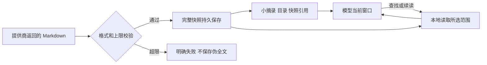

> 后续进展：Search直连与有限真实服务/模型验收已完成，当前状态见[后续报告](web-search-live-20261018.zh-CN.md)。下文保留前轮实现和验证时点。

网页读取接入与上下文取舍（2026-10-18）

本轮接入独立 DeepSeek Fetch 与本地网页快照阅读，沿用唯一 Agent 循环、ToolRegistry/ToolExecutor、SQLite artifact 和现有窗口维护。原 deepseek_server_web_search 保留，Search 直连迁移属于下一小步。前轮模型版本及其他未提交修改全部保留；本轮不提交、不推送或更新 GitHub 发布，也不操作生产会话。

为什么这样处理长内容

长上下文研究发现，在其测试模型和任务中，信息位置和上下文长度会影响检索表现；这不能当成对当前 DeepSeek 型号的精确性能测量。[Lost in the Middle](https://arxiv.org/abs/2307.03172)。Anthropic 的工程实践建议保留轻量引用，运行时按需取回资料，并提醒这种方式仍存在探索成本和漏找风险。[上下文工程](https://www.anthropic.com/engineering/effective-context-engineering-for-ai-agents)、[工具设计](https://www.anthropic.com/engineering/writing-tools-for-agents)。

因此，截断若直接删除原文，会使未见信息无法参与推理；全文无差别塞进窗口，也会增加噪声、延迟和输入费用。本轮将存储和模型输入分开：上限内完整保留提供商返回的 Markdown；首次反馈只给原文摘录、目录、总字节数、读取范围和快照引用。摘录不是模型摘要，也不被标记为全文已读。

只有模型实际补读过的内容才能参与当前推理。可追回全文并不保证模型一定会找到每个关键事实；目录、查找、明确的截断标记和提示词用于帮助它决定如何继续。全文总结应覆盖相关章节，大文档可分段记录有来源笔记并使用现有窗口维护，不给所有任务强制堆入整篇网页。

已实现的契约

| 行为 | 当前实现 |
| --- | --- |
| 抓取 | fetch_webpage(url, refresh=false)，使用官方 POST /v1/tools/fetch，沿已有 DeepSeek 配置鉴权，只提交 URL，不提交会话或另一次模型生成 |
| 首次反馈 | 最多 8192 UTF-8 字节原文预览，最多 24 条 Markdown 标题及位置；目录超限也明确标记 |
| 存档 | 独立不可变 web-page artifact，保存收到的完整正文、标题、请求 URL、取回时间与正文哈希；工具结果中不重复藏入完整正文 |
| 续读 | read_webpage(snapshotId, startByte, byteLength)，默认 8192，最多 64000 字节，返回 nextStartByte；按完整 UTF-8 边界处理 |
| 定位 | read_webpage(snapshotId, find)，在完整已存快照的指定起点之后进行区分大小写的字面查找，返回附近原文、匹配位置及 nextMatchByte；find 不是正则 |
| 无命中 | 读取执行成功、found=false，只能说明这份 Markdown 的搜索范围没有该文本，不能证明原网站不存在相关事实 |
| 归属 | 沿已结算 fetch 工具回执关联快照；同会话可读，其他会话拒绝。窗口折叠与重启不删除归属；兼容 read_artifact 与来源笔记 |
| 复用 | 同一 run、同一规范 URL 默认复用成功快照；refresh=true 新建快照；新 run 默认重新联网，旧快照不覆盖 |
| 错误 | HTTP 状态分类、空/无效响应、超限、取消、30秒抓取期限；不自动重试或悄悄退回旧模型包装搜索 |

两个不同层次的限制必须区分

archiveTruncated=false 表示：本次已接受的提供商 Markdown 没有在本地保存时删掉尾部。truncated=true 则表示当前返回的是部分字节范围。nextStartByte 为 null 只表示本次范围到达末尾，若 startByte 大于零，仍不表示已展示前文。

响应 JSON 上限 4 MiB，Markdown 正文上限 2 MiB。超限直接说明没有建立完整快照，不保存一个伪装成完整的前缀；超过上限的未取得内容无法从这次失败里追回。尚无全局资料自动清理或无限存储承诺，磁盘用量仍随成功抓取增长。

完整快照只对应提供商实际返回的提取文本。服务端可能省略动态区域或根本无法抓取，Umi 无法证明它等于整个网站、原始 HTML 或浏览器画面。[官方 Fetch 定义](https://api-docs.deepseek.com/zh-cn/api/fetch/)。公开响应未给出目标站最终状态码、跳转链或原始页面字节，本轮没有编造这些字段。requestedUrl 是提交的 URL，不冒充最终跳转 URL。

read_webpage 的字节偏移相对于 Markdown 正文；read_artifact 的偏移相对于快照规范 JSON，二者游标不能互换。Umi 主循环默认最多24轮，单次页面读取默认8KiB、可按需增至64000字节，与现有资料工具上限一致；2MiB快照也不保证一个run就能通读。应按目录/关键条款定位，全文任务分段记录来源并在需要时跨轮继续。没有提升全局轮次或新增调度器。

旧快照 ID 可通过 search_history(role=all)/read_history 中的工具回执追回，无需再次联网抓取。

代码与学习入口

- [webpage.ts](../packages/agent/src/tools/webpage.ts)：快照窄端口、标题索引、UTF-8 分页、全文字面定位与有界视图。
- [fetch.ts](../packages/adapters/src/deepseek-search/fetch.ts)：提供商端点、地址验证、有界 JSON 读取、取消/错误归一化与默认同轮复用。
- [sqlite/webpage.ts](../packages/adapters/src/sqlite/webpage.ts)：执行身份/租约核对、不可变 artifact 存档及同轮查找；不引入 SQL 到 Agent 核心。
- [sqlite/memory.ts](../packages/adapters/src/sqlite/memory.ts)：仅沿已成功 fetch 回执开放对应 web-page artifact，保留既有资料权限规则；无数据库结构迁移。
- [application.ts](../apps/headless/src/application.ts)：组装 umi.web-pages 与 umi.web-fetch，提供商传输可注入测试替身。无搜索配置时仍可阅读旧快照。
- [prompts.ts](../packages/agent/src/context/prompts.ts)：umi-persona-17，明确网页资料身份、未读范围、全文总结和按需追回原则。
- [web-fetch.test.ts](../tests/web-fetch.test.ts)：提供商替身、真实循环/存储、长文中末事实、请求体检查、窗口维护与重启验证。

界面只沿用原工具行，显示“读取网页”及具体网址、“读取网页快照”及查找内容/编号；未增加设置页、权限卡平台或额外卡片。

网络、费用与验证边界

提供商抓取只发送公开 URL，不附带浏览器 Cookie、登录头或本地文件。拒绝明显本地/私网地址、内嵌凭据和部分明确认证/签名参数；这不是完整的 DNS、目标站跳转审计或 OS 网络沙箱，也不能承诺识别所有敏感 URL。网页文字继续是资料，不授予其他工具权限。

同轮复用减少重复请求，明确刷新可能再次付费。客户端取消或超时不证明服务端没有完成请求，是否计费以提供商结算为准。本轮不新增复杂计费/全局限流系统。当前公开计费说明见[官方指南](https://api-docs.deepseek.com/zh-cn/guides/search/)，本次未调用付费 API，真实服务提取质量、延迟、模型主动补读能力和最终费用尚未实测。

验证记录

新增 18 项测试已通过，覆盖 HTTP 错误、无效/过大响应、停止、完整存档、中文/emoji/CRLF 无损续读、首段之外的中部/末尾定位、工具反馈没有隐含全文、同轮复用与刷新、跨会话拒绝、无提供商配置重启阅读，以及窗口维护后从历史找回引用。

这些测试使用固定模型与提供商响应，证明的是机制和请求内容，不是 DeepSeek 模型能力或提示注入抵抗性基准。网页里出现命令文字时不会由工具本身执行，这也不等于证明真实模型永远不会受网页指令影响；其他宿主操作仍沿原批准机制。

类型检查、编译与桌面资源构建通过；本轮全量 **458/458** 通过。随后将按需页上限对齐为64000字节并加强缓存回执读取核验，最终相关 **71/71** 再次通过。本地便携 Umi.exe 最终真实 Electron 桌面 **74/74** 通过；**185 个**运行文件逐项哈希一致，源码/构建/便携指纹均为 3503f4e8221d169ebbf8244b4b87a3e791be5be978beb6ad8bbf3cf779884b2f。这些测试没有真实 DeepSeek 调用；服务端实际响应和模型补读能力仍未实测。

本地便携版已同步，需菜单完整退出旧 Umi 后启动 release/Umi-win32-x64/Umi.exe；GitHub Releases 与本地 Setup 安装器保留原版。证据目录：E:/Codex/Workspace/output/umi-web-fetch-20261018。